# ĐẶC TẢ CHỨC NĂNG — HỆ THỐNG ĐĂNG KÝ MÔN HỌC

**Tên đề tài:** Xây dựng hệ thống đăng ký môn học
**Phiên bản đặc tả:** 2.0 — viết lại toàn bộ (5 vai trò, frontend Flutter Web + App)

---

## 1. TỔNG QUAN HỆ THỐNG

Hệ thống đăng ký môn học hỗ trợ nhà trường quản lý quy trình đào tạo từ tài khoản người dùng,
ngành đào tạo, chương trình đào tạo, môn học, học kỳ, lớp học phần, lịch học, đăng ký môn học,
điểm danh, nhập điểm, học phí, thông báo đến báo cáo thống kê.

**Ngoài phạm vi:**

- Học lại / cải thiện điểm khi đã có điểm `KHOA`: điền đơn qua PĐT xử lý thủ công (phiên bản
  này không tự động hóa luồng retake).
- Cổng thanh toán trực tuyến (KT chỉ xác nhận thu tay).
- Quản lý phòng học chi tiết (phòng chỉ là thuộc tính của lịch học).

Hệ thống bao gồm:

| Thành phần | Mô tả |
| :--- | :--- |
| **Ứng dụng Flutter** | Một codebase Flutter chạy trên **Flutter Web** (responsive, PWA-ready) và **Flutter App** (Android/iOS), phục vụ đủ 5 vai trò. |
| **Backend API** | Django REST Framework xử lý nghiệp vụ, phân quyền, đăng ký môn học, học phí, điểm danh và điểm số. |
| **Cơ sở dữ liệu** | PostgreSQL lưu trữ tài khoản, hồ sơ, ngành, CTĐT, môn học, học kỳ, lớp học phần, lịch học, đăng ký, điểm danh, điểm số, học phí và thông báo. |
| **Dịch vụ hỗ trợ** | JWT dùng cho xác thực, Swagger/OpenAPI dùng để tài liệu hóa và kiểm thử API, Docker dùng để triển khai. |

---

## 2. ĐỐI TƯỢNG SỬ DỤNG (5 VAI TRÒ)

| STT | Vai trò | Trách nhiệm chính | Nền tảng |
| :---: | :--- | :--- | :--- |
| 1 | **Admin** | Quản lý tài khoản, phân quyền, cấu hình hệ thống, nhật ký thao tác (audit log), backup. | Flutter Web + App |
| 2 | **Phòng đào tạo (PĐT)** | Ngành, CTĐT, môn học, học kỳ, lớp học phần, lịch học, theo dõi/hủy đăng ký, thông báo, báo cáo đào tạo. | Flutter Web + App |
| 3 | **Sinh viên (SV)** | Đăng ký/hủy đăng ký, tạo TKB tự động, xem lịch/điểm/điểm danh/học phí, nhận thông báo. | Flutter App + Web |
| 4 | **Giáo viên (GV)** | Lớp phụ trách, điểm danh theo buổi, nhập điểm, thông báo cho lớp. | Flutter App + Web |
| 5 | **Kế toán (KT)** | Cấu hình đơn giá, tính học phí, thu học phí, miễn giảm, công nợ, báo cáo tài chính. | Flutter Web + App |

> **Phân tách Admin / PĐT:** Admin xử lý *tài khoản & phân quyền & cấu hình hệ thống & log*;
> PĐT xử lý *nghiệp vụ đào tạo*. Cả hai đều là vai trò quản trị nhưng tách quyền để không
> giao thoa nghiệp vụ.

### 2.1. Ma trận use case (5 vai trò)

| Use case | Admin | PĐT | SV | GV | KT |
| :--- | :---: | :---: | :---: | :---: | :---: |
| UC-01 Đăng nhập / đăng xuất / đổi mật khẩu | ✓ | ✓ | ✓ | ✓ | ✓ |
| UC-02 Quản lý tài khoản (tạo/khóa/reset) | ✓ | ✗ | ✗ | ✗ | ✗ |
| UC-03 Quản lý hồ sơ SV/GV | Xem | Sửa | *(của mình)* | *(của mình)* | ✗ |
| UC-04 Quản lý ngành / CTĐT / môn / tiên quyết | ✗ | ✓ | ✗ | ✗ | ✗ |
| UC-05 Quản lý học kỳ & cửa sổ đăng ký | ✗ | ✓ | ✗ | ✗ | ✗ |
| UC-06 Quản lý lớp HP & lịch học | ✗ | ✓ | ✗ | ✗ | ✗ |
| UC-07 Đăng ký môn học | ✗ | *(theo dõi)* | ✓ | ✗ | ✗ |
| UC-08 Hủy đăng ký | ✗ | ✓ *(force)* | ✓ *(trong cửa sổ)* | ✗ | ✗ |
| UC-09 Tạo TKB tự động | ✗ | ✗ | ✓ | ✗ | ✗ |
| UC-10 Xem thời khóa biểu | ✗ | ✗ | ✓ *(của mình)* | ✓ *(lịch dạy)* | ✗ |
| UC-11 Điểm danh | ✗ | Xem | Xem + xin sửa | ✓ *(lớp phụ trách)* | ✗ |
| UC-12 Nhập điểm / khóa / duyệt điểm | ✗ | Duyệt | Xem | ✓ *(nhập, lớp phụ trách)* | ✗ |
| UC-13 Quản lý học phí / thanh toán | ✗ | ✗ | Xem *(của mình)* | ✗ | ✓ |
| UC-14 Gửi / nhận thông báo | ✓ | ✓ | Nhận | ✓ *(lớp)* | ✓ |
| UC-15 Báo cáo & xuất dữ liệu | ✗ | Đào tạo | ✗ | *(lớp mình)* | Tài chính |
| UC-16 Audit log / backup / cấu hình | ✓ | *(log đào tạo)* | ✗ | ✗ | *(log học phí)* |

---

## 3. DANH SÁCH CHỨC NĂNG TỔNG HỢP

Sau khi gộp trùng (KT-07↔SYS-08, SV-06↔SYS-05, BR-07↔SYS-06) và chuyển nhóm "Chức năng tự
động" thành Quy tắc nghiệp vụ + Luồng nghiệp vụ, số chức năng được đếm lại:

| STT | Nhóm chức năng | Mã tiền tố | Số lượng CN |
| :---: | :--- | :---: | :---: |
| 1 | Phòng đào tạo | `PDT-` | 15 |
| 2 | Sinh viên | `SV-` | 13 |
| 3 | Giáo viên | `GV-` | 12 |
| 4 | Kế toán | `KT-` | 13 |
| 5 | Quản trị hệ thống (Admin) | `ADM-` | 8 |
| | **TỔNG CỘNG** | | **61** |

> Nhóm "Chức năng tự động" (SYS-01..10 bản cũ) **không còn là nhóm chức năng riêng**: kiểm tra
> ràng buộc, tính điểm, tính học phí, cập nhật sĩ số, gợi ý TKB… được chuyển thành **quy tắc
> nghiệp vụ (mục 5)** và **luồng nghiệp vụ (mục 8)**. Xem mục 9 — Tách bạch & Gộp trùng.

---

## 4. CHI TIẾT CHỨC NĂNG THEO VAI TRÒ

### 4.1. Phòng đào tạo (PDT-01..15)

| Mã CN | Tên chức năng | Mô tả | Đối tượng |
| :--- | :--- | :--- | :--- |
| PDT-01 | Quản lý hồ sơ người dùng | Quản lý mã sinh viên, mã giáo viên, ngành học, khoa/bộ môn và thông tin liên hệ. | PĐT |
| PDT-02 | Quản lý ngành đào tạo | Thêm, sửa, ngừng sử dụng ngành đào tạo và thời gian đào tạo. | PĐT |
| PDT-03 | Quản lý chương trình đào tạo | Tạo CTĐT theo ngành, khóa tuyển sinh, tổng tín chỉ yêu cầu và danh sách môn học (gán `khoi_kien_thuc`, `loai_mon`, `hoc_ky_goi_y` cho từng môn × CTĐT). | PĐT |
| PDT-04 | Quản lý môn học | Thêm, sửa môn học: tín chỉ (tổng/LT/TH), số tiết LT/TH, trạng thái. | PĐT |
| PDT-05 | Quản lý môn tiên quyết | Thiết lập môn cần đạt trước khi đăng ký môn tiếp theo. | PĐT |
| PDT-06 | Quản lý học kỳ | Tạo học kỳ, cập nhật thời gian, mở/đóng học kỳ. | PĐT |
| PDT-07 | Cấu hình thời gian đăng ký | Thiết lập cửa sổ đăng ký (bắt đầu/kết thúc) cho từng học kỳ. | PĐT |
| PDT-08 | Quản lý lớp học phần | Mở lớp HP, phân công GV, đặt sĩ số tối đa, quản lý trạng thái lớp. | PĐT |
| PDT-09 | Quản lý lịch học | Thiết lập thứ, buổi, tiết, số tiết mỗi buổi, phòng học cho lớp HP (ràng buộc tại mục 6 — Lịch học, BR-08/09). | PĐT |
| PDT-10 | Theo dõi đăng ký môn học | Xem danh sách SV đăng ký theo môn, lớp HP, ngành, học kỳ. | PĐT |
| PDT-11 | Hủy đăng ký khi cần | Hủy đăng ký của SV khi có lý do hợp lệ (ngoài cửa sổ đăng ký → điều chỉnh học phí theo BR-05). | PĐT |
| PDT-12 | Duyệt điểm | Duyệt điểm `CHINH_THUC` → `KHOA` cho lớp HP (xem BR-14). | PĐT |
| PDT-13 | Gửi thông báo | Gửi thông báo đến vai trò / lớp / ngành / học kỳ / SV / GV / KT. | PĐT |
| PDT-14 | Báo cáo đào tạo | Thống kê SV, lớp HP, số lượng đăng ký, lớp đầy/còn chỗ theo học kỳ. | PĐT |
| PDT-15 | Tra cứu dữ liệu đào tạo | Tìm kiếm, lọc, xem chi tiết ngành, môn, lớp HP, lịch học, đăng ký. | PĐT |

### 4.2. Sinh viên (SV-01..13)

| Mã CN | Tên chức năng | Mô tả | Đối tượng |
| :--- | :--- | :--- | :--- |
| SV-01 | Đăng nhập / đăng xuất | Đăng nhập bằng tài khoản được cấp; đăng xuất kết thúc phiên. | SV |
| SV-02 | Xem hồ sơ cá nhân | Xem thông tin SV, ngành, khóa nhập học, GPA, tín chỉ tích lũy; xem/đổi mật khẩu. | SV |
| SV-03 | Xem chương trình đào tạo | Xem danh sách môn theo CTĐT: môn bắt buộc, môn tự chọn, khối kiến thức, học kỳ gợi ý. | SV |
| SV-04 | Xem môn được đăng ký | Xem lớp HP đang mở trong học kỳ (lọc theo CTĐT, còn chỗ, chưa trùng lịch). | SV |
| SV-05 | Đăng ký môn học thủ công | Chọn lớp HP, xác nhận; hệ thống chạy BR-01..06. | SV |
| SV-06 | Tạo thời khóa biểu tự động | Chọn danh sách môn + ưu tiên (ngày/buổi/GV) → hệ thống gợi ý tổ hợp → SV xác nhận → chạy BR-01..06. | SV |
| SV-07 | Hủy đăng ký môn học | Hủy lớp HP trong cửa sổ đăng ký → hoàn học phí theo BR-05. | SV |
| SV-08 | Xem thời khóa biểu | Xem lịch theo tuần/học kỳ: môn, lớp, GV, phòng, tiết. | SV |
| SV-09 | Xem lịch sử đăng ký | Xem môn đã đăng ký / đã hủy / đang học, ngày đăng ký, lý do hủy. | SV |
| SV-10 | Xem điểm danh & xin sửa điểm danh | Xem trạng thái điểm danh từng buổi; gửi yêu cầu sửa điểm danh (GV/PĐT xử lý). | SV |
| SV-11 | Xem điểm | Xem QT, GK, CK, tổng kết, điểm chữ, GPA; điểm `KHOA` mới hiển thị chính thức. | SV |
| SV-12 | Xem học phí | Xem học phí theo học kỳ: tổng tín chỉ, tổng tiền, đã thu, còn nợ, miễn giảm. | SV |
| SV-13 | Nhận thông báo | Nhận + đánh dấu đã đọc thông báo từ PĐT / GV / KT / Admin. | SV |

### 4.3. Giáo viên (GV-01..12)

| Mã CN | Tên chức năng | Mô tả | Đối tượng |
| :--- | :--- | :--- | :--- |
| GV-01 | Đăng nhập / đăng xuất | Đăng nhập bằng tài khoản được cấp; đăng xuất kết thúc phiên. | GV |
| GV-02 | Xem hồ sơ cá nhân | Xem mã GV, khoa/bộ môn, học vị, thông tin liên hệ; xem/đổi mật khẩu. | GV |
| GV-03 | Xem lớp phụ trách | Xem danh sách lớp HP được phân công giảng dạy. | GV |
| GV-04 | Xem chi tiết lớp | Xem môn, lịch, phòng, sĩ số, danh sách SV trong lớp. | GV |
| GV-05 | Xem thời khóa biểu cá nhân | Xem lịch dạy theo tuần hoặc học kỳ. | GV |
| GV-06 | Tạo buổi điểm danh | Chọn lớp HP, ngày học, buổi, tiết để mở buổi điểm danh. | GV |
| GV-07 | Điểm danh sinh viên | Đánh dấu từng SV: `CO_MAT` / `VANG_CO_PHEP` / `VANG_KHONG_PHEP`; cờ `DI_TRE` riêng (BR-19). | GV |
| GV-08 | Cập nhật điểm danh | Sửa trạng thái điểm danh khi có lý do hợp lệ; lưu thời gian cập nhật. | GV |
| GV-09 | Xem lịch sử điểm danh | Xem lại điểm danh theo từng buổi của lớp HP. | GV |
| GV-10 | Nhập điểm | Nhập QT/GK/CK cho SV lớp phụ trách; hiển thị **xem trước** tổng kết theo BR-10; lưu `NHAP_TAM`. Tổng kết **chính thức** chỉ chốt khi PĐT duyệt `KHOA` (PDT-12). | GV |
| GV-11 | Gửi thông báo cho lớp | Gửi thông báo đến SV trong lớp mình phụ trách. | GV |
| GV-12 | Xuất danh sách lớp | Xuất danh sách SV, bảng điểm, bảng điểm danh (định dạng Excel/PDF). | GV |

### 4.4. Kế toán (KT-01..13)

| Mã CN | Tên chức năng | Mô tả | Đối tượng |
| :--- | :--- | :--- | :--- |
| KT-01 | Quản lý cấu hình học phí | Thiết lập chính sách tính học phí áp dụng cho từng học kỳ. | KT |
| KT-02 | Thiết lập giá theo ngành | Cấu hình đơn giá tín chỉ mặc định theo từng ngành đào tạo. | KT |
| KT-03 | Thiết lập giá theo khối kiến thức | Cấu hình giá theo 5 khối: chung, cơ sở ngành, chuyên ngành, tự chọn, tốt nghiệp. | KT |
| KT-04 | Thiết lập giá tín chỉ lý thuyết | Cấu hình độ lệch ± đơn giá cho tín chỉ lý thuyết. | KT |
| KT-05 | Thiết lập giá tín chỉ thực hành | Cấu hình đơn giá riêng cho tín chỉ thực hành/thí nghiệm/đồ án. | KT |
| KT-06 | Thiết lập miễn giảm / hoàn giảm | Cấu hình học bổng, miễn giảm, hoàn tiền, giảm trừ theo chính sách. | KT |
| KT-07 | Tính học phí tự động | Hệ thống tính học phí theo BR-15/16/17 khi SV đăng ký hoặc KT bấm tính. | KT |
| KT-08 | Xem danh sách học phí | Xem học phí SV theo học kỳ, ngành, lớp, trạng thái thanh toán. | KT |
| KT-09 | Xác nhận thanh toán | Ghi nhận SV đóng học phí (tiền mặt / chuyển khoản / khác). | KT |
| KT-10 | Theo dõi công nợ | Xem SV chưa đóng, đóng thiếu, quá hạn. | KT |
| KT-11 | Điều chỉnh học phí | Điều chỉnh khi thay đổi đăng ký, hủy môn, miễn giảm, thu bổ sung. | KT |
| KT-12 | Xuất biên lai / hóa đơn | Xuất phiếu thu, biên lai, hóa đơn học phí (Excel/PDF). | KT |
| KT-13 | Báo cáo tài chính học phí | Thống kê phải thu, đã thu, còn nợ theo học kỳ / ngành / lớp / SV. | KT |

### 4.5. Quản trị hệ thống — Admin (ADM-01..08)

| Mã CN | Tên chức năng | Mô tả | Đối tượng |
| :--- | :--- | :--- | :--- |
| ADM-01 | Đăng nhập / đăng xuất | Đăng nhập admin; đăng xuất kết thúc phiên. | Admin |
| ADM-02 | Quản lý tài khoản | Tạo, cập nhật, khóa/mở khóa tài khoản cho cả 5 vai trò; reset mật khẩu. | Admin |
| ADM-03 | Quản lý hồ sơ người dùng | Xem/tra cứu hồ sơ SV / GV / KT gắn với tài khoản (sửa hồ sơ học vụ do **PĐT** thực hiện, PDT-01). | Admin |
| ADM-04 | Quản lý phân quyền | Gán vai trò, cấu hình quyền theo vai trò, cấp/thu hồi quyền đặc thù. | Admin |
| ADM-05 | Cấu hình hệ thống | Cấu hình tham số chung (giới hạn phân trang, rate limit, cờ tính năng). | Admin |
| ADM-06 | Nhật ký thao tác (audit log) | Xem log tạo/sửa/xóa, đăng nhập, thay đổi phân quyền theo thời gian. Admin xem toàn bộ; PĐT xem log đào tạo; KT xem log học phí. | Admin (+ PĐT, KT theo phạm vi) |
| ADM-07 | Quản lý thông báo hệ thống | Soạn/thu hồi thông báo toàn hệ thống (khi PĐT/KT không cần gửi). | Admin |
| ADM-08 | Sao lưu & phục hồi dữ liệu | Khởi tạo backup, xem lịch sử backup, phục hồi khi cần. | Admin |

> **Lưu ý tách bạch:** Bản cũ có **PDT-01 = Quản lý tài khoản**. Bản này giao toàn bộ quyền
> *tạo / sửa / khóa tài khoản* cho **Admin (ADM-02)**. PĐT chỉ giữ quyền quản lý **hồ sơ**
> nghiệp vụ (mã SV, ngành, khoa/bộ môn…) theo **PDT-01 mới = Quản lý hồ sơ người dùng**.
> Admin quản lý *tài khoản* (đăng nhập/khóa/quyền), PĐT quản lý *hồ sơ* (thông tin học vụ).

---

## 5. QUY TẮC NGHIỆP VỤ CHÍNH (BR-01..24)

Viết lại hoàn toàn, chia 5 nhóm. Mỗi BR chỉ nêu **một lần** trong toàn bộ tài liệu.

### 5.1. Nhóm đăng ký (BR-01..09)

| Mã | Quy tắc nghiệp vụ |
| :--- | :--- |
| BR-01 | SV chỉ đăng ký khi học kỳ đang mở **và** đang trong cửa sổ đăng ký (PDT-07). |
| BR-02 | Không đăng ký khi lớp HP đã đạt sĩ số tối đa. |
| BR-03 | Không đăng ký khi lịch học trùng với lớp đã đăng ký trong cùng học kỳ. |
| BR-04 | Chỉ đăng ký khi đã đạt môn tiên quyết (PDT-05). "Đạt" = có bản ghi `Grade` với trạng thái `KHOA` **và** `diem_tong_ket ≥ 5.0` **và** không `CAM_THI`. |
| BR-05 | SV hủy trong cửa sổ đăng ký → **hoàn toàn bộ học phí** môn đó. Hủy ngoài cửa sổ (do PĐT chủ động, PDT-11) → điều chỉnh học phí theo chính sách hoàn giảm (KT-06). **Cơ chế:** hủy → chạy lại KT-07 (`POST /api/tuitions/recalculate/?hoc_ky=`) giảm `tong_tien`; phần chênh lệch nếu đã thu → tạo `Discount` `loai = HOAN_TIEN` (không sửa ngược Payment). |
| BR-06 | Kiểm tra sĩ số + tăng/giảm sĩ số chạy trong **cùng một transaction DB** (`select_for_update` hoặc ràng buộc `UNIQUE(sinh_vien, lop_hoc_phan)`) → chống overbook khi nhiều SV cùng bấm chỗ cuối. |
| BR-07 | Giới hạn tín chỉ mỗi học kỳ theo cấu hình (ADM-05): tối thiểu `tin_chi_toi_thieu` và tối đa `tin_chi_toi_da` (mặc định **12–24**), PĐT có thể điều chỉnh theo từng học kỳ (PDT-07). **Tối đa chặn cứng** (lỗi `400`); **tối thiểu chỉ cảnh báo** (SV thiếu tín chỉ vẫn đăng ký được, hiện cảnh báo + ghi log). SV thuộc diện cảnh báo học vụ (GPA < 2.0) chỉ được đăng ký tối đa **14** tín chỉ. |
| BR-08 | Thời khóa biểu chia 15 tiết/ngày: sáng 1–5, chiều 6–10, tối 11–15. |
| BR-09 | Khi tạo lịch học, PĐT **bắt buộc** nhập số tiết mỗi buổi (`so_tiet_moi_buoi`). |

### 5.2. Nhóm điểm (BR-10..14)

| Mã | Quy tắc nghiệp vụ |
| :--- | :--- |
| BR-10 | Điểm tổng kết = `QT*0.1 + GK*0.4 + CK*0.5`. **Fallback thiếu GK:** bỏ GK, chia lại tỉ lệ QT/CK = 20%/80%. **Thiếu CK:** `diem_cuoi_ky = 0`, tổng kết = `QT*0.1 + GK*0.4 + 0*0.5` (tối đa 5.0 → không tự động F; GV quá hạn BR-13 thì PĐT xử lý). Làm tròn 2 chữ số. |
| BR-11 | Thang điểm chữ (thang 10 → thang 4, theo Thông tư 08/2021/TT-BGDĐT): A ≥ 8.5 → 4.0; B 7.0–8.4 → 3.0; C 5.5–6.9 → 2.0; D 4.0–5.4 → 1.0; F < 4.0 → 0.0; **P (pass)** ≥ 5.0, không tính vào GPA. |
| BR-25 | Xếp loại học kỳ / tích lũy: Xuất sắc 3.60–4.00 (9.00–10.00); Giỏi 3.20–3.59 (8.00–8.99); Khá 2.50–3.19 (7.00–7.99); Trung bình 2.00–2.49 (5.00–6.99); Yếu 1.00–1.99 (4.00–4.99); Kém < 1.00 (< 4.00). Áp vào `StudentProfile.gpa`. |
| BR-12 | GV chỉ nhập điểm / sửa điểm cho lớp mình phụ trách (GV-03). |
| BR-13 | GV cập nhật điểm trong vòng **2 tuần** sau khi kết thúc môn. |
| BR-14 | Trạng thái điểm: `NHAP_TAM` → `CHINH_THUC` (GV khóa) → `KHOA` (PĐT duyệt, PDT-12). Chỉ điểm `KHOA` hiển thị chính thức cho SV. |

### 5.3. Nhóm học phí (BR-15..18)

| Mã | Quy tắc nghiệp vụ |
| :--- | :--- |
| BR-15 | Học phí = Σ (tín chỉ × đơn giá) theo bảng giá đang áp dụng, tính trên các môn SV đã đăng ký trong học kỳ. |
| BR-16 | **Thứ tự ưu tiên bảng giá:** giá theo **khối kiến thức** (KT-03, nếu có) → giá theo **ngành** (KT-02) → giá mặc định hệ thống. KT-04 (LT) / KT-05 (TH) là **độ lệch ±** so với giá khối/ngành, không phải trục so sánh trực tiếp. |
| BR-17 | Môn có tín chỉ thực hành (`tin_chi_thuc_hanh > 0`) → áp đơn giá tín chỉ thực hành (KT-05) cho phần TH; phần LT dùng giá khối/ngành. |
| BR-18 | KT quyết định miễn giảm (KT-06) theo hồ sơ do PĐT / SV lập; mọi thay đổi miễn giảm đều ghi log. |

### 5.4. Nhóm điểm danh (BR-19, 20, 24)

| Mã | Quy tắc nghiệp vụ |
| :--- | :--- |
| BR-19 | Trạng thái điểm danh: `CO_MAT`, `VANG_CO_PHEP`, `VANG_KHONG_PHEP`. `DI_TRE` là **cờ riêng** (không thay thế trạng thái vắng/có mặt). |
| BR-20 | Trạng thái điểm danh lưu theo **từng buổi học** để tra cứu và báo cáo. |
| BR-24 | **Cấm thi theo điểm danh:** khi kết thúc môn, nếu `VANG_KHONG_PHEP` của SV vượt `MAX_ABSENT_PCT` (mặc định **20%**, cấu hình ở ADM-05) tính trên tổng số buổi của lớp → đăng ký của SV chuyển cờ `CAM_THI = true` (trigger: celery job quét sau khi lớp `DA_DONG`). GV **không được nhập/sửa điểm cuối kỳ** cho SV đó (`POST /api/grades/` **và** `PATCH /api/grades/{id}/` đều từ chối). PĐT xóa cờ qua `PATCH /api/registrations/{id}/` với `cam_thi = false` + `ly_do` bắt buộc (ghi audit log). |

### 5.5. Nhóm hệ thống (BR-21..23)

| Mã | Quy tắc nghiệp vụ |
| :--- | :--- |
| BR-21 | Phân quyền truy cập theo 5 vai trò (mục 11 — ma trận phân quyền). |
| BR-22 | Xác thực JWT trước khi truy cập mọi chức năng nội bộ. |
| BR-23 | Bảo vệ dữ liệu điểm và dữ liệu cá nhân: SV chỉ xem dữ liệu của mình; GV chỉ xem lớp phụ trách; KT/Admin theo phạm vi được cấp. |

---

## 6. ĐẶC TẢ THỰC THỂ VÀ THUỘC TÍNH

Sửa trực tiếp các mâu thuẫn đơn vị (tín chỉ ↔ tiết) và các điểm gán dữ liệu (khối kiến thức,
trạng thái) ngay tại mô hình.

| Thực thể | Thuộc tính chính | Ràng buộc |
| :--- | :--- | :--- |
| **User (Tài khoản)** | `username`, `password_hash`, `role` ∈ {`ADMIN`, `PHONG_DAO_TAO`, `SINH_VIEN`, `GIAO_VIEN`, `KE_TOAN`}, `is_locked`, `last_login` | `role` = 1 trong 5; `is_locked` chặn đăng nhập. |
| **StudentProfile** | `ma_sv`, `ho_ten`, `nganh`, `khoa_nhap_hoc`, `gpa`, `tin_chi_tich_luy`, `email`, `sdt` | `ma_sv` duy nhất. |
| **TeacherProfile** | `ma_gv`, `ho_ten`, `khoa_bo_mon`, `hoc_vi`, `email`, `sdt` | `ma_gv` duy nhất. |
| **Ngành (Major)** | `ma_nganh`, `ten_nganh`, `thoi_gian_dao_tao`, `trang_thai` | `ma_nganh` duy nhất. |
| **CTĐT (Curriculum)** | `ma_ctdt`, `nganh`, `khoa_tuyen_sinh`, `tong_tin_chi_yeu_cau`, `trang_thai` | `tong_tin_chi_yeu_cau` > 0. |
| **CurriculumCourse (Môn × CTĐT)** | `ctdt`, `mon_hoc`, `khoi_kien_thuc` ∈ {`chung`, `co_so_nganh`, `chuyen_nganh`, `tu_chon`, `tot_nghiep`}, `loai_mon` ∈ {`bat_buoc`, `tu_chon`}, `hoc_ky_goi_y` | Cặp `(ctdt, mon_hoc)` **duy nhất**. ← **Nơi gán khối kiến thức** (KT-03, SV-03 đọc từ đây). |
| **Môn học (Course)** | `ma_mon`, `ten_mon`, `tong_tin_chi`, `tin_chi_ly_thuyet`, `tin_chi_thuc_hanh`, `so_tiet_ly_thuyet`, `so_tiet_thuc_hanh`, `trang_thai` | `tong_tin_chi = tin_chi_ly_thuyet + tin_chi_thuc_hanh`. `so_tiet_*` chỉ để **truyền dạy**, không dùng tính phí. |
| **Môn tiên quyết (Prerequisite)** | `mon_hoc`, `mon_tien_quyet` | Cặp `(mon_hoc, mon_tien_quyet)` duy nhất. |
| **Học kỳ (Semester)** | `ten_hk`, `nam_hoc`, `ngay_bat_dau`, `ngay_ket_thuc`, `cua_so_dk_bat_dau`, `cua_so_dk_ket_thuc`, `trang_thai` ∈ {`MO`, `DONG`} | Cửa sổ đăng ký ⊂ thời gian học kỳ. |
| **Lớp học phần (ClassSection)** | `ma_lop`, `mon_hoc`, `hoc_ky`, `giao_vien`, `si_so_toi_da`, `si_so_hien_tai`, `trang_thai` ∈ {`KE_HOACH`, `MO`, `DANG_HOC`, `DA_DONG`} | `si_so_hien_tai ≤ si_so_toi_da`. |
| **Lịch học (Schedule)** | `lop_hoc_phan`, `thu`, `buoi`, `tiet_bat_dau`, `tiet_ket_thuc`, `so_tiet_moi_buoi`, `phong`, `ngay_hoc` | `tiet_bat_dau`/`tiet_ket_thuc` ∈ 1–15; `tiet_ket_thuc = tiet_bat_dau + so_tiet_moi_buoi − 1`; không vượt nhóm tiết buổi (BR-08); **phòng + GV không overlap** cùng thời điểm/ngày hiệu lực. |
| **Đăng ký (Registration)** | `sinh_vien`, `lop_hoc_phan`, `hoc_ky`, `trang_thai` ∈ {`DA_DANG_KY`, `DA_HUY`}, `cam_thi` (bool, mặc định false), `ngay_dang_ky`, `ngay_huy`, `ly_do_huy` | Cặp `(sinh_vien, lop_hoc_phan)` **duy nhất**. `cam_thi = true` khi vắng quá `MAX_ABSENT_PCT` (BR-24). |
| **Điểm danh (Attendance)** | `attendance_session`, `lop_hoc_phan`, `ngay_hoc`, `sinh_vien`, `trang_thai` ∈ {`CO_MAT`, `VANG_CO_PHEP`, `VANG_KHONG_PHEP`}, `di_tre` (bool), `ghi_chu`, `cap_nhat_luc` | Một bản ghi theo `(attendance_session, sinh_vien)` (BR-20). |
| **AttendanceSession (Buổi điểm danh)** | `lop_hoc_phan`, `ngay_hoc`, `buoi`, `tiet_bat_dau`, `trang_thai` ∈ {`MO`, `DA_DIEM_DANH`} | Một buổi/lớp HP; các bản ghi Attendance tham chiếu đến buổi này (GV-06). |
| **AttendanceRequest (Yêu cầu sửa điểm danh)** | `attendance`, `sinh_vien`, `ly_do`, `trang_thai` ∈ {`CHO_DUYET`, `DUYET`, `TU_CHOI`}, `nguoi_duyet`, `ngay_duyet` | SV-10 gửi; PĐT/GV duyệt (`PATCH /api/attendance/requests/{id}/`). |
| **HocPhanGia (Bảng giá)** | `hoc_ky` (hoặc `NULL` = mặc định), `pham_vi` ∈ {`MAC_DINH`, `KHOI_KIEN_THUC`, `NGANH`, `LECH_LT`, `GIA_TH`}, `tham_chieu` (ID khối kiến thức / ngành), `don_gia` | KT-02..05; thứ tự áp dụng theo BR-16/17. |
| **TuitionConfig (Chính sách học phí)** | `hoc_ky`, `han_dong`, `chinh_sach_hoan_giam` | KT-01. |
| **Discount (Miễn giảm)** | `sinh_vien`, `hoc_ky`, `loai` ∈ {`MIEN_GIAM`, `HOAN_TIEN`, `GIAM_TRU`, `HOC_BONG`}, `so_tien`/`ty_le`, `ly_do`, `trang_thai` | KT-06, BR-18; mọi thay đổi ghi audit log. |
| **Payment (Thanh toán)** | `tuition`, `so_tien`, `phuong_thuc` ∈ {`TIEN_MAT`, `CHUYEN_KHOAN`, `KHAC`}, `ngay_thu`, `nguoi_thu`, `bien_lai_ma` | KT-09; mỗi lần thu một bản ghi; `da_thu` = Σ Payment. |
| **AuditLog** | `user`, `hanh_dong` ∈ {`CREATE`, `UPDATE`, `DELETE`, `LOGIN`, `PHAN_QUYEN`}, `doi_tuong`, `doi_tuong_id`, `chi_tiet` (JSON), `thoi_gian` | ADM-06; chỉ Admin toàn bộ, PĐT/KT xem theo scope. |
| **SystemConfig** | `khoa`, `gia_tri`, `mo_ta` | ADM-05; gồm `tin_chi_toi_thieu/toi_da`, `MAX_ABSENT_PCT`, rate limit, phân trang… |
| **Điểm (Grade)** | `lop_hoc_phan`, `sinh_vien`, `diem_qua_trinh`, `diem_giua_ky`, `diem_cuoi_ky`, `diem_tong_ket`, `diem_chu`, `gpa_thang_4`, `trang_thai` ∈ {`NHAP_TAM`, `CHINH_THUC`, `KHOA`}, `ngay_nhap` | `UNIQUE(lop_hoc_phan, sinh_vien)`; `diem_tong_ket` tính theo BR-10; `diem_chu`/`gpa_thang_4` theo BR-11; `diem_chu = P` → `gpa_thang_4 = null` (không tính GPA). |
| **Học phí (Tuition)** | `sinh_vien`, `hoc_ky`, `tong_tin_chi`, `tong_tien`, `da_thu`, `con_no`, `mien_giam`, `trang_thai` ∈ {`CHUA_TINH`, `DA_TINH`, `DA_DONG`, `CON_NO`, `GIAM_TRU`} | `UNIQUE(sinh_vien, hoc_ky)`; `con_no = tong_tien − da_thu − mien_giam`. |
| **Thông báo (Notification)** | `tieu_de`, `noi_dung`, `audience` ∈ {`ROLE`, `MAJOR`, `CLASS`, `SEMESTER`, `USER`}, `target_refs` (danh sách ID: vai trò / ngành / lớp HP / học kỳ / user — theo `audience`), `nguoi_gui`, `ngay_gui` | Tập người nhận phân giải từ `audience` × `target_refs`. |
| **NotificationRead** | `notification`, `user`, `da_doc`, `ngay_doc` | Cặp `(notification, user)` duy nhất. |
| **Phân quyền (RolePermission)** | `role`, `permission` (mã quyền), `trang_thai` | `role` ∈ 5 vai trò; 1 quyền gán cho nhiều vai trò. |

---

## 7. VÒNG ĐỜI TRẠNG THÁI

Mỗi trạng thái chỉ nhận transition hợp lệ; mọi vi phạm bị chặn tại backend.

| Đối tượng | Transition hợp lệ | Điều kiện | Vai trò thực hiện |
| :--- | :--- | :--- | :--- |
| **Học kỳ** | `MO` ↔ `DONG` | Mở: đã cấu hình cửa sổ đăng ký. Đóng: kết thúc học kỳ. | PĐT |
| **Lớp học phần** | `KE_HOACH` → `MO` → `DANG_HOC` → `DA_DONG` | `MO`: có lịch học + sĩ số (PĐT bấm). `DANG_HOC`: tự động khi qua `ngay_bat_dau` (celery/cron daily) hoặc PĐT bấm. `DA_DONG`: kết thúc + đã nhập điểm + đã khóa học phí (xem 7.1). | PĐT |
| **Đăng ký** | `DA_DANG_KY` → `DA_HUY`; `DA_HUY` → `DA_DANG_KY` (đăng ký lại) | Hủy hợp lệ trong cửa sổ (SV) hoặc ngoài cửa sổ (PĐT) theo BR-05. Đăng ký lại: re-activate bản ghi cũ, chạy lại BR-01..06. | SV / PĐT |
| **Điểm** | `NHAP_TAM` → `CHINH_THUC` → `KHOA` | `CHINH_THUC`: GV khóa (BR-14). `KHOA`: PĐT duyệt (PDT-12). | GV → PĐT |
| **Học phí** | `CHUA_TINH` → `DA_TINH` → `DA_DONG` / `CON_NO` / `GIAM_TRU`; `CON_NO` / `GIAM_TRU` → `DA_DONG` | `DA_TINH`: chạy BR-15..17. `DA_DONG`: `con_no = 0` (kể cả khi đã từng `CON_NO`/`GIAM_TRU`). `GIAM_TRU`: có miễn giảm (KT-06). | KT |
| **Tài khoản** (`is_locked`) | `false` ↔ `true` | `true`: Admin khóa tài khoản (ADM-02); chặn đăng nhập lẫn request đã có token. | Admin |

### 7.1. Điều kiện mở khóa theo vòng đời lớp HP

Trạng thái lớp HP là **xương sống** của các module điểm danh / điểm / học phí. Mọi thao tác
phụ thuộc phải kiểm tra trạng thái lớp trước khi thực thi:

| Thao tác | Điều kiện (trạng thái lớp) | Vai trò |
| :--- | :--- | :--- |
| Điểm danh (GV-06/07/08) | Lớp `DANG_HOC` | GV |
| Nhập / sửa điểm (GV-10) | Lớp `DANG_HOC` hoặc `DA_DONG` | GV |
| Khóa điểm (BR-14) | Lớp `DANG_HOC` hoặc `DA_DONG` | GV |
| Duyệt điểm (PDT-12) | Lớp `DA_DONG` | PĐT |
| Tính học phí (KT-07) | Lớp đã `MO` + học kỳ đã đóng cửa sổ đăng ký | KT |
| Khóa học phí (KT-09) | Lớp `DA_DONG` + điểm đã `KHOA` | KT |
| Đóng lớp (`DA_DONG`) | Đã nhập đủ điểm + đã khóa học phí | PĐT |

---

## 8. LUỒNG NGHIỆP VỤ CHÍNH

### 8.1. Luồng 1 — SV đăng ký thủ công (SV-05)

```
SV chọn lớp HP → POST /registrations
  ├─ BR-01 (HK mở + trong cửa sổ)
  ├─ BR-02 (còn chỗ)
  ├─ BR-03 (không trùng lịch)
  ├─ BR-04 (đạt tiên quyết)
  ├─ BR-06 (transaction lock → tăng sĩ số nguyên tử)
  ├─ Tính học phí (BR-15/16/17) → cập nhật Tuition
  └─ Tạo thông báo xác nhận đăng ký
```

### 8.2. Luồng 2 — SV tạo TKB tự động (SV-06)

```
SV chọn danh sách môn + ưu tiên (ngày/buổi/GV)
  → Hệ thống tìm tổ hợp hợp lệ (greedy + scoring, xem ghi chú MVP)
  → Trả về GỢI Ý (chưa đăng ký)
  → SV xác nhận từng môn
  → Chạy lại BR-01..06 cho từng môn (nguyên tử)
  → Tính học phí → thông báo
```

> **Gợi ý ≠ Đăng ký.** Gợi ý chỉ là đề xuất; đăng ký thật phải chạy lại toàn bộ BR.

> **MVP (Pha 1):** dùng **greedy** — sắp môn bắt buộc trước theo `hoc_ky_goi_y`, mỗi môn
> chọn lớp đầu tiên không trùng lịch, scoring đơn giản (+điểm nếu không trùng buổi, +điểm
> nếu tiết gần nhau). Trả về tối đa 3 tổ hợp. Tách `AutoScheduleService` (pure Dart, test
> độc lập, không phụ thuộc Flutter).
> **Nâng cấp (Pha 2):** backtracking với bảng điểm ưu tiên (tiết sáng/chiều, GV yêu thích, phòng
> gần). Không cần sửa API, chỉ đổi thuật toán bên trong service.

### 8.3. Luồng 3 — PĐT chuẩn bị dữ liệu học vụ

```
Tạo Ngành (PDT-02) → Tạo CTĐT (PDT-03) → Thêm môn + tiên quyết (PDT-04/05)
  → Gán CurriculumCourse (khoi_kien_thuc, loai_mon, hoc_ky_goi_y)
  → Tạo Học kỳ + cửa sổ đăng ký (PDT-06/07)
  → Mở lớp HP + lịch học (PDT-08/09)
  → Mở học kỳ (`MO`) + mở lớp (`MO`)
```

### 8.4. Luồng 4 — KT tính & thu học phí

```
KT cấu hình chính sách (KT-01) → Bảng giá KT-02/03/04/05
  → Tính học phí (KT-07 theo BR-15/16/17)
  → SV đóng tiền → KT xác nhận thanh toán (KT-09)
  → Cập nhật da_thu / con_no → Công nợ (KT-10)
  → Miễn giảm nếu có (KT-06, BR-18)
```

### 8.5. Luồng 5 — GV điểm danh & nhập điểm

```
GV mở buổi điểm danh (GV-06) → Điểm danh theo buổi (GV-07/08, BR-19/20)
  → Nhập điểm QT/GK/CK (GV-10, NHAP_TAM) — xem trước tổng kết BR-10 ngay khi nhập
  → GV khóa (CHINH_THUC, BR-13/14)
  → PĐT duyệt (KHOA, PDT-12)
  → Chốt tổng kết chính thức (BR-10) + đổi điểm chữ/GPA (BR-11) + cập nhật GPA tích lũy
  → SV xem (SV-11)
```

### 8.6. Luồng 6 — Thông báo

```
PĐT / GV / KT / Admin soạn → Chọn đích (audience: ROLE / MAJOR / CLASS / SEMESTER / USER)
  → Gửi → Lưu Notification → Đánh dấu đã đọc (NotificationRead)
```

**Trigger tự động** (hệ thống gửi, không cần người soạn):

| Trigger | Đối tượng nhận | Khi nào |
| :--- | :--- | :--- |
| Đăng ký / hủy đăng ký thành công | `USER` (SV) | Sau khi BR-06 commit |
| Lớp bị hủy / đổi phòng / đổi lịch | `CLASS` | Khi PĐT sửa lớp (PDT-08/09) |
| Mở cửa sổ đăng ký | `MAJOR` / `SEMESTER` | Khi PĐT mở cửa sổ (PDT-07) |
| Điểm mới `CHINH_THUC` | `USER` (SV) | Sau khi GV khóa điểm (BR-14) |
| Học phí quá hạn đóng | `USER` (SV) + KĐT báo cáo | Khi `da_thu < tong_tien` quá hạn (KT-09) |
| Cảnh báo học vụ (GPA < 2.0) | `USER` (SV) + PĐT | Sau khi điểm `KHOA` |

### 8.7. Luồng 7 — Admin quản lý tài khoản & phân quyền

```
Admin tạo tài khoản (ADM-02) → Gán vai trò (ADM-04)
  → Cấp quyền theo vai trò → Mọi thay đổi ghi audit log (ADM-06)
  → Khóa/mở khóa / reset mật khẩu đều có log
```

---

## 9. TÁCH BẠCH & GỘP TRÙNG

| Vấn đề | Cách xử lý |
| :--- | :--- |
| KT-07 (Tính học phí tự động) ≡ SYS-08 | **Gộp** → giữ KT-07; SYS-08 bỏ. |
| SV-06 (TKB tự động) ≡ SYS-05 (Gợi ý TKB) | **Gộp** → giữ SV-06; SYS-05 bỏ; thuật toán nêu ở Luồng 2. |
| BR-07 bản cũ (công thức điểm) ≡ SYS-06 (Tính tổng kết) | **Gộp** → giữ BR-10 duy nhất nêu công thức; SYS-06 bỏ. |
| SYS-01..04, 07, 09, 10 (kiểm tra ràng buộc, quy đổi, lưu trạng thái) | **Chuyển** → BR + Luồng nghiệp vụ; không còn là nhóm CN riêng. |
| Quyền tạo tài khoản nằm ở PĐT (PDT-01 cũ) | **Chuyển** → Admin (ADM-02); PĐT giữ quản lý **hồ sơ** (PDT-01). |
| Nhóm "Chức năng tự động" (mục 4.5 cũ, 10 CN) | **Bỏ** → chuyển hết thành Quy tắc nghiệp vụ (mục 5) + Luồng nghiệp vụ (mục 8). |

---

## 10. ĐẶC TẢ API

> Chi tiết schema request/response xem **Swagger** (`/api/docs/`). Bảng dưới liệt kê endpoint,
> method, vai trò được phép và mô tả ngắn.

### 10.1. Auth & hệ thống

| Method | Endpoint | Vai trò | Mô tả |
| :--- | :--- | :--- | :--- |
| POST | `/api/auth/login/` | Public | Đăng nhập, trả access + refresh token. |
| POST | `/api/auth/refresh/` | Public | Làm mới access token. |
| POST | `/api/auth/forgot-password/` | Public | Yêu cầu đặt lại mật khẩu (rate limit 3/15p/email). |
| POST | `/api/auth/reset-password/` | Public | Đặt lại mật khẩu bằng token. |
| POST | `/api/auth/change-password/` | Mọi vai trò | Đổi mật khẩu khi đã đăng nhập. |
| GET | `/api/health/` | Public | Kiểm tra hệ thống sống. |
| GET | `/api/profiles/me/` | Mọi vai trò | Xem hồ sơ cá nhân (BR-23). |
| GET | `/api/schema/` | Public | OpenAPI schema. |
| GET | `/api/docs/` | Public | Swagger UI. |

### 10.2. Admin

| Method | Endpoint | Vai trò | Mô tả |
| :--- | :--- | :--- | :--- |
| GET/POST/PATCH | `/api/users/` | Admin | Quản lý tài khoản (ADM-02). |
| PATCH | `/api/users/{id}/lock/` | Admin | Khóa/mở khóa (ADM-02). |
| POST | `/api/users/{id}/reset-password/` | Admin | Reset mật khẩu (ADM-02). |
| GET/POST/PATCH | `/api/admin/roles/` | Admin | Quản lý vai trò (ADM-04). |
| POST | `/api/admin/permissions/` | Admin | Gán quyền theo vai trò (ADM-04). |
| GET | `/api/admin/audit-logs/` | Admin / PĐT / KT | Nhật ký thao tác (ADM-06). `?scope=all` (Admin) / `training` (PĐT) / `finance` (KT); server filter theo role. |
| POST | `/api/admin/backups/` | Admin | Khởi tạo/phục hồi backup (ADM-08). |
| GET/PATCH | `/api/admin/config/` | Admin | Cấu hình hệ thống (ADM-05). |

### 10.3. Phòng đào tạo

| Method | Endpoint | Vai trò | Mô tả |
| :--- | :--- | :--- | :--- |
| GET/POST/PATCH | `/api/profiles/students/` | PĐT/Admin | Quản lý hồ sơ SV (PDT-01). |
| GET/POST/PATCH | `/api/profiles/teachers/` | PĐT/Admin | Quản lý hồ sơ GV (PDT-01). |
| GET/POST/PATCH | `/api/majors/` | PĐT | Ngành (PDT-02). |
| GET/POST/PATCH | `/api/curriculums/` | PĐT | CTĐT (PDT-03). |
| GET/POST/PATCH | `/api/curriculum-courses/` | PĐT | Môn × CTĐT, gán khối (PDT-03). |
| GET/POST/PATCH | `/api/courses/` | PĐT | Môn học (PDT-04). |
| GET/POST/PATCH | `/api/prerequisites/` | PĐT | Môn tiên quyết (PDT-05). |
| GET/POST/PATCH | `/api/semesters/` | PĐT | Học kỳ (PDT-06). |
| POST | `/api/semesters/{id}/open/` | PĐT | Mở học kỳ (BR-01). |
| POST | `/api/semesters/{id}/close/` | PĐT | Đóng học kỳ. |
| PATCH | `/api/semesters/{id}/window/` | PĐT | Cửa sổ đăng ký (PDT-07). |
| GET/POST/PATCH | `/api/class-sections/` | PĐT | Lớp HP (PDT-08). |
| GET/POST/PATCH | `/api/schedules/` | PĐT | Lịch học (PDT-09, BR-08/09). |
| GET | `/api/registrations/` | PĐT | Theo dõi đăng ký (PDT-10). |
| GET | `/api/attendance/` | PĐT | Xem điểm danh (PDT-10). |
| GET | `/api/grades/` | PĐT | Xem điểm, lọc theo lớp/học kỳ (PDT-12). |
| PATCH | `/api/attendance/requests/{id}/` | PĐT/GV | Duyệt/từ chối yêu cầu sửa điểm danh (BR-23). |
| DELETE | `/api/registrations/{id}/` | PĐT | Hủy đăng ký (PDT-11, BR-05). |
| POST | `/api/grades/{id}/approve/` | PĐT | Duyệt điểm (PDT-12, BR-14). |
| POST | `/api/notifications/` | PĐT/GV/KT/Admin | Gửi thông báo (PDT-13). |
| GET | `/api/reports/training/` | PĐT | Báo cáo đào tạo (PDT-14). |
| GET | `/api/reports/training/export/` | PĐT | Xuất báo cáo đào tạo Excel/PDF (PDT-14). |
| GET | `/api/registrations/export/` | PĐT | Xuất danh sách đăng ký Excel/PDF (PDT-10). |

### 10.4. Sinh viên

| Method | Endpoint | Vai trò | Mô tả |
| :--- | :--- | :--- | :--- |
| GET | `/api/curriculums/my/` | SV | Xem CTĐT của mình (SV-03). |
| GET | `/api/courses/available/` | SV | Môn/lớp đang mở (SV-04). |
| POST | `/api/registrations/` | SV | Đăng ký (SV-05, BR-01..06). |
| DELETE | `/api/registrations/{id}/` | SV | Hủy đăng ký (SV-07, BR-05). |
| GET | `/api/registrations/history/` | SV | Lịch sử đăng ký (SV-09). |
| POST | `/api/auto-schedule/suggest/` | SV | Gợi ý TKB (SV-06, Luồng 2). |
| GET | `/api/auto-schedule/available-courses/` | SV | Danh sách môn cho gợi ý (SV-06). |
| GET | `/api/timetable/` | SV | Thời khóa biểu (SV-08). |
| GET | `/api/attendance/my/` | SV | Điểm danh của mình (SV-10). |
| POST | `/api/attendance/requests/` | SV | Xin sửa điểm danh (SV-10). |
| GET | `/api/grades/my/` | SV | Xem điểm (SV-11). |
| GET | `/api/tuition/my/` | SV | Xem học phí (SV-12). |
| GET | `/api/notifications/` | Mọi vai trò | Danh sách thông báo của mình (SV-13). |
| PATCH | `/api/notifications/{id}/read/` | Mọi vai trò | Đánh dấu đã đọc. |

### 10.5. Giáo viên

| Method | Endpoint | Vai trò | Mô tả |
| :--- | :--- | :--- | :--- |
| GET | `/api/class-sections/my/` | GV | Lớp phụ trách (GV-03). |
| GET | `/api/class-sections/{id}/` | GV | Chi tiết lớp (GV-04, BR-23). |
| GET | `/api/timetable/my/` | GV | Lịch dạy (GV-05). |
| POST | `/api/attendance/sessions/` | GV | Tạo buổi điểm danh (GV-06). |
| POST | `/api/attendance/{id}/records/` | GV | Điểm danh (GV-07, BR-19). |
| PATCH | `/api/attendance/{id}/records/` | GV | Sửa điểm danh (GV-08). |
| GET | `/api/attendance/history/` | GV | Lịch sử điểm danh (GV-09). |
| POST | `/api/grades/` | GV | Nhập điểm (GV-10, BR-12/13). |
| PATCH | `/api/grades/{id}/lock/` | GV | Khóa điểm (BR-14). |
| POST | `/api/notifications/` | GV | Thông báo lớp (GV-11). |
| GET | `/api/class-sections/{id}/export/` | GV | Xuất Excel/PDF (GV-12). |

### 10.6. Kế toán

| Method | Endpoint | Vai trò | Mô tả |
| :--- | :--- | :--- | :--- |
| GET/POST/PATCH | `/api/tuition/config/` | KT | Chính sách học phí (KT-01). |
| GET/POST/PATCH | `/api/tuition/pricing/` | KT | Bảng giá (KT-02/03/04/05, BR-16/17). |
| GET/POST/PATCH | `/api/tuition/discounts/` | KT | Miễn giảm (KT-06, BR-18). |
| GET | `/api/tuition/` | KT | Danh sách học phí (KT-08). |
| POST | `/api/tuition/calculate/` | KT | Tính học phí (KT-07, BR-15..17). |
| POST | `/api/tuition/payments/` | KT | Xác nhận thanh toán (KT-09). |
| GET | `/api/tuition/debts/` | KT | Công nợ (KT-10). |
| POST | `/api/tuition/adjustments/` | KT | Điều chỉnh (KT-11). |
| GET | `/api/tuition/receipts/{id}/` | KT | Biên lai (KT-12). |
| GET | `/api/reports/finance/` | KT | Báo cáo tài chính (KT-13). |

### 10.7. Thông số API

| Thông số | Giá trị |
| :--- | :--- |
| **Phân trang** | Mặc định 25 bản ghi/trang, tối đa 50. |
| **Rate limit — đăng nhập** | 5 lần/phút/IP; quá ngưỡng khóa 15 phút. |
| **Rate limit — quên mật khẩu** | 3 lần/15 phút/email. |
| **JWT** | Access 60 phút, refresh 7 ngày, rotate khi refresh. |

---

## 11. ĐẶC TẢ PHÂN QUYỀN (MA TRẬN QUYỀN × 5 VAI TRÒ)

Ký hiệu: ✓ = có quyền · ✗ = không quyền · *(giới hạn)* = có giới hạn phạm vi.

| Quyền / Nhóm chức năng | Admin | PĐT | SV | GV | KT |
| :--- | :---: | :---: | :---: | :---: | :---: |
| **Auth & tài khoản** | | | | | |
| Đăng nhập / đăng xuất | ✓ | ✓ | ✓ | ✓ | ✓ |
| Đổi / quên mật khẩu | ✓ | ✓ | ✓ | ✓ | ✓ |
| Tạo / sửa / khóa tài khoản | ✓ | ✗ | ✗ | ✗ | ✗ |
| Reset mật khẩu | ✓ | ✗ | ✗ | ✗ | ✗ |
| Quản lý phân quyền / vai trò | ✓ | ✗ | ✗ | ✗ | ✗ |
| Nhật ký thao tác (audit log) | ✓ *(toàn bộ)* | ✓ *(chỉ đào tạo)* | ✗ | ✗ | ✓ *(chỉ học phí)* |
| Sao lưu / phục hồi dữ liệu | ✓ | ✗ | ✗ | ✗ | ✗ |
| Cấu hình hệ thống | ✓ | ✗ | ✗ | ✗ | ✗ |
| **Hồ sơ & dữ liệu cá nhân** | | | | | |
| Xem hồ sơ cá nhân | ✓ | ✓ | ✓ | ✓ | ✓ |
| Quản lý hồ sơ SV / GV (mã SV, ngành…) | ✓ | ✓ | ✗ | ✗ | ✗ |
| **Dữ liệu đào tạo** | | | | | |
| Quản lý Ngành / CTĐT / Môn / Tiên quyết | ✗ | ✓ | ✗ | ✗ | ✗ |
| Gán khối kiến thức, loại môn (CurriculumCourse) | ✗ | ✓ | ✗ | ✗ | ✗ |
| Quản lý Học kỳ / Cửa sổ đăng ký | ✗ | ✓ | ✗ | ✗ | ✗ |
| Quản lý Lớp HP / Lịch học | ✗ | ✓ | ✗ | ✗ | ✗ |
| **Đăng ký môn học** | | | | | |
| Theo dõi danh sách đăng ký | ✗ | ✓ | *(lịch sử mình)* | ✗ | ✗ |
| Đăng ký / hủy đăng ký | ✗ | *(chỉ force-cancel)* | ✓ | ✗ | ✗ |
| Gợi ý TKB tự động | ✗ | ✗ | ✓ | ✗ | ✗ |
| **Điểm danh** | | | | | |
| Tạo buổi + điểm danh + sửa điểm danh | ✗ | ✗ | ✗ | ✓ *(lớp phụ trách)* | ✗ |
| Xem điểm danh | ✗ | ✓ | ✓ *(của mình)* | ✓ *(lớp phụ trách)* | ✗ |
| Xin sửa điểm danh | ✗ | ✗ | ✓ | ✗ | ✗ |
| Duyệt yêu cầu sửa điểm danh | ✗ | ✓ | ✗ | ✓ *(lớp phụ trách)* | ✗ |
| **Điểm** | | | | | |
| Nhập / sửa điểm | ✗ | ✗ | ✗ | ✓ *(lớp phụ trách, BR-13)* | ✗ |
| Khóa điểm (`NHAP_TAM`→`CHINH_THUC`) | ✗ | ✗ | ✗ | ✓ | ✗ |
| Duyệt điểm (`CHINH_THUC`→`KHOA`) | ✗ | ✓ | ✗ | ✗ | ✗ |
| Xem điểm | ✗ | ✓ | ✓ *(của mình)* | ✓ *(lớp phụ trách)* | ✗ |
| **Học phí** | | | | | |
| Cấu hình giá / miễn giảm | ✗ | ✗ | ✗ | ✗ | ✓ |
| Tính / điều chỉnh học phí | ✗ | ✗ | ✗ | ✗ | ✓ |
| Xác nhận thanh toán / công nợ | ✗ | ✗ | ✗ | ✗ | ✓ |
| Xuất biên lai / báo cáo tài chính | ✗ | ✗ | ✗ | ✗ | ✓ |
| Xem học phí | ✗ | ✗ | ✓ *(của mình)* | ✗ | ✓ |
| **Thông báo** | | | | | |
| Soạn / gửi thông báo | ✓ | ✓ | ✗ | ✓ *(lớp)* | ✓ |
| Nhận / đọc thông báo | ✓ | ✓ | ✓ | ✓ | ✓ |
| **Báo cáo & xuất dữ liệu** | | | | | |
| Báo cáo đào tạo | ✗ | ✓ | ✗ | ✗ | ✗ |
| Báo cáo tài chính | ✗ | ✗ | ✗ | ✗ | ✓ |
| Xuất Excel/PDF (lớp, điểm, điểm danh) | ✗ | ✓ | ✗ | ✓ *(lớp)* | ✓ |

---

## 12. ĐẶC TẢ FRONTEND — FLUTTER WEB + FLUTTER APP

Một codebase Flutter duy nhất biên dịch ra cả **Flutter Web** (responsive, PWA-ready) và
**Flutter App** (Android, iOS nếu cần).

### 12.1. Bảng công nghệ

| Layer | Công nghệ |
| :--- | :--- |
| UI framework | Flutter (Dart), Material 3 |
| Web | Flutter Web (responsive, PWA-ready) |
| App | Flutter Android (iOS nếu cần) |
| State management | Riverpod (chốt — chọn một) |
| HTTP client | Dio (interceptor refresh token) |
| Routing | GoRouter (route map theo vai trò) |
| Local storage | flutter_secure_storage (token), shared_preferences (cấu hình) |
| API docs | Swagger/OpenAPI (từ backend DRF) |

### 12.2. Cấu trúc thư mục Flutter

```
lib/
├── main.dart
├── app.dart                    # MaterialApp + GoRouter
├── core/
│   ├── api/                    # Dio client, interceptor refresh token
│   ├── auth/                   # auth provider, token storage
│   ├── router/                 # GoRouter, route map theo role
│   └── theme/                  # Material 3 theme
├── features/
│   ├── auth/                   # login, forgot/reset password
│   ├── admin/                  # tài khoản, phân quyền, audit log, backup
│   ├── training/               # ngành, CTĐT, môn, HK, lớp HP, lịch
│   ├── registration/           # đăng ký, TKB tự động
│   ├── attendance/             # điểm danh
│   ├── grades/                 # nhập / xem điểm
│   ├── tuition/                # học phí, công nợ
│   └── notifications/          # thông báo
└── shared/                     # widgets, models, utils
```

### 12.3. Route map theo vai trò

| Vai trò | Route |
| :--- | :--- |
| **Public** | `/login`, `/forgot-password` |
| **Admin** | `/admin`, `/admin/accounts`, `/admin/roles`, `/admin/logs`, `/admin/backups` |
| **PĐT** | `/pdt`, `/pdt/majors`, `/pdt/curriculums`, `/pdt/courses`, `/pdt/semesters`, `/pdt/classes`, `/pdt/registrations`, `/pdt/reports`, `/pdt/notifications` |
| **Sinh viên** | `/student`, `/student/register`, `/student/auto-schedule`, `/student/schedule`, `/student/grades`, `/student/attendance`, `/student/tuition`, `/student/notifications` |
| **Giáo viên** | `/teacher`, `/teacher/classes`, `/teacher/attendance`, `/teacher/grades`, `/teacher/notifications` |
| **Kế toán** | `/accountant`, `/accountant/config`, `/accountant/tuition`, `/accountant/debts`, `/accountant/reports`, `/accountant/notifications` |

### 12.4. Chiến lược responsive

| Bề rộng | Layout | Nền tảng |
| :--- | :--- | :--- |
| < 600px | Mobile — NavigationRail ẩn, menu trượt | App + Web (Web co lại theo viewport) |
| 600–1024px | Tablet — NavigationRail trượt | App + Web |
| > 1024px | Desktop — NavigationDrawer cố định + TopBar | Flutter Web |

Flutter Web dùng `LayoutBuilder` + `MediaQuery` để chuyển layout; App luôn dùng layout
mobile native. Nút bấm, bảng, form đều tối ưu touch target ≥ 48px.

---

## 13. CÔNG NGHỆ SỬ DỤNG (TỔNG HỢP)

| Thành phần | Công nghệ |
| :--- | :--- |
| **Frontend Web** | Flutter Web (Dart), Material 3, GoRouter, Riverpod, Dio |
| **Frontend App** | Flutter Android/iOS (Dart), cùng codebase với Web |
| **Backend API** | Python, Django 5.1+, Django REST Framework |
| **Cơ sở dữ liệu** | PostgreSQL 16, SQL, Django ORM |
| **Xác thực** | JWT access/refresh (SimpleJWT), `LockedAwareJWTAuthentication`, phân quyền theo vai trò |
| **Tài liệu & kiểm thử API** | Swagger/OpenAPI (drf-spectacular) |
| **Triển khai** | Docker, Docker Compose (Gunicorn + Nginx) |
| **Kiểm thử** | pytest (backend), Flutter widget/integration test (frontend) |

---

## 14. SƠ ĐỒ HỆ THỐNG (MERMAID)

> Xem render: GitHub hiển thị Mermaid trực tiếp; VS Code cần extension *Markdown Preview
> Mermaid*. Sơ đồ là minh họa trực quan của §4 (use case), §6 (thực thể), §7 (trạng thái),
> §8 (luồng) — nguồn chuẩn vẫn là các mục chữ.

### 14.1. Use case tổng quan (5 tác nhân × nhóm chức năng)

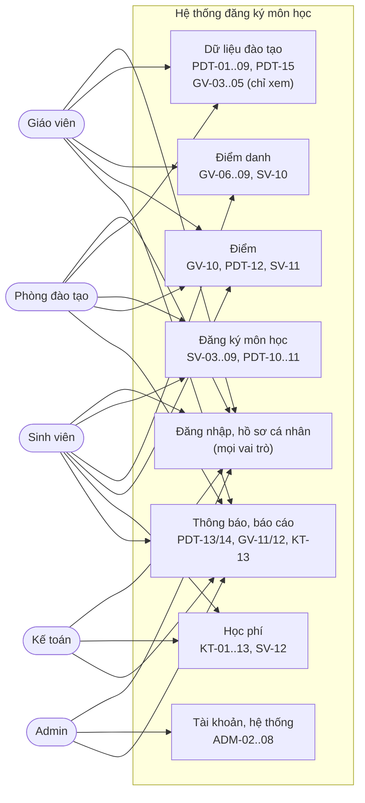

> Use case chi tiết từng vai trò: bảng §4.1..4.5 (61 CN). Sơ đồ trên gom theo nhóm để đọc
> được; không vẽ 61 ô riêng.

### 14.2. Activity — SV đăng ký thủ công (Luồng 1, §8.1, BR-01..07)

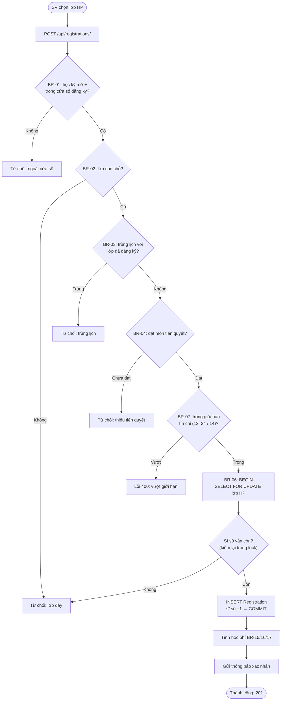

### 14.3. Activity — điểm danh & nhập điểm (Luồng 5, §8.5, BR-19/20/24 + BR-10..14)

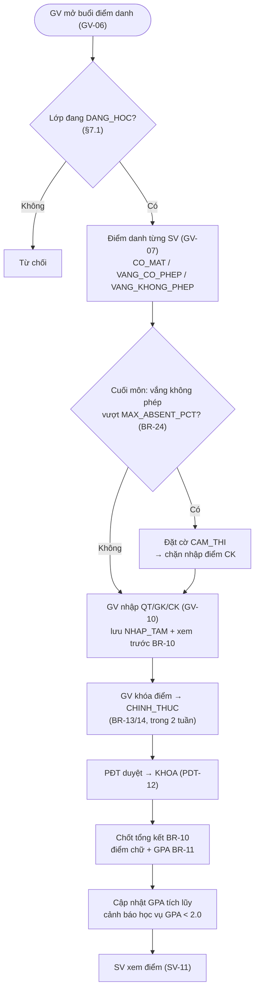

### 14.4. Sequence — chống overbook khi đăng ký đồng thời (BR-06)

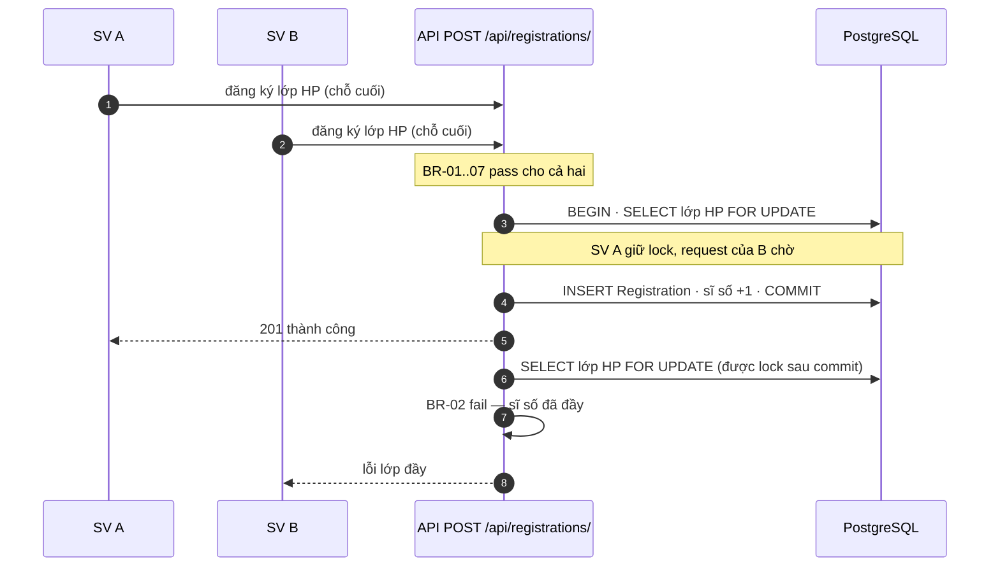

### 14.5. State — vòng đời 6 đối tượng (§7)

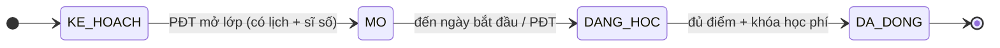

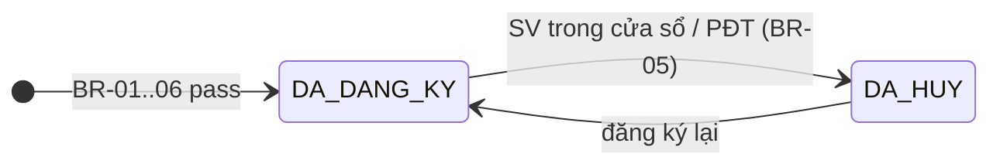

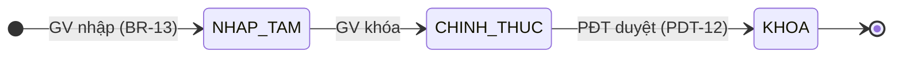

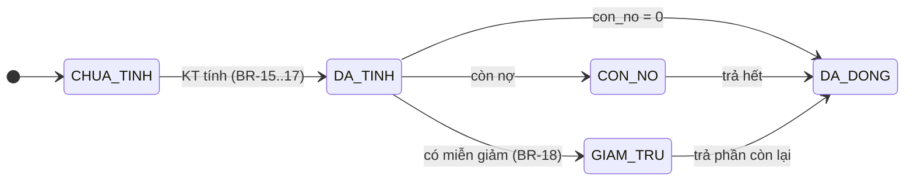

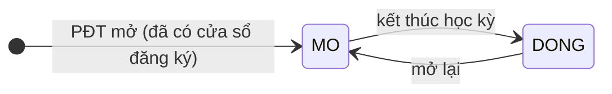

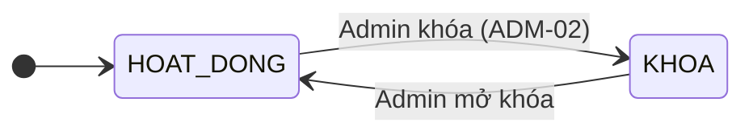

### 14.6. ERD — quan hệ 26 thực thể (§6)

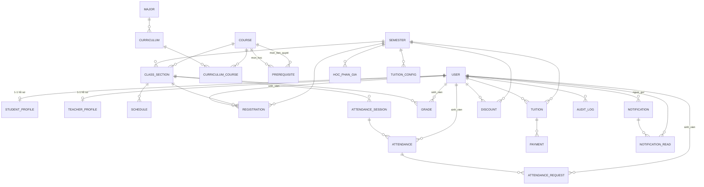

> Thuộc tính từng thực thể xem bảng §6. `SystemConfig` và `RolePermission` không có FK
> (độc lập). `HocPhanGia.tham_chieu` trỏ đa hình (khối kiến thức hoặc ngành) theo `pham_vi`.
