# KẾ HOẠCH TRIỂN KHAI & ĐẶC TẢ — HỆ THỐNG ĐĂNG KÝ MÔN HỌC

**Phiên bản:** 2.5.1 — 5 vai trò · 63 chức năng · BR-01..25 · Flutter Web + App (SV/GV) · Django REST · PostgreSQL 16

> **Nền tảng theo vai trò:** **SV + GV = Flutter Web + Flutter App (Android/iOS)**;
> **Admin + PĐT + KT = chỉ Flutter Web** (nghiệp vụ nặng, thao tác bàn phím,
> bảng dữ liệu lớn, làm trên desktop). Một codebase Flutter duy nhất; các màn hình của
> Admin/PĐT/KT chỉ khai báo route cho Web.

> File này là nguồn **duy nhất** để build: đặc tả nghiệp vụ (Phần II, mục 4–17) được gộp
> nguyên văn từ `chuc_nang.md` (file gốc giữ nguyên làm bản lưu). Không tham chiếu chéo
> file khác.

---

## 1. KIẾN TRÚC TỔNG THỂ

```
┌─────────────────────────────────────────────────────────────┐
│  Flutter Web (responsive)  │  Flutter App (Android/iOS)     │
│  SV + GV: Web + App        │  Admin/PĐT/KT: Web only        │
│  Material 3 · GoRouter · Riverpod · Dio                     │
└──────────────────────────┬──────────────────────────────────┘
                           │ HTTPS · JWT (access 60m / refresh 7d)
┌──────────────────────────▼──────────────────────────────────┐
│  Django REST Framework (Python)                             │
│  ├─ apps: auth · profiles · training · registration ·       │
│  │        attendance · grades · tuition · notifications ·   │
│  │        audit · config                                    │
│  ├─ LockedAwareJWTAuthentication (chặn token khi bị khóa)   │
│  ├─ drf-spectacular (Swagger /api/docs/)                    │
│  └─ celery + beat (5 job: mở lớp, BR-24, quá hạn HP, GPA, backup — mục 11.8)
└──────────────────────────┬──────────────────────────────────┘
                           │ Django ORM · select_for_update
┌──────────────────────────▼──────────────────────────────────┐
│  PostgreSQL 16                                              │
│  28 thực thể (mục 9, ERD 17.6)                              │
└─────────────────────────────────────────────────────────────┘
```

**Nguyên tắc kiến trúc:**
- **Backend là nguồn sự thật duy nhất** — mọi ràng buộc nghiệp vụ (BR-01..25) kiểm tra tại API, không tin frontend.
- **Transaction mọi thao tác ghi đè lẫn nhau** — đăng ký (BR-06), điểm danh, học phí.
- **Idempotent** — retry API không tạo bản ghi trùng (UNIQUE constraint + client request_id).
- **Phân quyền tại API** — mọi endpoint kiểm tra role + phạm vi (BR-21/22/23).

---

## 2. CẤU TRÚC BACKEND (DJANGO)

> **Bố cục repo (monorepo) — đã chốt theo trạng thái hiện có:**
>
> ```
> HeThongDangKyMonHoc/            ← git root
> ├── backend/                    ← tạo mới (Django — cây bên dưới)
> ├── dang_ky_mon_hoc/            ← Flutter project ĐÃ CÓ SẴN — giữ nguyên vị trí
> │                               #   (package name lấy từ pubspec.yaml, không phụ thuộc tên thư mục)
> ├── design.md                   # hướng UI (Material 3, indigo/teal) — thay cho mockup HTML cũ
> ├── plan.md · checklist.md · chuc_nang.md
> ├── docker-compose.yml          ← Khai báo service dùng chung đặt ở backend/ (cây bên dưới);
> │                               #   root KHÔNG đặt compose trùng lặp
> └── .github/workflows/ci.yml    ← 2 job: backend (ruff+mypy+pytest) / flutter (analyze+test),
>                                 #   trigger theo path backend/** và dang_ky_mon_hoc/**
> ```
>
> **Platform Flutter:** chỉ giữ `android/`, `ios/`, `web/`. Xóa `linux/`, `macos/`, `windows/`
> (mặc định của `flutter create`, plan không dùng — cần lại thì `flutter create --platforms=linux .`).

```
backend/
├── config/                     # settings, urls, wsgi, asgi
├── apps/
│   ├── auth/                   # User, JWT, LockedAwareJWTAuthentication
│   ├── profiles/               # StudentProfile, TeacherProfile
│   ├── training/               # Major, Curriculum, CurriculumCourse,
│   │                           # Course, Prerequisite, Semester,
│   │                           # ClassSection, Schedule
│   ├── registration/           # Registration, GradeRetake
│   ├── attendance/             # AttendanceSession, Attendance, AttendanceRequest
│   ├── grades/                 # Grade
│   ├── tuition/                # HocPhanGia, TuitionConfig, Discount,
│   │                           # Payment, Tuition
│   ├── notifications/          # Notification, NotificationRead
│   ├── audit/                  # AuditLog
│   └── config/                 # SystemConfig, RolePermission
├── core/                       # permissions, pagination, exceptions,
│                               #   mixins (AuditLogMixin, ScopeFilter)
├── tests/                      # pytest theo từng app
├── requirements.txt
├── Dockerfile
└── docker-compose.yml          # web + db + redis + celery
```

**Thư viện chính:** Django 5.1+, DRF, SimpleJWT (+ `token_blacklist`), drf-spectacular, django-filter, celery + django-celery-beat, redis, psycopg, openpyxl + reportlab (xuất file), pytest, factory-boy.

---

## 3. CẤU TRÚC FRONTEND (FLUTTER)

Chi tiết đầy đủ: mục 15. Tóm tắt:

```
lib/
├── main.dart, app.dart
├── core/  (api · auth · router · theme)
├── features/ (auth · admin · training · registration ·
│              attendance · grades · tuition · notifications)
└── shared/ (widgets · models · utils)
```

**State management:** Riverpod (chốt). **Routing:** GoRouter theo role. **HTTP:** Dio + interceptor refresh token.

---

---

# PHẦN II — ĐẶC TẢ NGHIỆP VỤ

## 4. TỔNG QUAN HỆ THỐNG

Hệ thống đăng ký môn học hỗ trợ nhà trường quản lý quy trình đào tạo từ tài khoản người dùng,
ngành đào tạo, chương trình đào tạo, môn học, học kỳ, lớp học phần, lịch học, đăng ký môn học,
điểm danh, nhập điểm, học phí, thông báo đến báo cáo thống kê.

**Ngoài phạm vi:**

- **Tự động hoá** luồng học lại / cải thiện điểm: hệ thống có đơn + duyệt thủ công (Luồng 8,
  mục 25) nhưng không tự động phát hiện sinh viên cần học lại — PĐT quyết định.
- Cổng thanh toán trực tuyến (KT chỉ xác nhận thu tay).
- Quản lý phòng học chi tiết (phòng chỉ là thuộc tính của lịch học).
- Xếp lớp mới / phân ban theo khóa tuyển sinh (SV thuộc 1 CTĐT cố định theo `khoa_nhap_hoc`).

Hệ thống bao gồm:

| Thành phần | Mô tả |
| :--- | :--- |
| **Ứng dụng Flutter** | Một codebase Flutter chạy trên **Flutter Web** (responsive; offline **chỉ là cache-API minimal** — read-only TKB/điểm đã tải, mọi thao tác ghi cần mạng; không service worker phức tạp) và **Flutter App** (Android/iOS). **Phạm vi:** SV + GV dùng cả Web lẫn App; Admin, PĐT, KT **chỉ chạy trên Web**. |
| **Backend API** | Django REST Framework xử lý nghiệp vụ, phân quyền, đăng ký môn học, học phí, điểm danh và điểm số. |
| **Cơ sở dữ liệu** | PostgreSQL lưu trữ tài khoản, hồ sơ, ngành, CTĐT, môn học, học kỳ, lớp học phần, lịch học, đăng ký, điểm danh, điểm số, học phí và thông báo. |
| **Dịch vụ hỗ trợ** | JWT dùng cho xác thực, Swagger/OpenAPI dùng để tài liệu hóa và kiểm thử API, Docker dùng để triển khai. |

---

## 5. ĐỐI TƯỢNG SỬ DỤNG (5 VAI TRÒ)

| STT | Vai trò | Trách nhiệm chính | Nền tảng |
| :---: | :--- | :--- | :--- |
| 1 | **Admin** | Quản lý tài khoản, phân quyền, cấu hình hệ thống, nhật ký thao tác (audit log), backup. | Flutter Web (chỉ Web) |
| 2 | **Phòng đào tạo (PĐT)** | Ngành, CTĐT, môn học, học kỳ, lớp học phần, lịch học, theo dõi/hủy đăng ký, thông báo, báo cáo đào tạo. | Flutter Web (chỉ Web) |
| 3 | **Sinh viên (SV)** | Đăng ký/hủy đăng ký, tạo TKB tự động, xem lịch/điểm/điểm danh/học phí, nhận thông báo. | Flutter Web + App |
| 4 | **Giáo viên (GV)** | Lớp phụ trách, điểm danh theo buổi, nhập điểm, thông báo cho lớp. | Flutter Web + App |
| 5 | **Kế toán (KT)** | Cấu hình đơn giá, tính học phí, thu học phí, miễn giảm, công nợ, báo cáo tài chính. | Flutter Web (chỉ Web) |

> **Phân tách Admin / PĐT:** Admin xử lý *tài khoản & phân quyền & cấu hình hệ thống & log*;
> PĐT xử lý *nghiệp vụ đào tạo*. Cả hai đều là vai trò quản trị nhưng tách quyền để không
> giao thoa nghiệp vụ.

### 5.1. Ma trận use case (5 vai trò)

| Use case | Admin | PĐT | SV | GV | KT |
| :--- | :---: | :---: | :---: | :---: | :---: |
| UC-01 Đăng nhập / đăng xuất / đổi mật khẩu | ✓ | ✓ | ✓ | ✓ | ✓ |
| UC-02 Quản lý tài khoản (tạo/khóa/reset) | ✓ | ✗ | ✗ | ✗ | ✗ |
| UC-03 Quản lý hồ sơ SV/GV | Xem | Sửa | *(của mình)* | *(của mình)* | ✗ |
| UC-04 Quản lý ngành / CTĐT / môn / tiên quyết | ✗ | ✓ | ✗ | ✗ | ✗ |
| UC-05 Quản lý học kỳ & cửa sổ đăng ký | ✗ | ✓ | ✗ | ✗ | ✗ |
| UC-06 Quản lý lớp HP & lịch học | ✗ | ✓ | ✗ | ✗ | ✗ |
| UC-07 Đăng ký môn học | ✗ | *(theo dõi)* | ✓ | ✗ | ✗ |
| UC-08 Hủy đăng ký | ✗ | ✓ *(force)* | ✓ *(trong cửa sổ)* | ✗ | ✗ |
| UC-09 Tạo TKB tự động | ✗ | ✗ | ✓ | ✗ | ✗ |
| UC-10 Xem thời khóa biểu | ✗ | ✗ | ✓ *(của mình)* | ✓ *(lịch dạy)* | ✗ |
| UC-11 Điểm danh | ✗ | Xem | Xem + xin sửa | ✓ *(lớp phụ trách)* | ✗ |
| UC-12 Nhập điểm / khóa / duyệt điểm | ✗ | Duyệt + nhập hộ quá hạn | Xem | ✓ *(nhập, lớp phụ trách)* | ✗ |
| UC-13 Quản lý học phí / thanh toán | ✗ | ✗ | Xem *(của mình)* | ✗ | ✓ |
| UC-14 Gửi / nhận thông báo | ✓ | ✓ | Nhận | ✓ *(lớp)* | ✓ |
| UC-15 Báo cáo & xuất dữ liệu | ✗ | Đào tạo | ✗ | *(lớp mình)* | Tài chính |
| UC-16 Audit log / backup / cấu hình | ✓ | *(log đào tạo)* | ✗ | ✗ | *(log học phí)* |

---

## 6. DANH SÁCH CHỨC NĂNG TỔNG HỢP

Sau khi gộp trùng (KT-07↔SYS-08, SV-06↔SYS-05, BR-07↔SYS-06) và chuyển nhóm "Chức năng tự
động" thành Quy tắc nghiệp vụ + Luồng nghiệp vụ, số chức năng được đếm lại:

| STT | Nhóm chức năng | Mã tiền tố | Số lượng CN |
| :---: | :--- | :---: | :---: |
| 1 | Phòng đào tạo | `PDT-` | 16 |
| 2 | Sinh viên | `SV-` | 14 |
| 3 | Giáo viên | `GV-` | 12 |
| 4 | Kế toán | `KT-` | 13 |
| 5 | Quản trị hệ thống (Admin) | `ADM-` | 8 |
| | **TỔNG CỘNG** | | **63** |

> Nhóm "Chức năng tự động" (SYS-01..10 bản cũ) **không còn là nhóm chức năng riêng**: kiểm tra
> ràng buộc, tính điểm, tính học phí, cập nhật sĩ số, gợi ý TKB… được chuyển thành **quy tắc
> nghiệp vụ (mục 8)** và **luồng nghiệp vụ (mục 11)**. Xem mục 12 — Tách bạch & Gộp trùng.
>
> Bản 2.1 bổ sung **PDT-16** (duyệt đơn học lại / cải thiện điểm) và **SV-14** (nộp đơn) → **63 CN**.

---

## 7. CHI TIẾT CHỨC NĂNG THEO VAI TRÒ

### 7.1. Phòng đào tạo (PDT-01..16)

| Mã CN | Tên chức năng | Mô tả | Đối tượng |
| :--- | :--- | :--- | :--- |
| PDT-01 | Quản lý hồ sơ người dùng | Quản lý mã sinh viên, mã giáo viên, ngành học, khoa/bộ môn và thông tin liên hệ. | PĐT |
| PDT-02 | Quản lý ngành đào tạo | Thêm, sửa, ngừng sử dụng ngành đào tạo và thời gian đào tạo. | PĐT |
| PDT-03 | Quản lý chương trình đào tạo | Tạo CTĐT theo ngành, khóa tuyển sinh, tổng tín chỉ yêu cầu và danh sách môn học (gán `khoi_kien_thuc`, `loai_mon`, `hoc_ky_goi_y` cho từng môn × CTĐT). | PĐT |
| PDT-04 | Quản lý môn học | Thêm, sửa môn học: tín chỉ (tổng/LT/TH), số tiết LT/TH, trạng thái. | PĐT |
| PDT-05 | Quản lý môn tiên quyết | Thiết lập môn cần đạt trước khi đăng ký môn tiếp theo. | PĐT |
| PDT-06 | Quản lý học kỳ | Tạo học kỳ, cập nhật thời gian, mở/đóng học kỳ. | PĐT |
| PDT-07 | Cấu hình thời gian đăng ký | Thiết lập cửa sổ đăng ký (bắt đầu/kết thúc) và **3 trần tín chỉ** (`tin_chi_toi_thieu`, `tin_chi_toi_da`, `tin_chi_toi_da_canh_bao`) cho từng học kỳ. | PĐT |
| PDT-08 | Quản lý lớp học phần | Mở lớp HP, phân công GV, đặt sĩ số tối đa, quản lý trạng thái lớp. | PĐT |
| PDT-09 | Quản lý lịch học | Thiết lập thứ, buổi, tiết, số tiết mỗi buổi, phòng học cho lớp HP (ràng buộc tại mục 9 — Lịch học, BR-08/09). | PĐT |
| PDT-10 | Theo dõi đăng ký môn học | Xem danh sách SV đăng ký theo môn, lớp HP, ngành, học kỳ. | PĐT |
| PDT-11 | Hủy đăng ký khi cần | Hủy đăng ký của SV khi có lý do hợp lệ (ngoài cửa sổ đăng ký → điều chỉnh học phí theo BR-05). | PĐT |
| PDT-12 | Duyệt điểm | Duyệt điểm `CHINH_THUC` → `KHOA` cho lớp HP (xem BR-14). | PĐT |
| PDT-13 | Gửi thông báo | Gửi thông báo đến vai trò / lớp / ngành / học kỳ / SV / GV / KT. | PĐT |
| PDT-14 | Báo cáo đào tạo | Thống kê SV, lớp HP, số lượng đăng ký, lớp đầy/còn chỗ theo học kỳ. | PĐT |
| PDT-15 | Tra cứu dữ liệu đào tạo | Tìm kiếm, lọc, xem chi tiết ngành, môn, lớp HP, lịch học, đăng ký. | PĐT |
| PDT-16 | Duyệt đơn học lại / cải thiện điểm | Xem và duyệt/từ chối đơn của SV; đơn `DUYET` cho phép SV đăng ký lại môn (xem Luồng 8, mục 25). | PĐT |

### 7.2. Sinh viên (SV-01..14)

| Mã CN | Tên chức năng | Mô tả | Đối tượng |
| :--- | :--- | :--- | :--- |
| SV-01 | Đăng nhập / đăng xuất | Đăng nhập bằng tài khoản được cấp; đăng xuất kết thúc phiên. | SV |
| SV-02 | Xem hồ sơ cá nhân | Xem thông tin SV, ngành, khóa nhập học, GPA, tín chỉ tích lũy; xem/đổi mật khẩu. | SV |
| SV-03 | Xem chương trình đào tạo | Xem danh sách môn theo CTĐT: môn bắt buộc, môn tự chọn, khối kiến thức, học kỳ gợi ý. | SV |
| SV-04 | Xem môn được đăng ký | Xem lớp HP đang mở trong học kỳ (lọc theo CTĐT, còn chỗ, chưa trùng lịch). | SV |
| SV-05 | Đăng ký môn học thủ công | Chọn lớp HP, xác nhận; hệ thống chạy BR-01..07. | SV |
| SV-06 | Tạo thời khóa biểu tự động | Chọn danh sách môn + ưu tiên (ngày/buổi/GV) → hệ thống gợi ý tổ hợp → SV xác nhận → chạy BR-01..07. | SV |
| SV-07 | Hủy đăng ký môn học | Hủy lớp HP trong cửa sổ đăng ký → hoàn học phí theo BR-05. | SV |
| SV-08 | Xem thời khóa biểu | Xem lịch theo tuần/học kỳ: môn, lớp, GV, phòng, tiết. | SV |
| SV-09 | Xem lịch sử đăng ký | Xem môn đã đăng ký / đã hủy / đang học, ngày đăng ký, lý do hủy. | SV |
| SV-10 | Xem điểm danh & xin sửa điểm danh | Xem trạng thái điểm danh từng buổi; gửi yêu cầu sửa điểm danh (GV/PĐT xử lý). | SV |
| SV-11 | Xem điểm | Xem QT, GK, CK, tổng kết, điểm chữ, GPA; điểm `KHOA` mới hiển thị chính thức. | SV |
| SV-12 | Xem học phí | Xem học phí theo học kỳ: tổng tín chỉ, tổng tiền, đã thu, còn nợ, miễn giảm. | SV |
| SV-13 | Nhận thông báo | Nhận + đánh dấu đã đọc thông báo từ PĐT / GV / KT / Admin. | SV |
| SV-14 | Nộp đơn học lại / cải thiện điểm | Nộp đơn cho môn đã có điểm `KHOA`, chọn `HOC_LAI` hoặc `HOC_CAI_THIEN`; theo dõi trạng thái đơn (xem Luồng 8, mục 25). | SV |

### 7.3. Giáo viên (GV-01..12)

| Mã CN | Tên chức năng | Mô tả | Đối tượng |
| :--- | :--- | :--- | :--- |
| GV-01 | Đăng nhập / đăng xuất | Đăng nhập bằng tài khoản được cấp; đăng xuất kết thúc phiên. | GV |
| GV-02 | Xem hồ sơ cá nhân | Xem mã GV, khoa/bộ môn, học vị, thông tin liên hệ; xem/đổi mật khẩu. | GV |
| GV-03 | Xem lớp phụ trách | Xem danh sách lớp HP được phân công giảng dạy. | GV |
| GV-04 | Xem chi tiết lớp | Xem môn, lịch, phòng, sĩ số, danh sách SV trong lớp. | GV |
| GV-05 | Xem thời khóa biểu cá nhân | Xem lịch dạy theo tuần hoặc học kỳ. | GV |
| GV-06 | Tạo buổi điểm danh | Chọn lớp HP, ngày học, buổi, tiết để mở buổi điểm danh. | GV |
| GV-07 | Điểm danh sinh viên | Đánh dấu từng SV: `CO_MAT` / `VANG_CO_PHEP` / `VANG_KHONG_PHEP`; cờ `DI_TRE` riêng (BR-19). | GV |
| GV-08 | Cập nhật điểm danh | Sửa trạng thái điểm danh khi có lý do hợp lệ; lưu thời gian cập nhật. **Chỉ khi `AttendanceSession` còn `MO` hoặc chuyển `DA_DIEM_DANH` ≤ 24h** (tính từ thời điểm session được chốt — quản theo session, mỗi session = 1 buổi/lớp/ngày, BR-20; qua 24h GV không sửa được — SV dùng `AttendanceRequest`; PĐT/GV duyệt). Không sửa bản ghi của lớp đã `DA_DONG`. | GV |
| GV-09 | Xem lịch sử điểm danh | Xem lại điểm danh theo từng buổi của lớp HP. | GV |
| GV-10 | Nhập điểm | Nhập QT/GK/CK cho SV lớp phụ trách; hiển thị **xem trước** tổng kết theo BR-10; lưu `NHAP_TAM`. Tổng kết **chính thức** chỉ chốt khi PĐT duyệt `KHOA` (PDT-12). | GV |
| GV-11 | Gửi thông báo cho lớp | Gửi thông báo đến SV trong lớp mình phụ trách. | GV |
| GV-12 | Xuất danh sách lớp | Xuất danh sách SV, bảng điểm, bảng điểm danh (định dạng Excel/PDF). | GV |

### 7.4. Kế toán (KT-01..13)

| Mã CN | Tên chức năng | Mô tả | Đối tượng |
| :--- | :--- | :--- | :--- |
| KT-01 | Quản lý cấu hình học phí | Thiết lập chính sách tính học phí áp dụng cho từng học kỳ. | KT |
| KT-02 | Thiết lập giá theo ngành | Cấu hình đơn giá tín chỉ mặc định theo từng ngành đào tạo. | KT |
| KT-03 | Thiết lập giá theo khối kiến thức | Cấu hình giá theo 5 khối: chung, cơ sở ngành, chuyên ngành, tự chọn, tốt nghiệp. | KT |
| KT-04 | Thiết lập giá tín chỉ lý thuyết | Cấu hình độ lệch ± đơn giá cho tín chỉ lý thuyết. | KT |
| KT-05 | Thiết lập giá tín chỉ thực hành | Cấu hình đơn giá riêng cho tín chỉ thực hành/thí nghiệm/đồ án. | KT |
| KT-06 | Thiết lập miễn giảm / hoàn giảm | Cấu hình học bổng, miễn giảm, hoàn tiền, giảm trừ theo chính sách. | KT |
| KT-07 | Tính học phí tự động | Hệ thống tính học phí theo BR-15/16/17 khi SV đăng ký hoặc KT bấm tính. | KT |
| KT-08 | Xem danh sách học phí | Xem học phí SV theo học kỳ, ngành, lớp, trạng thái thanh toán. | KT |
| KT-09 | Xác nhận thanh toán | Ghi nhận SV đóng học phí (tiền mặt / chuyển khoản / khác). | KT |
| KT-10 | Theo dõi công nợ | Xem SV chưa đóng, đóng thiếu, quá hạn. | KT |
| KT-11 | Điều chỉnh học phí | Điều chỉnh khi thay đổi đăng ký, hủy môn, miễn giảm, thu bổ sung. | KT |
| KT-12 | Xuất biên lai / hóa đơn | Xuất phiếu thu, biên lai, hóa đơn học phí (Excel/PDF). | KT |
| KT-13 | Báo cáo tài chính học phí | Thống kê phải thu, đã thu, còn nợ theo học kỳ / ngành / lớp / SV. | KT |

### 7.5. Quản trị hệ thống — Admin (ADM-01..08)

| Mã CN | Tên chức năng | Mô tả | Đối tượng |
| :--- | :--- | :--- | :--- |
| ADM-01 | Đăng nhập / đăng xuất | Đăng nhập admin; đăng xuất kết thúc phiên. | Admin |
| ADM-02 | Quản lý tài khoản | Tạo, cập nhật, khóa/mở khóa tài khoản cho cả 5 vai trò; reset mật khẩu. | Admin |
| ADM-03 | Quản lý hồ sơ người dùng | Xem/tra cứu hồ sơ SV / GV / KT gắn với tài khoản (sửa hồ sơ học vụ do **PĐT** thực hiện, PDT-01). | Admin |
| ADM-04 | Quản lý phân quyền | Gán vai trò, cấu hình quyền theo vai trò, cấp/thu hồi quyền đặc thù. | Admin |
| ADM-05 | Cấu hình hệ thống | Cấu hình tham số chung qua `SystemConfig`: **3 trần tín chỉ** (`tin_chi_toi_thieu`, `tin_chi_toi_da`, `tin_chi_toi_da_canh_bao` — fallback cho `Semester`, BR-07), `MAX_ABSENT_PCT`, `so_ngay_cho_phep_nhap_diem`, giới hạn phân trang, rate limit, cờ tính năng, `backup_retention_days`. | Admin |
| ADM-06 | Nhật ký thao tác (audit log) | Xem log tạo/sửa/xóa, đăng nhập, thay đổi phân quyền theo thời gian. Admin xem toàn bộ; PĐT xem log đào tạo; KT xem log học phí. | Admin (+ PĐT, KT theo phạm vi) |
| ADM-07 | Quản lý thông báo hệ thống | Soạn/thu hồi thông báo toàn hệ thống (khi PĐT/KT không cần gửi). | Admin |
| ADM-08 | Sao lưu & phục hồi dữ liệu | Khởi tạo backup, xem lịch sử backup, phục hồi khi cần. | Admin |

> **Lưu ý tách bạch:** Bản cũ có **PDT-01 = Quản lý tài khoản**. Bản này giao toàn bộ quyền
> *tạo / sửa / khóa tài khoản* cho **Admin (ADM-02)**. PĐT chỉ giữ quyền quản lý **hồ sơ**
> nghiệp vụ (mã SV, ngành, khoa/bộ môn…) theo **PDT-01 mới = Quản lý hồ sơ người dùng**.
> Admin quản lý *tài khoản* (đăng nhập/khóa/quyền), PĐT quản lý *hồ sơ* (thông tin học vụ).

---

## 8. QUY TẮC NGHIỆP VỤ CHÍNH (BR-01..25)

Viết lại hoàn toàn, chia 5 nhóm. Mỗi BR chỉ nêu **một lần** trong toàn bộ tài liệu.

### 8.1. Nhóm đăng ký (BR-01..09)

| Mã | Quy tắc nghiệp vụ |
| :--- | :--- |
| BR-01 | SV chỉ đăng ký khi: (1) học kỳ đang `MO`, (2) đang trong cửa sổ đăng ký (PDT-07), **và** (3) lớp HP đang ở trạng thái `MO`. Không đăng ký được lớp `KE_HOACH` / `DANG_HOC` / `DA_DONG`. |
| BR-02 | Không đăng ký khi lớp HP đã đạt sĩ số tối đa. |
| BR-03 | Không đăng ký khi lịch học trùng với lớp đã đăng ký trong cùng học kỳ. **Định nghĩa "trùng":** 2 buổi trùng khi **giao tiết** cùng ngày hiệu lực — (a) cả 2 lịch định kỳ (`ngay_hoc NULL`): trùng nếu cùng `thu` và giao tiết; (b) có lịch bù (`ngay_hoc` cụ thể): lịch bù so sánh theo **ngày thật** với mọi lịch khác có `ngay_hoc` trùng ngày đó (kể cả lịch định kỳ — quy ngày của lịch định kỳ về các ngày `thu` tương ứng trong tuần chứa `ngay_hoc` của lịch bù); 2 lịch bù trùng khi cùng `ngay_hoc` và giao tiết. |
| BR-04 | Chỉ đăng ký khi đã đạt môn tiên quyết (PDT-05). "Đạt" = có bản ghi `Grade` trạng thái `KHOA` **và** `diem_chu ≠ F` (BR-11: môn chấm `DIEM` → tổng kết ≥ 4.0 là **D** trở lên; môn `DAT_KHONG_DAT` → `P`) **và** `Registration.cam_thi = false` — **không phân biệt CTĐT** (điểm đạt ở CTĐT cũ vẫn tính — học lại trong CTĐT mới theo `GradeRetake` như thường). **Đã có `Grade` `KHOA` cho chính môn này** (kể cả chưa đạt, kể cả từ CTĐT khác) → bắt buộc `GradeRetake` trạng thái `DUYET` cho `(sinh_vien, mon_hoc)` mới được đăng ký lại (mục 25) — không đăng ký lại được với `loai_dang_ky = BINH_THUONG`. **Miễn BR-04 (tiên quyết)** khi đăng ký lại chính môn đó theo đơn đã `DUYET` — nếu không miễn thì môn chưa đạt sẽ tự chặn chính nó. |
| BR-05 | SV hủy trong cửa sổ đăng ký → **hoàn toàn bộ học phí** môn đó. Hủy ngoài cửa sổ (do PĐT chủ động, PDT-11) → điều chỉnh học phí theo chính sách hoàn giảm (KT-06). **Cơ chế:** hủy → chạy lại KT-07 (`POST /api/tuition/calculate/?hoc_ky=`) giảm `tong_tien`; phần chênh lệch nếu đã thu → tạo `Discount` `loai = HOAN_TIEN` (không sửa ngược Payment). **`HOAN_TIEN` là tiền trả lại SV, KHÔNG phải khoản giảm trừ** → bị loại khỏi `mien_giam` và được cộng vào `hoan_tien` (xem công thức tại thực thể **Tuition**). Khi `hoan_tien > 0` → `Tuition.trang_thai = CHO_HOAN_TIEN`; KT chi trả xong → `DA_HOAN_TIEN`. |
| BR-06 | Kiểm tra sĩ số + tăng/giảm sĩ số chạy trong **cùng một transaction DB**: `SELECT … FOR UPDATE` trên dòng `ClassSection` → **đọc lại** `si_so_hien_tai` trong lock → còn chỗ mới `INSERT Registration` + `si_so_hien_tai += 1` → `COMMIT`. `UNIQUE(sinh_vien, lop_hoc_phan)` **chỉ** chống 1 SV đăng ký trùng 1 lớp, **không** chống overbook giữa nhiều SV — thiếu `FOR UPDATE` là lỗi. Hủy đăng ký cũng phải `FOR UPDATE` và `si_so_hien_tai -= 1` (không xuống dưới 0). |
| BR-07 | Giới hạn tín chỉ mỗi học kỳ theo cấu hình (ADM-05): tối thiểu `tin_chi_toi_thieu` và tối đa `tin_chi_toi_da` (mặc định **12–24**), PĐT có thể điều chỉnh theo từng học kỳ (PDT-07). **Tối đa chặn cứng** (`VUOT_TIN_TC_TOI_DA`, HTTP 400); **tối thiểu chỉ cảnh báo** (SV thiếu tín chỉ vẫn đăng ký được → trả `warnings[]` + ghi log). SV thuộc diện cảnh báo học vụ (`StudentProfile.gpa < 2.0`) chỉ được đăng ký tối đa `tran_canh_bao` tín chỉ. PĐT ghi đè theo từng học kỳ bằng `Semester.tin_chi_toi_thieu` / `tin_chi_toi_da` (`NULL` = dùng `SystemConfig`) và **`Semester.tin_chi_toi_da_canh_bao`** (`NULL` = **14**, cấu hình chung ở ADM-05). Cách áp: `tin_chi_toi_da_ap_dung = Semester.tin_chi_toi_da ?? SystemConfig.tin_chi_toi_da`; `tran_canh_bao = min(tin_chi_toi_da_ap_dung, Semester.tin_chi_toi_da_canh_bao ?? 14)`. SV chưa có GPA (`gpa IS NULL`, học kỳ đầu) **không** thuộc diện cảnh báo. |
| BR-08 | Thời khóa biểu chia 15 tiết/ngày: sáng 1–5, chiều 6–10, tối 11–15. |
| BR-09 | Khi tạo lịch học, PĐT **bắt buộc** nhập số tiết mỗi buổi (`so_tiet_moi_buoi`). |

### 8.2. Nhóm điểm (BR-10..14, BR-25)

| Mã | Quy tắc nghiệp vụ |
| :--- | :--- |
| BR-10 | Điểm tổng kết = `QT*0.1 + GK*0.4 + CK*0.5`. **Fallback thiếu GK:** bỏ GK, chia lại tỉ lệ QT/CK = 20%/80%. **Thiếu CK (`diem_cuoi_ky IS NULL` — chưa nhập):** `diem_cuoi_ky = 0`, tổng kết = `QT*0.1 + GK*0.4 + 0*0.5` (tối đa 5.0 → không tự động F; GV quá hạn BR-13 thì PĐT mở hạn/nhập hộ). **Phân biệt NULL vs 0:** NULL = chưa nhập → fallback áp dụng; `0` = GV đã nhập 0 (vắng thi) → tính công thức thường, SV tự nhận F nếu đủ điều kiện. **Lưu trữ:** `diem_cuoi_ky` giữ `NULL` trong DB ngay cả khi chốt `KHOA` (fallback chỉ áp lúc tính tổng kết) — dữ liệu gốc phản ánh đúng "chưa nhập", phân biệt với "GV nhập 0". Làm tròn 2 chữ số. **Ngoại lệ:** SV có `Registration.cam_thi = true` **không áp fallback thiếu CK** — chốt `F` theo BR-24. |
| BR-11 | Thang điểm chữ (thang 10 → thang 4) **band liên tục không khoảng trống** (điểm tổng kết làm tròn 2 chữ số): `≥ 8.50` → **A** (4.0); `≥ 7.00` → **B** (3.0); `≥ 5.50` → **C** (2.0); `≥ 4.00` → **D** (1.0); `< 4.00` → **F** (0.0). Môn có `Course.loai_danh_gia = DAT_KHONG_DAT` **không dùng A–F**: `diem_tong_ket ≥ 5.00` → **P** (`gpa_thang_4 = null`, không tính GPA), ngược lại → **F** (0.0). Band đơn giản hóa cho hệ thống (không dùng trọn thang B+/C+ của TT 08/2021). **Định nghĩa "đạt" (dùng thống nhất ở BR-04, BR-25d):** `diem_chu ≠ F` — tức **D (≥ 4.00) vẫn đạt**, vừa có GPA 1.0 vừa được tính tín chỉ tích lũy; không có ngưỡng 5.0 riêng cho môn chấm `DIEM`. |
| BR-25 | **GPA & xếp loại.** (a) *GPA học kỳ* = Σ(`gpa_thang_4` × `tong_tin_chi` môn) / Σ(`tong_tin_chi` môn) trên các `Grade` trạng thái `KHOA` **thuộc học kỳ đó**; *GPA tích lũy* tính trên **toàn bộ** `Grade` `KHOA`. (b) Môn `diem_chu = P` (`gpa_thang_4 = null`) bị loại **cả tử số lẫn mẫu số**; môn `F` **vẫn vào mẫu số** (0 điểm). (c) Học lại/cải thiện: mỗi cặp `(sinh_vien, mon_hoc)` chỉ tính **1 lần** — lấy theo **lần học mới nhất** (`Grade` `KHOA` có `ngay_nhap` lớn nhất; **cùng `ngay_nhap` → tie-break theo `id` lớn hơn** — bản ghi tạo sau), không cộng dồn. **Học cải thiện (`Registration.loai_dang_ky = HOC_CAI_THIEN`, mục 25) cũng lấy lần cuối cùng** — điểm mới thấp hơn điểm cũ thì vẫn tính điểm mới. (d) `StudentProfile.tin_chi_tich_luy` = Σ `tong_tin_chi` các môn `Grade` `KHOA` có `diem_chu ≠ F` (đạt = D trở lên hoặc `P`, cùng ngưỡng với BR-04). (e) Ghi kết quả vào `StudentProfile.gpa` (thang 4) khi `Grade` chuyển `KHOA`. (f) Xếp loại theo thang 4 (thang 10 tương ứng): Xuất sắc 3.60–4.00 (9.00–10.00); Giỏi 3.20–3.59 (8.00–8.99); Khá 2.50–3.19 (7.00–7.99); Trung bình 2.00–2.49 (5.00–6.99); Yếu 1.00–1.99 (4.00–4.99); Kém < 1.00 (< 4.00). |
| BR-12 | GV chỉ nhập điểm / sửa điểm cho lớp mình phụ trách (GV-03). |
| BR-13 | GV cập nhật điểm trong vòng **2 tuần** kể từ `ClassSection.ngay_ket_thuc` (mốc "kết thúc môn"); quá hạn → hệ thống chặn, **PĐT mở hạn** qua `POST /api/class-sections/{id}/grade-deadline/` (cấp lại `so_ngay_cho_phep_nhap_diem` cho lớp, ghi audit log) hoặc **nhập hộ** qua `POST /api/grades/` với quyền PĐT (mọi thao tác nhập hộ ghi audit log). |
| BR-14 | Trạng thái điểm: `NHAP_TAM` → `CHINH_THUC` (GV khóa) → `KHOA` (PĐT duyệt, PDT-12). GV có thể **tự mở khóa** `CHINH_THUC` → `NHAP_TAM` để sửa (`PATCH /api/grades/{id}/lock/` action `unlock` — chỉ lớp `DANG_HOC` + trong hạn BR-13, ghi audit log; sau khi lớp `DA_DONG` không mở được nữa — GV-10 không thao tác trên lớp đã đóng). `KHOA` bất biến. Chỉ điểm `KHOA` hiển thị chính thức cho SV. |

### 8.3. Nhóm học phí (BR-15..18)

| Mã | Quy tắc nghiệp vụ |
| :--- | :--- |
| BR-15 | Học phí = Σ (tín chỉ × đơn giá) theo bảng giá đang áp dụng, tính trên các môn SV đã đăng ký trong học kỳ. |
| BR-16 | **Tra bảng giá** cho 1 môn × 1 học kỳ: duyệt 2 trục theo thứ tự — **(1)** bản ghi `hoc_ky` = học kỳ đang tính, **(2)** bản ghi `hoc_ky IS NULL` (mặc định); trong mỗi trục xét `pham_vi` theo thứ tự `KHOI_KIEN_THUC` → `NGANH` → `MAC_DINH`. Dừng ở bản ghi khớp đầu tiên làm **đơn giá gốc**. Điều kiện khớp: `KHOI_KIEN_THUC` khớp `CurriculumCourse.khoi_kien_thuc` của môn trong CTĐT của SV; `NGANH` khớp `StudentProfile.nganh`; `MAC_DINH` khớp mọi môn. `LECH_LT` / `LECH_TH` / `GIA_TH` là **hệ số điều chỉnh** áp lên đơn giá gốc (công thức tại BR-17), không phải trục so sánh. Không tìm được bản ghi nào → lỗi `400` (chưa cấu hình bảng giá). |
| BR-17 | Đơn giá phần **lý thuyết** = `đơn giá gốc` (BR-16) × `(1 + LECH_LT)` nếu có bản ghi `HocPhanGia.pham_vi = LECH_LT` **khớp khối kiến thức của môn trong CTĐT của SV** (CurriculumCourse.khoi_kien_thuc — luôn biết từ CTĐT, không phụ thuộc trục resolve ra đơn giá gốc; không xét trục ngành), ngược lại = `đơn giá gốc`. Đơn giá phần **thực hành** = `don_gia` của bản ghi `pham_vi = GIA_TH` nếu có (cùng quy tắc khớp khối), ngược lại = `đơn giá gốc × (1 + LECH_TH)` nếu có `LECH_TH`, ngược lại = `đơn giá gốc`. **Các bản ghi điều chỉnh (`LECH_LT`/`LECH_TH`/`GIA_TH`) tra theo cùng 2 trục `hoc_ky` như BR-16** — trục (1) `hoc_ky` = học kỳ đang tính, trục (2) `hoc_ky IS NULL` — mỗi loại tra độc lập theo 2 trục này (VD: đơn giá gốc resolve từ trục 1, `LECH_LT` có thể chỉ có ở trục 2). `HocPhanGia.pham_vi` nhận thêm giá trị `LECH_TH` (độ lệch cho tín chỉ thực hành, tương ứng KT-05). Môn có `tin_chi_thuc_hanh > 0` → học phí = `tin_chi_ly_thuyet × đơn giá LT + tin_chi_thuc_hanh × đơn giá TH`. |
| BR-18 | KT quyết định miễn giảm (KT-06) theo hồ sơ do PĐT / SV lập; mọi thay đổi miễn giảm đều ghi log. |

### 8.4. Nhóm điểm danh (BR-19, 20, 24)

| Mã | Quy tắc nghiệp vụ |
| :--- | :--- |
| BR-19 | Trạng thái điểm danh: `CO_MAT`, `VANG_CO_PHEP`, `VANG_KHONG_PHEP`. `DI_TRE` là **cờ riêng** (không thay thế trạng thái vắng/có mặt). |
| BR-20 | Trạng thái điểm danh lưu theo **từng buổi học** để tra cứu và báo cáo. |
| BR-24 | **Cấm thi theo điểm danh.** Job `scan_cam_thi` chạy **hằng ngày trên lớp `DANG_HOC`** (đặt cờ ngay khi vượt ngưỡng giữa kỳ, không đợi đóng lớp) **và** bắn lại khi lớp chuyển `DA_DONG`. **Mẫu số** = số `AttendanceSession` trạng thái `DA_DIEM_DANH` của lớp (buổi chưa điểm danh không tính; **mẫu số = 0 → skip**, không chia). **Ngưỡng:** `so_vang_khong_phep / so_buoi_da_diem_danh > MAX_ABSENT_PCT` (mặc định **20%**, `SystemConfig`) → `Registration.cam_thi = true`. Hệ quả: (a) GV **không** nhập/sửa `diem_cuoi_ky` cho SV đó — `POST /api/grades/` và `PATCH /api/grades/{id}/` đều trả `409` (áp ngay từ lúc đặt cờ, kể cả lớp `DANG_HOC`); (b) khi lớp `DA_DONG`, job sinh/chốt `Grade` cho SV có cờ: nếu **chưa có** `Grade` → tạo mới; nếu **đã có** (GV nhập QT/GK từ trước) → **UPDATE** bản ghi đó. Cả hai nhánh: `diem_cuoi_ky = 0`, `diem_tong_ket = 0`, `diem_chu = F`, `gpa_thang_4 = 0.0`, `trang_thai = KHOA` (tôn trọng UNIQUE `(lop_hoc_phan, sinh_vien)`). PĐT xóa cờ qua `PATCH /api/registrations/{id}/` với `cam_thi = false` + `ly_do` bắt buộc (ghi audit log) — **chỉ hợp lệ khi lớp còn `DANG_HOC`** (lớp đã `DA_DONG` thì `Grade` F đã `KHOA` bất biến, xóa cờ vô nghĩa → trả `409`; sửa điểm sau đó chỉ qua PĐT nhập hộ có audit log) → khi đó GV nhập điểm lại được. **Job chỉ set, không tự unset cờ** — chủ ý kiểm soát: khi duyệt `AttendanceRequest` (mục 9) làm tỷ lệ vắng tụt dưới ngưỡng → hệ thống **gửi notification cho PĐT đúng 1 lần** (cờ `notified_cam_thi_review` trên `Registration`, reset khi PĐT xóa cờ — chống spam job hằng ngày) xem xét xóa cờ tay, không tự động hạ (tránh dao động trạng thái). |

### 8.5. Nhóm hệ thống (BR-21..23)

| Mã | Quy tắc nghiệp vụ |
| :--- | :--- |
| BR-21 | Phân quyền truy cập theo 5 vai trò (mục 14 — ma trận phân quyền). |
| BR-22 | Xác thực JWT trước khi truy cập mọi chức năng nội bộ. |
| BR-23 | Bảo vệ dữ liệu điểm và dữ liệu cá nhân: SV chỉ xem dữ liệu của mình; GV chỉ xem lớp phụ trách; KT/Admin theo phạm vi được cấp. |

---

## 9. ĐẶC TẢ THỰC THỂ VÀ THUỘC TÍNH

Sửa trực tiếp các mâu thuẫn đơn vị (tín chỉ ↔ tiết) và các điểm gán dữ liệu (khối kiến thức,
trạng thái) ngay tại mô hình.

| Thực thể | Thuộc tính chính | Ràng buộc |
| :--- | :--- | :--- |
| **User (Tài khoản)** | `username`, `password_hash`, `role` ∈ {`ADMIN`, `PHONG_DAO_TAO`, `SINH_VIEN`, `GIAO_VIEN`, `KE_TOAN`}, `is_locked`, `last_login` | `role` = 1 trong 5 — **enum cứng, không tạo/xóa được**; ADM-04 chỉ gán/thu hồi `permission` cho 5 role có sẵn. `is_locked` chặn đăng nhập **và** chặn refresh token. |
| **StudentProfile** | `ma_sv`, `ho_ten`, `nganh`, `khoa_nhap_hoc`, `ctdt` (FK → Curriculum), `gpa` (thang 4, `NULL` = chưa có điểm), `tin_chi_tich_luy`, `email`, `sdt` | `ma_sv` duy nhất; `nganh` FK → Major. `ctdt` gán 1 lần khi tạo hồ sơ (chọn CTĐT khớp `nganh` + `khoa_nhap_hoc`); CTĐT cố định theo SV (mục 4 — ngoài phạm vi). `gpa`/`tin_chi_tich_luy` là **cache** tính lại theo BR-25, không nhập tay. |
| **TeacherProfile** | `ma_gv`, `ho_ten`, `khoa_bo_mon`, `hoc_vi`, `email`, `sdt` | `ma_gv` duy nhất. |
| **Ngành (Major)** | `ma_nganh`, `ten_nganh`, `thoi_gian_dao_tao`, `trang_thai` | `ma_nganh` duy nhất. |
| **CTĐT (Curriculum)** | `ma_ctdt`, `nganh`, `khoa_tuyen_sinh`, `tong_tin_chi_yeu_cau`, `trang_thai` | `tong_tin_chi_yeu_cau` > 0. **Chỉ 1 CTĐT `HOAT_DONG` mỗi cặp `(nganh, khoa_tuyen_sinh)`** — unique một phần (index có điều kiện `WHERE trang_thai = 'HOAT_DONG'`); bản cũ chuyển `trang_thai` khác khi thay thế. Nguồn resolve CTĐT của SV: `StudentProfile.ctdt` (FK tường minh, ưu tiên); bỏ trống mới suy từ `(nganh, khoa_nhap_hoc)` → CTĐT `HOAT_DONG`. |
| **CurriculumCourse (Môn × CTĐT)** | `ctdt`, `mon_hoc`, `khoi_kien_thuc` ∈ {`chung`, `co_so_nganh`, `chuyen_nganh`, `tu_chon`, `tot_nghiep`}, `loai_mon` ∈ {`bat_buoc`, `tu_chon`}, `hoc_ky_goi_y` | Cặp `(ctdt, mon_hoc)` **duy nhất**. ← **Nơi gán khối kiến thức** (KT-03, SV-03 đọc từ đây). |
| **Course (Môn học)** | `ma_mon`, `ten_mon`, `tong_tin_chi`, `tin_chi_ly_thuyet`, `tin_chi_thuc_hanh`, `so_tiet_ly_thuyet`, `so_tiet_thuc_hanh`, `loai_danh_gia` ∈ {`DIEM`, `DAT_KHONG_DAT`}, `trang_thai` | `tong_tin_chi = tin_chi_ly_thuyet + tin_chi_thuc_hanh`. `so_tiet_*` chỉ để **truyền dạy**, không dùng tính phí. `loai_danh_gia = DAT_KHONG_DAT` → điểm chữ chỉ có `P`/`F` (BR-11), không vào GPA. `trang_thai` = `NGUNG_SU_DUNG` (môn khai báo sai / thay thế): chặn mở lớp HP mới và loại khỏi danh sách mở cho SV (mục 13.4); môn đang có lớp/CTĐT thì **không xóa**, chỉ ngừng. |
| **Môn tiên quyết (Prerequisite)** | `mon_hoc`, `mon_tien_quyet` | Cặp `(mon_hoc, mon_tien_quyet)` duy nhất; `mon_hoc ≠ mon_tien_quyet`; **không chu trình** — validation duyệt DFS từ `mon_hoc` theo cạnh `mon_tien_quyet`, gặp lại chính nó thì `400` (thêm test §19). |
| **Học kỳ (Semester)** | `ten_hk`, `nam_hoc`, `ngay_bat_dau`, `ngay_ket_thuc`, `cua_so_dk_bat_dau`, `cua_so_dk_ket_thuc`, `tin_chi_toi_thieu` (nullable), `tin_chi_toi_da` (nullable), `tin_chi_toi_da_canh_bao` (nullable), `trang_thai` ∈ {`MO`, `DONG`} | Cửa sổ đăng ký ⊂ thời gian học kỳ. Ba field `tin_chi_*` do **PĐT** set theo từng học kỳ (PDT-07); `NULL` = fallback `SystemConfig` (riêng `tin_chi_toi_da_canh_bao` fallback **14**). Xem công thức áp dụng ở BR-07. |
| **Lớp học phần (ClassSection)** | `ma_lop`, `mon_hoc`, `hoc_ky`, `giao_vien`, `si_so_toi_da`, `si_so_hien_tai`, `ngay_bat_dau` (nullable — mốc job daily chuyển `MO` → `DANG_HOC`; bỏ trống = theo `Semester.ngay_bat_dau`), `ngay_ket_thuc` (mốc tính hạn nhập điểm BR-13), `han_nhap_diem` (nullable — PĐT gia hạn), `trang_thai` ∈ {`KE_HOACH`, `MO`, `DANG_HOC`, `DA_DONG`} | `si_so_hien_tai ≤ si_so_toi_da`; `si_so_hien_tai ≥ 0`. Đăng ký/hủy chỉ khi `trang_thai = MO` (BR-01). Chuyển trạng thái: lịch (job daily theo `ngay_bat_dau`/`ngay_ket_thuc`) **hoặc** PĐT bấm tay — override tay **thắng** lịch, job bỏ qua lớp đã ở trạng thái đích. |
| **Lịch học (Schedule)** | `lop_hoc_phan`, `thu` (2–6), `buoi`, `tiet_bat_dau`, `so_tiet_moi_buoi`, `phong`, `ngay_hoc` (nullable — chỉ dùng cho buổi bù/thiếu, bỏ trống = lịch định kỳ theo `thu`) | `tiet_ket_thuc = tiet_bat_dau + so_tiet_moi_buoi − 1` (giá trị **dẫn xuất**, không lưu cột riêng); không vượt nhóm tiết buổi (BR-08); `buoi` **dẫn xuất** từ `tiet_bat_dau` (1–5 sáng, 6–10 chiều, 11–15 tối) nên luôn khớp; **phòng + GV không overlap** cùng thời điểm/ngày hiệu lực (định nghĩa "trùng" theo BR-03). Kiểm overlap dùng khoảng tiết `[tiet_bat_dau, tiet_ket_thuc]` — cho phép 2 lịch cùng (lớp, thứ, buổi) nếu **không giao tiết** (VD tiết 1–2 và 4–5). |
| **Registration** | `sinh_vien`, `lop_hoc_phan`, `hoc_ky`, `trang_thai` ∈ {`DA_DANG_KY`, `DA_HUY`}, `cam_thi` (bool, mặc định false), `notified_cam_thi_review` (bool, mặc định false — chống spam notification BR-24), `loai_dang_ky` ∈ {`BINH_THUONG`, `HOC_LAI`, `HOC_CAI_THIEN`}, `ngay_dang_ky`, `ngay_huy`, `ly_do_huy`, `request_id` (UUID, nullable) | Cặp `(sinh_vien, lop_hoc_phan)` **duy nhất**. `request_id` **duy nhất khi khác NULL** — chống tạo trùng khi client retry (mục 1); key `Idempotency-Key` và body `request_id` là **một cơ chế** (13.7), không song song. `cam_thi = true` khi vắng quá `MAX_ABSENT_PCT` (BR-24). `loai_dang_ky ≠ BINH_THUONG` chỉ tạo được khi có `GradeRetake` `DUYET` (mục 25); ngược lại đã có `Grade` `KHOA` cho chính môn → chặn theo BR-04. |
| **Điểm danh (Attendance)** | `attendance_session`, `lop_hoc_phan`, `ngay_hoc`, `sinh_vien`, `trang_thai` ∈ {`CO_MAT`, `VANG_CO_PHEP`, `VANG_KHONG_PHEP`}, `di_tre` (bool), `ghi_chu`, `cap_nhat_luc` | Một bản ghi theo `(attendance_session, sinh_vien)` **duy nhất** (BR-20). |
| **AttendanceSession (Buổi điểm danh)** | `lop_hoc_phan`, `ngay_hoc`, `buoi`, `tiet_bat_dau`, `trang_thai` ∈ {`MO`, `DA_DIEM_DANH`} | Một buổi/lớp HP; `UNIQUE(lop_hoc_phan, ngay_hoc, buoi)` — cho phép 2 buổi cùng ngày khác buổi (sáng + tối), **chỉ 1 buổi điểm danh mỗi (lớp, ngày, buổi)** (GV điểm danh cả khối tiết của buổi đó; lịch rời tiết 1–2 + 4–5 cùng buổi vẫn tính là 1 buổi điểm danh). **Mẫu số của BR-24** = số bản ghi `DA_DIEM_DANH` của lớp. |
| **AttendanceRequest (Yêu cầu sửa điểm danh)** | `attendance`, `sinh_vien`, `ly_do`, `trang_thai_mong_muon` ∈ {`CO_MAT`, `VANG_CO_PHEP`, `VANG_KHONG_PHEP`}, `trang_thai` ∈ {`CHO_DUYET`, `DUYET`, `TU_CHOI`}, `nguoi_duyet`, `ngay_duyet` | SV-10 gửi (kèm trạng thái mong muốn + lý do); PĐT/GV duyệt (`PATCH /api/attendance/requests/{id}/`) → khi `DUYET`, ghi `Attendance.trang_thai = trang_thai_mong_muon`. |
| **HocPhanGia (Bảng giá)** | `hoc_ky` (nullable = bảng giá mặc định), `pham_vi` ∈ {`MAC_DINH`, `KHOI_KIEN_THUC`, `NGANH`, `LECH_LT`, `LECH_TH`, `GIA_TH`}, `tham_chieu` (chuỗi: `NULL` khi `pham_vi = MAC_DINH`; `ma_nganh` khi `NGANH`; tên khối ∈ {`chung`, `co_so_nganh`, `chuyen_nganh`, `tu_chon`, `tot_nghiep`} khi `KHOI_KIEN_THUC` / `LECH_LT` / `LECH_TH` / `GIA_TH`), `don_gia`, `hieu_luc_tu` (nullable — **đã loại khỏi thuật toán tra bảng**: bỏ trống = luôn hiệu lực; set thì bản ghi chỉ khớp từ ngày đó trở đi. Kệ lại để dùng tương lai, BR-16 **không xét**) | `UNIQUE(hoc_ky, pham_vi, tham_chieu)` — thực hiện bằng **functional unique index** `COALESCE(tham_chieu, '')` hoặc partial index riêng cho `tham_chieu IS NULL` (PostgreSQL: `NULL ≠ NULL` trong UNIQUE thường → nhiều bản `MAC_DINH` cùng `hoc_ky` lọt nếu dùng UNIQUE thường). `don_gia` ≥ 0; riêng `LECH_LT`/`LECH_TH` là **hệ số** (âm hoặc dương). KT-02..05; tra bảng theo BR-16, công thức theo BR-17. |
| **TuitionConfig (Chính sách học phí)** | `hoc_ky`, `han_dong`, `chinh_sach_hoan_giam` | KT-01. |
| **Discount (Miễn giảm)** | `sinh_vien`, `hoc_ky`, `loai` ∈ {`MIEN_GIAM`, `HOAN_TIEN`, `GIAM_TRU`, `HOC_BONG`}, `so_tien`/`ty_le`, `ly_do`, `trang_thai` ∈ {`AP_DUNG`, `DA_CHI`} | KT-06, BR-18; mọi thay đổi ghi audit log. **`HOAN_TIEN` là tiền chi trả lại SV**, không cộng vào `Tuition.mien_giam` (xem công thức tại thực thể Tuition). `trang_thai = DA_CHI` chỉ dùng cho `HOAN_TIEN` sau khi KT xác nhận chi. |
| **Payment (Thanh toán)** | `tuition`, `so_tien`, `phuong_thuc` ∈ {`TIEN_MAT`, `CHUYEN_KHOAN`, `KHAC`}, `ngay_thu`, `nguoi_thu`, `bien_lai_ma`, `request_id` (UUID, nullable) | KT-09; mỗi lần thu một bản ghi; `da_thu` = Σ Payment. `request_id` duy nhất khi khác NULL (cơ chế idempotency 13.7 — chống thu trùng tiền khi retry). |
| **AuditLog** | `user`, `hanh_dong` ∈ {`CREATE`, `UPDATE`, `DELETE`, `LOGIN`, `PHAN_QUYEN`}, `doi_tuong`, `doi_tuong_id` (UUID — **polymorphic, không FK** cứng tới thực thể; dev **không** thêm FK), `chi_tiet` (JSON), `thoi_gian`, `ip` | ADM-06; chỉ Admin toàn bộ, PĐT xem scope `training`, KT xem scope `finance`. Phân loại scope theo tiền tố `doi_tuong` — **bảng mapping chuẩn:** `training.*`: User/Profile, Major, Curriculum, CurriculumCourse, Course, Prerequisite, Semester, ClassSection, Schedule, Registration, GradeRetake, Attendance*, Grade, Notification; `finance.*`: HocPhanGia, TuitionConfig, Discount, Payment, Tuition; khác: SystemConfig, RolePermission, Backup. |
| **SystemConfig** | `khoa`, `kieu` ∈ {`INT`, `DECIMAL`, `STRING`, `BOOL`, `JSON`}, `gia_tri` (lưu dạng chuỗi, parse theo `kieu`), `mo_ta` | ADM-05; gồm `tin_chi_toi_thieu` / `tin_chi_toi_da` / **`tin_chi_toi_da_canh_bao`**, `MAX_ABSENT_PCT`, `so_ngay_cho_phep_nhap_diem`, rate limit, phân trang, `backup_retention_days`… |
| **Điểm (Grade)** | `lop_hoc_phan`, `sinh_vien`, `diem_qua_trinh`, `diem_giua_ky`, `diem_cuoi_ky`, `diem_tong_ket`, `diem_chu`, `gpa_thang_4`, `trang_thai` ∈ {`NHAP_TAM`, `CHINH_THUC`, `KHOA`}, `ngay_nhap` | `UNIQUE(lop_hoc_phan, sinh_vien)`; điểm số ∈ [0, 10]; `diem_tong_ket` tính theo BR-10; `diem_chu`/`gpa_thang_4` theo BR-11; `diem_chu = P` → `gpa_thang_4 = null` (không tính GPA). `Grade` do BR-24 tự sinh cũng theo `UNIQUE` này (mỗi SV 1 bản ghi / lớp) — nếu GV đã nhập trước, job **UPDATE** bản ghi đó (không tạo mới). `diem_tong_ket` của bản ghi F tự sinh = `0`. |
| **Học phí (Tuition)** | `sinh_vien`, `hoc_ky`, `tong_tin_chi`, `tong_tien`, `da_thu`, `mien_giam`, `hoan_tien`, `con_no`, `trang_thai` ∈ {`CHUA_TINH`, `DA_TINH`, `DA_DONG`, `CON_NO`, `GIAM_TRU`, `CHO_HOAN_TIEN`, `DA_HOAN_TIEN`} | `UNIQUE(sinh_vien, hoc_ky)`. `da_thu` = Σ `Payment`. `mien_giam` = Σ `Discount` có `loai ∈ {MIEN_GIAM, GIAM_TRU, HOC_BONG}` **và `trang_thai = AP_DUNG`** (**loại trừ `HOAN_TIEN`**). `hoan_tien` = Σ `Discount` `loai = HOAN_TIEN` **và `trang_thai = AP_DUNG`** — `Discount` đã `DA_CHI` là **dữ liệu lịch sử, không vào phép tính** (chống hoàn tiền 2 lần). `con_no = max(0, tong_tien − da_thu − mien_giam)`. **Thứ tự ưu tiên trạng thái khi tính lại** (đánh giá theo điều kiện, lấy nhánh đầu khớp): `hoan_tien > 0` → `CHO_HOAN_TIEN`; `con_no > 0` → `CON_NO`; `mien_giam > 0` → `GIAM_TRU`; ngược lại → `DA_DONG`. Tính lại (rebase) sau khi đăng ký mới: reset về `DA_TINH`, **giữ nguyên** `Discount` đã `DA_CHI` (tiền đã chi không thu hồi). |
| **Thông báo (Notification)** | `tieu_de`, `noi_dung`, `audience` ∈ {`ROLE`, `MAJOR`, `CLASS`, `SEMESTER`, `USER`}, `target_refs` (JSON array — kiểu phần tử theo `audience`: `ROLE` → mã role chuỗi; `MAJOR` → `ma_nganh` chuỗi; `CLASS` → UUID `ClassSection`; `SEMESTER` → UUID `Semester`; `USER` → UUID `User`), `nguoi_gui`, `ngay_gui`, `trang_thai` ∈ {`DA_GUI`, `THU_HOI`} | Tập người nhận phân giải từ `audience` × `target_refs`. ADM-07 thu hồi → `THU_HOI`, thông báo biến mất khỏi danh sách người nhận. |
| **NotificationRead** | `notification`, `user`, `da_doc`, `ngay_doc` | Cặp `(notification, user)` duy nhất. |
| **GradeRetake (Đơn học lại / cải thiện)** | `sinh_vien`, `mon_hoc`, `hoc_ky`, `loai` ∈ {`HOC_LAI`, `HOC_CAI_THIEN`}, `ly_do`, `trang_thai` ∈ {`CHO_DUYET`, `DUYET`, `TU_CHOI`}, `nguoi_duyet`, `ngay_duyet` | `UNIQUE(sinh_vien, mon_hoc, hoc_ky)`. `DUYET` là điều kiện để `Registration.loai_dang_ky ≠ BINH_THUONG` (mục 25, BR-25c). **Không** sửa `Grade` cũ. |
| **Phân quyền (RolePermission)** | `role`, `permission` (mã quyền), `trang_thai` | `role` ∈ 5 vai trò; 1 quyền gán cho nhiều vai trò. |
| **Backup (Lịch sử sao lưu)** | `ten_file`, `kich_thuoc`, `loai` ∈ {`THU_CONG`, `TU_DONG`}, `trang_thai` ∈ {`DANG_CHAY`, `THANH_CONG`, `LOI`}, `nguoi_tao` (FK User, nullable — `NULL` khi job tự động), `thoi_gian` | ADM-08, job `backup_daily` (11.8) ghi mỗi lần chạy; `GET /api/admin/backups/` đọc từ bảng này. File dump nằm ở `BACKUP_DIR`; xóa file quá `backup_retention_days` thì xóa luôn bản ghi. **Chưa có trong code** (Pha 0 bỏ sót) — thêm model + migration ở Pha 10. |

---

## 10. VÒNG ĐỜI TRẠNG THÁI

Mỗi trạng thái chỉ nhận transition hợp lệ; mọi vi phạm bị chặn tại backend.

| Đối tượng | Transition hợp lệ | Điều kiện | Vai trò thực hiện |
| :--- | :--- | :--- | :--- |
| **Học kỳ** | `MO` ↔ `DONG` | Mở: đã cấu hình cửa sổ đăng ký **và** 3 trần tín chỉ (PDT-07). Đóng: kết thúc học kỳ **và** không còn lớp HP `MO`/`DANG_HOC` nào thuộc học kỳ (PĐT phải đóng/xử lý hết lớp trước; endpoint trả `409` `TRANG_THAI_KHONG_HOP_LE` nếu còn). | PĐT |
| **Lớp học phần** | `KE_HOACH` → `MO` → `DANG_HOC` → `DA_DONG` | `MO`: có lịch học + sĩ số (PĐT bấm, `POST /api/class-sections/{id}/open/`). `DANG_HOC`: tự động khi qua `ngay_bat_dau` (celery/cron daily) hoặc PĐT bấm. `DA_DONG`: kết thúc + **mọi `Registration` `DA_DANG_KY` đều có `Grade` ≥ `CHINH_THUC`** (GV đã khóa) **hoặc** tự sinh F (BR-24) — điểm `KHOA` là bước **sau** đóng lớp (PDT-12 duyệt), không phải điều kiện đóng. **Học phí chạy song song, KHÔNG phải điều kiện đóng lớp.** | PĐT |
| **Đăng ký** | `DA_DANG_KY` → `DA_HUY`; `DA_HUY` → `DA_DANG_KY` (đăng ký lại) | Hủy hợp lệ trong cửa sổ (SV) hoặc ngoài cửa sổ (PĐT) theo BR-05. Đăng ký lại: re-activate bản ghi cũ, chạy lại BR-01..07. **Re-activate và `request_id`:** bản ghi giữ nguyên `request_id` cũ **cho tới khi** re-activate mang key mới — khi đó key mới ghi đè và **key cũ trở thành orphan** (không còn row nào khớp). Replay key orphan sau đó → trả **`409 IDEMPOTENCY_KEY_REUSED`** (mã 13.8), **không** re-execute — client phải sinh key mới (đây là hành vi đúng: thao tác cũ đã bị thay thế bởi đăng ký mới). | SV / PĐT |
| **Điểm** | `NHAP_TAM` → `CHINH_THUC` → `KHOA`; `CHINH_THUC` → `NHAP_TAM` (GV tự mở khóa để sửa, chỉ khi lớp `DANG_HOC` + trong hạn BR-13, ghi audit log); hệ thống sinh trực tiếp `KHOA` cho SV `cam_thi = true` (BR-24, không qua `NHAP_TAM`/`CHINH_THUC`) | `CHINH_THUC`: GV khóa (BR-14). `KHOA`: PĐT duyệt (PDT-12), **hoặc** hệ thống tự chốt `F` cho SV `cam_thi = true` (BR-24). Điểm `KHOA` là **bất biến** — không transition ngược từ `KHOA`. | GV → PĐT / hệ thống |
| **Học phí** | `CHUA_TINH` → `DA_TINH` → `DA_DONG` / `CON_NO` / `GIAM_TRU` / `CHO_HOAN_TIEN`; `CON_NO` / `GIAM_TRU` → `DA_DONG`; `DA_DONG` → `CHO_HOAN_TIEN` (đã đóng đủ rồi hủy môn trong cửa sổ → phát sinh `HOAN_TIEN`, BR-05); `CHO_HOAN_TIEN` → `DA_HOAN_TIEN`; `DA_HOAN_TIEN` → `DA_TINH` (rebase khi phát sinh đăng ký mới, giữ `Discount` đã `DA_CHI`) | `DA_TINH`: chạy BR-15..17. Trạng thái tính theo **thứ tự ưu tiên** tại thực thể Tuition: `CHO_HOAN_TIEN` > `CON_NO` > `GIAM_TRU` > `DA_DONG`. `DA_DONG`: `con_no = 0` và `hoan_tien = 0`. `GIAM_TRU`: có miễn giảm còn hiệu lực (KT-06). `CHO_HOAN_TIEN`: `hoan_tien > 0` (BR-05). | KT |
| **Tài khoản** (`is_locked`) | `false` ↔ `true` | `true`: Admin khóa tài khoản (ADM-02); chặn đăng nhập lẫn request đã có token. | Admin |

### 10.1. Điều kiện mở khóa theo vòng đời lớp HP

Trạng thái lớp HP là **xương sống** của các module điểm danh / điểm / học phí. Mọi thao tác
phụ thuộc phải kiểm tra trạng thái lớp trước khi thực thi:

| Thao tác | Điều kiện (trạng thái lớp) | Vai trò |
| :--- | :--- | :--- |
| Xem lớp / lịch (GV-03/04/05) | Mọi trạng thái | GV |
| Đăng ký / hủy đăng ký | Lớp `MO` + học kỳ `MO` + trong cửa sổ (BR-01) | SV / PĐT |
| Điểm danh (GV-06/07/08) | Lớp `DANG_HOC` | GV |
| Nhập / sửa điểm (GV-10) | Lớp `DANG_HOC`; trong `han_nhap_diem` (BR-13). Sau khi lớp `DA_DONG`, GV **không** nhập/sửa được nữa (điều kiện đóng lớp đã đảm bảo mọi `Grade` ≥ `CHINH_THUC` — không còn `NHAP_TAM` nào). Sửa điểm sau khi GV tự khóa: `CHINH_THUC` → `NHAP_TAM` (GV tự mở khóa, trong hạn BR-13, ghi audit log) | GV |
| Khóa điểm (BR-14) | Lớp `DANG_HOC` | GV |
| Duyệt điểm (PDT-12) | Lớp `DA_DONG` | PĐT |
| Tính học phí (KT-07) | 2 tầng: (1) **tự động** khi đăng ký/hủy (BR-15/16/17 cập nhật `Tuition` đột biến ngay trong cửa sổ — SV xem được số tiền dự kiến mọi lúc); (2) **tính gộp** khi KT bấm `POST /calculate/` hoặc học kỳ đóng cửa sổ — **rebase** toàn bộ theo đơn giá tại thời điểm chạy (giá KT đổi giữa cửa sổ → kết quả bấm là chuẩn). Tính gộp không phụ thuộc trạng thái lớp. | KT |
| Xác nhận thanh toán (KT-09) | `Tuition` tồn tại và `trang_thai ≠ CHUA_TINH` (không phụ thuộc trạng thái lớp). **Rebase làm thay đổi `tong_tien` sau khi SV đã đóng:** nếu `tong_tien mới < da_thu` → phần chênh trở thành `hoan_tien` (BR-05, `CHO_HOAN_TIEN`); nếu `tong_tien mới > da_thu` → `CON_NO`, KT thu bổ sung (KT-11). Không sửa ngược `Payment` đã thu. | KT |
| Đóng lớp (`DA_DONG`) | Mọi ĐK `DA_DANG_KY` có `Grade` ≥ `CHINH_THUC` (hoặc F tự sinh BR-24) — điểm `KHOA` là bước sau | PĐT |

---

## 11. LUỒNG NGHIỆP VỤ CHÍNH

### 11.1. Luồng 1 — SV đăng ký thủ công (SV-05)

```
SV chọn lớp HP → POST /registrations
  ├─ BR-01 (HK mở + trong cửa sổ + lớp MO)
  ├─ BR-02 (còn chỗ)
  ├─ BR-03 (không trùng lịch)
  ├─ BR-04 (đạt tiên quyết)
  ├─ BR-07 (giới hạn tín chỉ: vượt tối đa → 400; thiếu tối thiểu → cảnh báo)
  ├─ BR-06 (transaction lock → tăng sĩ số nguyên tử) → COMMIT
  ├─ Tính học phí đột biến (BR-15/16/17) → cập nhật Tuition (xem BR-05)
  │     **NGOÀI transaction BR-06, và KHÔNG chặn đăng ký.** Đăng ký đã COMMIT là hợp lệ;
  │     nếu tính học phí lỗi (đặc biệt `CHUA_CAU_HINH_GIA` vì KT chưa nhập bảng giá) thì
  │     vẫn trả `201`, kèm `warnings: [{code: "CHUA_CAU_HINH_GIA", …}]`, `Tuition` giữ
  │     `CHUA_TINH`; KT cấu hình giá rồi bấm `POST /api/tuition/calculate/` (KT-07) để tính gộp.
  └─ Tạo thông báo xác nhận đăng ký
```

### 11.2. Luồng 2 — SV tạo TKB tự động (SV-06)

```
SV chọn danh sách môn + ưu tiên (ngày/buổi/GV)
  → AutoScheduleService (pure Dart, chạy tại client) tìm tổ hợp hợp lệ
  → Trả về GỢI Ý (chưa đăng ký)
  → SV xác nhận từng môn
  → POST /api/registrations/ cho từng môn (server chạy BR-01..07)
  → Tính học phí → thông báo
```

> **Gợi ý ≠ Đăng ký.** Gợi ý chỉ là đề xuất; đăng ký thật phải chạy lại toàn bộ BR.

> **MVP (Pha 1):** dùng **greedy** — sắp môn bắt buộc trước theo `hoc_ky_goi_y`, mỗi môn
> chọn lớp đầu tiên không trùng lịch, scoring đơn giản (+điểm nếu không trùng buổi, +điểm
> nếu tiết gần nhau). Trả về tối đa 3 tổ hợp. Tách `AutoScheduleService` (pure Dart, test
> độc lập, không phụ thuộc Flutter).
> **Nâng cấp (Pha 2):** backtracking với bảng điểm ưu tiên (tiết sáng/chiều, GV yêu thích, phòng
> gần). Không cần sửa API, chỉ đổi thuật toán bên trong service.
>
> **Thuật toán chạy ở client** (pure Dart) — client đã có sẵn danh sách lớp mở + lịch qua
> `GET /api/auto-schedule/available-courses/` (toàn bộ lớp mở, **không lọc trùng lịch** — client
> cần cả lớp trùng để tạo tổ hợp; khác `/api/courses/available/` đã lọc theo SV). Không có
> endpoint `/suggest/` server-side.

### 11.3. Luồng 3 — PĐT chuẩn bị dữ liệu học vụ

```
Tạo Ngành (PDT-02) → Tạo CTĐT (PDT-03) → Thêm môn + tiên quyết (PDT-04/05)
  → Gán CurriculumCourse (khoi_kien_thuc, loai_mon, hoc_ky_goi_y)
  → Tạo Học kỳ + cửa sổ đăng ký (PDT-06/07)
  → Mở lớp HP + lịch học (PDT-08/09)
  → Mở học kỳ (`MO`) + mở lớp (`MO`)
```

### 11.4. Luồng 4 — KT tính & thu học phí

```
KT cấu hình chính sách (KT-01) → Bảng giá KT-02/03/04/05
  → Tính học phí (KT-07 theo BR-15/16/17)
  → SV đóng tiền → KT xác nhận thanh toán (KT-09)
  → Cập nhật da_thu / con_no → Công nợ (KT-10)
  → Miễn giảm nếu có (KT-06, BR-18)
```

### 11.5. Luồng 5 — GV điểm danh & nhập điểm

```
GV mở buổi điểm danh (GV-06) → Điểm danh theo buổi (GV-07/08, BR-19/20)
  → Nhập điểm QT/GK/CK (GV-10, NHAP_TAM) — xem trước tổng kết BR-10 ngay khi nhập
  → GV khóa (CHINH_THUC, trong hạn BR-13; quá hạn → PĐT mở hạn / nhập hộ)
  → Lớp đóng (DA_DONG) → celery job chạy BR-24 (quét vắng > ngưỡng → cờ CAM_THI đặt ngay từ giữa kỳ, GV nhập CK bị 409)
        └─ SV bị CAM_THI: sinh/UPDATE Grade F/KHOA (khi lớp đóng), GV không nhập được CK
  → PĐT duyệt phần còn lại (KHOA, PDT-12)
  → Chốt tổng kết chính thức (BR-10) + đổi điểm chữ/GPA (BR-11)
  → Cập nhật GPA học kỳ / tích lũy (BR-25) + cảnh báo học vụ GPA < 2.0
  → SV xem (SV-11)
```

### 11.6. Luồng 6 — Thông báo

```
PĐT / GV / KT / Admin soạn → Chọn đích (audience: ROLE / MAJOR / CLASS / SEMESTER / USER)
  → Gửi → Lưu Notification → Đánh dấu đã đọc (NotificationRead)
```

**Trigger tự động** (hệ thống gửi, không cần người soạn):

| Trigger | Đối tượng nhận | Khi nào |
| :--- | :--- | :--- |
| Đăng ký / hủy đăng ký thành công | `USER` (SV) | Sau khi BR-06 commit |
| Lớp bị hủy / đổi phòng / đổi lịch | `CLASS` | Khi PĐT sửa lớp (PDT-08/09) |
| Mở cửa sổ đăng ký | `MAJOR` / `SEMESTER` | Khi PĐT mở cửa sổ (PDT-07) |
| Điểm mới `KHOA` | `USER` (SV) | Sau khi PĐT duyệt `KHOA` (BR-14) — **không** bắn ở `CHINH_THUC` vì SV chưa thấy điểm |
| Học phí quá hạn đóng | `USER` (SV) + **KT** (báo cáo công nợ) | Khi `con_no > 0` và quá `TuitionConfig.han_dong` |
| Cảnh báo học vụ (GPA < 2.0) | `USER` (SV) + PĐT | Sau khi điểm `KHOA` |

### 11.7. Luồng 7 — Admin quản lý tài khoản & phân quyền

```
Admin tạo tài khoản (ADM-02) → Gán vai trò (ADM-04)
  → Cấp quyền theo vai trò → Mọi thay đổi ghi audit log (ADM-06)
  → Khóa/mở khóa / reset mật khẩu đều có log
```

### 11.8. Celery jobs nền (beat schedule)

Mọi job dùng `django-celery-beat` để chỉnh lịch không cần deploy lại.

| Job | Lịch | Việc | Nguồn |
| :--- | :--- | :--- | :--- |
| `classes_transition_daily` | 00:05 hằng ngày | Lớp `MO` qua `ngay_bat_dau` → `DANG_HOC`; lớp `DANG_HOC` qua `ngay_ket_thuc` + mọi ĐK có `Grade` ≥ `CHINH_THUC` (hoặc F tự sinh BR-24) → `DA_DONG`. Override tay của PĐT thắng lịch; job bỏ qua lớp đã ở trạng thái đích. Chỉ PĐT bấm `/open/` chuyển `KE_HOACH` → `MO` (job không tự mở). | mục 10 |
| `scan_cam_thi` | 00:30 hằng ngày trên lớp `DANG_HOC` (đặt cờ sớm) **+** bắn lại khi 1 lớp chuyển `DA_DONG` | Quét BR-24: đặt cờ `cam_thi` khi vượt ngưỡng (giữa kỳ đã chặn GV nhập CK, `409`); lúc lớp `DA_DONG` → sinh mới hoặc **UPDATE** `Grade` sẵn có thành `F`/`KHOA` cho SV bị cấm thi | BR-24 |
| `tuition_overdue_notify` | 07:00 hằng ngày | **Chỉ xét `Tuition.trang_thai` đã `DA_TINH`** (chưa tính thì bỏ qua — nợ chưa xác định, không nhắc oan); `con_no > 0` và quá `TuitionConfig.han_dong` → thông báo SV + báo cáo KT. Riêng job 00:05 quét học kỳ `DONG` còn `Tuition` `CHUA_TINH` → nhắc KT tính (audit log) | mục 11.6 |
| `recalc_gpa` | Bắn ngay khi `Grade` → `KHOA`; **+** 01:00 hằng ngày (tự chữa lành) | Tính lại `StudentProfile.gpa` / `tin_chi_tich_luy` theo BR-25 | BR-25 |
| `backup_daily` | 02:00 hằng ngày | `pg_dump` **PostgreSQL** (hệ thống không có media upload) → `BACKUP_DIR` (volume, mục 23), xoá file quá `SystemConfig.backup_retention_days`, ghi bản ghi lịch sử backup | ADM-08 |

> `scan_cam_thi` bắn đồng bộ trong cùng transaction khi lớp đóng **và** là job định kỳ hằng ngày trên lớp `DANG_HOC` (đặt cờ sớm — không đợi đóng lớp) — job định kỳ đóng cũng chỉ để chữa lành nếu lần chạy đồng bộ thất bại.

> **Luồng 8** — học lại / cải thiện điểm — nằm ở **mục 25** (Phần III) vì là luồng thủ công, gắn với phase triển khai.

---

## 12. TÁCH BẠCH & GỘP TRÙNG

| Vấn đề | Cách xử lý |
| :--- | :--- |
| KT-07 (Tính học phí tự động) ≡ SYS-08 | **Gộp** → giữ KT-07; SYS-08 bỏ. |
| SV-06 (TKB tự động) ≡ SYS-05 (Gợi ý TKB) | **Gộp** → giữ SV-06; SYS-05 bỏ; thuật toán nêu ở Luồng 2. |
| BR-07 bản cũ (công thức điểm) ≡ SYS-06 (Tính tổng kết) | **Gộp** → giữ BR-10 duy nhất nêu công thức; SYS-06 bỏ. |
| SYS-01..04, 07, 09, 10 (kiểm tra ràng buộc, quy đổi, lưu trạng thái) | **Chuyển** → BR + Luồng nghiệp vụ; không còn là nhóm CN riêng. |
| Quyền tạo tài khoản nằm ở PĐT (PDT-01 cũ) | **Chuyển** → Admin (ADM-02); PĐT giữ quản lý **hồ sơ** (PDT-01). |
| Nhóm "Chức năng tự động" (mục 4.5 cũ, 10 CN) | **Bỏ** → SYS-01..09 chuyển hết thành Quy tắc nghiệp vụ (mục 8) + Luồng nghiệp vụ (mục 11); **SYS-10 (sao lưu dữ liệu) chuyển thành ADM-08** vì là thao tác quản trị có chủ đích, không phải logic tự động. |

---

## 13. ĐẶC TẢ API

> Chi tiết schema request/response xem **Swagger** (`/api/docs/`). Bảng dưới liệt kê endpoint,
> method, vai trò được phép và mô tả ngắn.

### 13.1. Auth & hệ thống

| Method | Endpoint | Vai trò | Mô tả |
| :--- | :--- | :--- | :--- |
| POST | `/api/auth/login/` | Public | Đăng nhập, trả access + refresh token. Rate limit 5/min/IP **và** 10/min/account (kèm NAT phòng máy). |
| POST | `/api/auth/logout/` | Mọi vai trò | Đăng xuất: blacklist refresh token hiện tại (cần `rest_framework_simplejwt.token_blacklist`). |
| POST | `/api/auth/refresh/` | Public | Làm mới access token (rotate + blacklist refresh cũ). |
| POST | `/api/auth/forgot-password/` | Public | Yêu cầu đặt lại mật khẩu (rate limit 3/15p/email). Token reset TTL **30 phút**, dùng 1 lần. |
| POST | `/api/auth/reset-password/` | Public | Đặt lại mật khẩu bằng token. **Invalidate toàn bộ refresh token cũ** của user (blacklist) khi đổi xong. |
| POST | `/api/auth/change-password/` | Mọi vai trò | Đổi mật khẩu khi đã đăng nhập. **Blacklist refresh token cũ** của user khi đổi xong. |
| GET | `/api/health/` | Public | Kiểm tra hệ thống sống. |
| GET | `/api/profiles/me/` | Mọi vai trò | Xem hồ sơ cá nhân (BR-23). |
| PATCH | `/api/profiles/me/` | Mọi vai trò | Sửa thông tin liên hệ của mình (email, sdt — không sửa trường học vụ; SV-02, GV-02). |
| GET | `/api/schema/` | Public | OpenAPI schema. |
| GET | `/api/docs/` | Public | Swagger UI. |

### 13.2. Admin

| Method | Endpoint | Vai trò | Mô tả |
| :--- | :--- | :--- | :--- |
| GET/POST/PATCH | `/api/users/` | Admin | Quản lý tài khoản (ADM-02). |
| PATCH | `/api/users/{id}/lock/` | Admin | Khóa/mở khóa (ADM-02). |
| POST | `/api/users/{id}/reset-password/` | Admin | Reset mật khẩu (ADM-02). |
| GET | `/api/admin/roles/` | Admin | Danh sách 5 vai trò cố định (**chỉ đọc** — `User.role` là enum, không tạo/sửa/xóa được). |
| GET/PUT | `/api/admin/permissions/` | Admin | Xem / gán bộ quyền cho 5 vai trò có sẵn (ADM-04). Không có POST/PATCH tạo vai trò mới. |
| GET | `/api/admin/audit-logs/` | Admin / PĐT / KT | Nhật ký thao tác (ADM-06). `?scope=all` (Admin) / `training` (PĐT) / `finance` (KT); server filter theo role. |
| POST | `/api/admin/backups/` | Admin | Khởi tạo backup / phục hồi (ADM-08). Body `{action: "create" | "restore", backup_id?}`. |
| GET | `/api/admin/backups/` | Admin | Xem lịch sử backup (ADM-08). |
| GET/PATCH | `/api/admin/config/` | Admin | Cấu hình hệ thống (ADM-05). |

### 13.3. Phòng đào tạo

| Method | Endpoint | Vai trò | Mô tả |
| :--- | :--- | :--- | :--- |
| GET/POST/PATCH | `/api/profiles/students/` | PĐT/Admin | Quản lý hồ sơ SV (PDT-01). |
| GET/POST/PATCH | `/api/profiles/teachers/` | PĐT/Admin | Quản lý hồ sơ GV (PDT-01). |
| GET/POST/PATCH | `/api/majors/` | PĐT | Ngành (PDT-02). |
| GET/POST/PATCH | `/api/curriculums/` | PĐT | CTĐT (PDT-03). |
| GET/POST/PATCH | `/api/curriculum-courses/` | PĐT | Môn × CTĐT, gán khối (PDT-03). |
| GET/POST/PATCH | `/api/courses/` | PĐT | Môn học (PDT-04). |
| GET/POST/PATCH | `/api/prerequisites/` | PĐT | Môn tiên quyết (PDT-05). |
| GET/POST/PATCH | `/api/semesters/` | PĐT | Học kỳ (PDT-06). |
| POST | `/api/semesters/{id}/open/` | PĐT | Mở học kỳ (BR-01). |
| POST | `/api/semesters/{id}/close/` | PĐT | Đóng học kỳ. |
| PATCH | `/api/semesters/{id}/window/` | PĐT | Cửa sổ đăng ký (PDT-07). |
| GET/POST/PATCH | `/api/class-sections/` | PĐT | Lớp HP (PDT-08). |
| POST | `/api/class-sections/{id}/open/` | PĐT | Mở lớp `KE_HOACH` → `MO` (cần lịch học + sĩ số). |
| POST | `/api/class-sections/{id}/close/` | PĐT | Đóng lớp → `DA_DONG` (mọi ĐK có `Grade` ≥ `CHINH_THUC` hoặc F tự sinh BR-24; điểm `KHOA` là bước sau, PDT-12). |
| POST | `/api/class-sections/{id}/grade-deadline/` | PĐT | Gia hạn nhập điểm khi GV quá hạn BR-13 (ghi audit log). |
| GET/POST/PATCH | `/api/schedules/` | PĐT | Lịch học (PDT-09, BR-08/09). |
| GET | `/api/registrations/` | PĐT | Theo dõi đăng ký (PDT-10). |
| GET | `/api/attendance/` | PĐT | Xem điểm danh (PDT-10). |
| GET | `/api/grades/` | PĐT | Xem điểm, lọc theo lớp/học kỳ (PDT-12). |
| PATCH | `/api/attendance/requests/{id}/` | PĐT/GV | Duyệt/từ chối yêu cầu sửa điểm danh (duyệt → ghi `Attendance.trang_thai = trang_thai_mong_muon`). |
| PATCH | `/api/registrations/{id}/` | PĐT | Sửa đăng ký: xóa cờ `cam_thi` (BR-24) — `cam_thi = false` + `ly_do` bắt buộc, ghi audit log. |
| DELETE | `/api/registrations/{id}/` | PĐT | Hủy đăng ký (PDT-11, BR-05). |
| POST | `/api/grade-sheets/{lop_hoc_phan}/approve/` | PĐT | Duyệt cả bảng điểm của lớp HP: toàn bộ `Grade` `CHINH_THUC` → `KHOA` (PDT-12, BR-14). Duyệt theo **lớp** thay vì theo từng `Grade` vì PĐT duyệt ở đơn vị lớp và số bản ghi có thể lên tới hàng trăm. |
| POST | `/api/notifications/` | PĐT/GV/KT/Admin | Gửi thông báo (PDT-13). |
| DELETE | `/api/notifications/{id}/` | Admin / người gửi | Thu hồi thông báo (ADM-07) → `trang_thai = THU_HOI`. |
| GET/PATCH | `/api/grade-retakes/` | PĐT | Duyệt / từ chối đơn học lại, cải thiện điểm (mục 25, PDT-16). |
| GET | `/api/reports/training/` | PĐT | Báo cáo đào tạo (PDT-14). |
| GET | `/api/reports/training/export/` | PĐT | Xuất báo cáo đào tạo Excel/PDF (PDT-14). |
| GET | `/api/registrations/export/` | PĐT | Xuất danh sách đăng ký Excel/PDF (PDT-10). |

### 13.4. Sinh viên

| Method | Endpoint | Vai trò | Mô tả |
| :--- | :--- | :--- | :--- |
| GET | `/api/curriculums/my/` | SV | Xem CTĐT của mình (SV-03). |
| GET | `/api/courses/available/` | SV | Môn/lớp đang mở, **đã lọc** theo CTĐT, còn chỗ, không trùng lịch với đăng ký hiện tại (SV-04). |
| POST | `/api/registrations/` | SV | Đăng ký (SV-05, BR-01..07). **Bắt buộc** `Idempotency-Key` (mục 13.7). |
| DELETE | `/api/registrations/{id}/` | SV | Hủy đăng ký (SV-07, BR-05). |
| GET | `/api/registrations/history/` | SV | Lịch sử đăng ký (SV-09). |
| GET | `/api/auto-schedule/available-courses/` | SV | Danh sách **toàn bộ** lớp mở + lịch (SV-06, cho client tạo tổ hợp) — **không lọc trùng lịch** (client cần cả lớp trùng để tạo tổ hợp). Khác `/api/courses/available/` (đã lọc trùng lịch theo SV đăng ký). Client chạy `AutoScheduleService` pure Dart (mục 11.2), không có endpoint suggest server-side. |
| GET | `/api/timetable/my/` | SV | Thời khóa biểu (SV-08). Dùng chung path với GV-05, phân giải theo role của token. |
| GET | `/api/attendance/my/` | SV | Điểm danh của mình (SV-10). |
| POST | `/api/attendance/requests/` | SV | Xin sửa điểm danh (SV-10). |
| GET | `/api/attendance/requests/` | SV *(của mình)* / GV *(lớp phụ trách)* / PĐT | Xem danh sách + trạng thái yêu cầu sửa điểm danh (SV-10). |
| GET | `/api/grades/my/` | SV | Xem điểm (SV-11). |
| GET | `/api/tuition/my/` | SV | Xem học phí (SV-12). |
| GET/POST | `/api/grade-retakes/` | SV | Nộp đơn học lại / cải thiện điểm + xem đơn của mình (mục 25, SV-14). |
| GET | `/api/notifications/` | Mọi vai trò | Danh sách thông báo của mình (SV-13). |
| PATCH | `/api/notifications/{id}/read/` | Mọi vai trò | Đánh dấu đã đọc. |
| POST | `/api/notifications/read-all/` | Mọi vai trò | Đánh dấu tất cả đã đọc (bulk). |

### 13.5. Giáo viên

| Method | Endpoint | Vai trò | Mô tả |
| :--- | :--- | :--- | :--- |
| GET | `/api/class-sections/my/` | GV | Lớp phụ trách (GV-03). |
| GET | `/api/class-sections/{id}/` | GV | Chi tiết lớp (GV-04, BR-23). |
| GET | `/api/timetable/my/` | GV | Lịch dạy (GV-05). |
| POST | `/api/attendance/sessions/` | GV | Tạo buổi điểm danh (GV-06). |
| POST | `/api/attendance/{id}/records/` | GV | Điểm danh (GV-07, BR-19). |
| PATCH | `/api/attendance/{id}/records/` | GV | Sửa điểm danh (GV-08). |
| GET | `/api/attendance/history/` | GV | Lịch sử điểm danh (GV-09). |
| POST | `/api/grades/` | GV (lớp mình) / PĐT (nhập hộ khi quá hạn BR-13) | Nhập điểm (GV-10, BR-12/13). Từ chối `409` nếu SV có `cam_thi = true` (BR-24). |
| PATCH | `/api/grades/{id}/lock/` | GV | Khóa / **mở khóa** điểm (BR-14): body `{action: "lock" \| "unlock"}` — `lock` → `CHINH_THUC`, `unlock` → `NHAP_TAM` (chỉ lớp `DANG_HOC` + trong hạn BR-13, ghi audit log). `unlock` không áp cho điểm `KHOA` (bất biến). |
| POST | `/api/notifications/` | GV | Thông báo lớp (GV-11). |
| GET | `/api/class-sections/{id}/export/` | GV | Xuất Excel/PDF (GV-12). |

### 13.6. Kế toán

| Method | Endpoint | Vai trò | Mô tả |
| :--- | :--- | :--- | :--- |
| GET/POST/PATCH | `/api/tuition/config/` | KT | Chính sách học phí (KT-01). |
| GET/POST/PATCH | `/api/tuition/pricing/` | KT | Bảng giá (KT-02/03/04/05, BR-16/17). |
| GET/POST/PATCH | `/api/tuition/discounts/` | KT | Miễn giảm (KT-06, BR-18). |
| GET | `/api/tuition/` | KT | Danh sách học phí (KT-08). |
| POST | `/api/tuition/calculate/` | KT | Tính học phí (KT-07, BR-15..17). |
| POST | `/api/tuition/payments/` | KT | Xác nhận thanh toán (KT-09). |
| GET | `/api/tuition/debts/` | KT | Công nợ (KT-10). |
| POST | `/api/tuition/adjustments/` | KT | Điều chỉnh (KT-11). |
| GET | `/api/tuition/receipts/{id}/` | KT | Biên lai (KT-12). |
| GET | `/api/reports/finance/` | KT | Báo cáo tài chính (KT-13). |

### 13.7. Thông số API

| Thông số | Giá trị |
| :--- | :--- |
| **Phân trang** | Mặc định 25 bản ghi/trang, tối đa 50 (`page`, `page_size`). |
| **Rate limit — đăng nhập** | 5 lần/phút/IP **+** 10 lần/phút/account (NAT dùng chung); quá ngưỡng chặn 15 phút. |
| **Rate limit — quên mật khẩu** | 3 lần/15 phút/email. |
| **Rate limit — đăng ký môn** | 30 request/phút/user (chống spam + chống double-click sinh request trùng). |
| **Rate limit — ghi dữ liệu chung** | 120 request/phút/user cho các `POST/PATCH/PUT/DELETE` khác. |
| **JWT** | Access 60 phút, refresh 7 ngày, **rotate + blacklist** khi refresh (cần `token_blacklist`); logout blacklist refresh token. |
| **Học kỳ mặc định** | Khi endpoint nhận `?hoc_ky=`: bỏ trống = học kỳ chứa ngày hiện tại; nếu không có = học kỳ `MO` gần nhất; nếu vẫn không có → `400`. |
| **Lọc / tìm kiếm / sắp xếp** | Mọi list endpoint dùng `django-filter`: `?search=` (theo mã/tên), `?ordering=` (whitelist field, mặc định `-id`), filter theo FK và trạng thái (`?hoc_ky=`, `?nganh=`, `?lop_hoc_phan=`, `?trang_thai=`, `?khoa_tuyen_sinh=`…). Mỗi ViewSet khai báo `filterset_fields` + `search_fields` + `ordering_fields` tường minh — không cho filter field tùy ý. |
| **Định dạng lỗi** | Xem mục 13.8. |
| **Idempotency** — các endpoint `POST` **có replay semantics** nhận header `Idempotency-Key` (UUID): hiện chỉ `POST /api/registrations/` và `POST /api/tuition/payments/` (2 endpoint có trường `request_id` riêng). **Cơ chế duy nhất:** key (hoặc `request_id` trong body) → ghi vào trường riêng của thực thể (`Registration.request_id`, `Payment.request_id`) với UNIQUE DB **bền**; Redis chỉ là fast-path cache 24h. Request trùng key: trả lại **đúng response cũ** (kể cả `201`); key hết hạn Redis mà đụng UNIQUE DB → vẫn trả response gốc theo `request_id` tra từ DB, **không** trả lỗi trùng. `POST /api/registrations/` **bắt buộc** có key. Các `POST` khác chưa có `request_id` — không nhận key (không replay semantics; nếu cần thêm thì thêm cả trường + UNIQUE cho thực thể tương ứng). |

### 13.8. Định dạng lỗi và mã lỗi nghiệp vụ

Mọi lỗi trả cùng một envelope (DRF custom exception handler tại `core/exceptions.py`):

```json
{
  "error": {
    "code": "LOP_DAY",
    "message": "Lớp học phần đã đủ sĩ số.",
    "details": { "si_so_toi_da": 60, "si_so_hien_tai": 60 }
  }
}
```

Lỗi validation field (DRF mặc định) giữ nguyên `{"field": ["..."]}`; envelope trên dùng cho lỗi nghiệp vụ.

| HTTP | `code` | Khi nào |
| :--- | :--- | :--- |
| 400 | `NGOAI_CUA_SO_DANG_KY` | BR-01 — ngoài cửa sổ / học kỳ chưa mở |
| 400 | `LOP_CHUA_MO` | BR-01 — lớp không ở trạng thái `MO` |
| 409 | `LOP_DAY` | BR-02 — hết chỗ (kể cả khi kiểm lại trong lock) |
| 409 | `TRUNG_LICH` | BR-03 |
| 400 | `DA_DAT_MON` | BR-04 — đã có `Grade` `KHOA` cho chính môn, cần đơn `GradeRetake` `DUYET` để học lại/cải thiện |
| 400 | `THIEU_TIEN_QUYET` | BR-04 |
| 400 | `VUOT_TIN_TC_TOI_DA` | BR-07 — vượt trần (kèm `details.gioi_han`) |
| 400 | `VUOT_TIN_TC_CANH_BAO` | BR-07 — SV diện cảnh báo học vụ vượt `tran_canh_bao` (= `min(tin_chi_toi_da_ap_dung, Semester.tin_chi_toi_da_canh_bao ?? 14)`) |
| 409 | `CAM_THI` | BR-24 — SV bị cấm thi, không nhập/sửa điểm (áp từ khi đặt cờ giữa kỳ, lớp `DANG_HOC`) |
| 409 | `QUA_HAN_NHAP_DIEM` | BR-13 — quá `han_nhap_diem` |
| 409 | `TRANG_THAI_KHONG_HOP_LE` | Vi phạm state machine mục 10 |
| 403 | `KHONG_CO_QUYEN` | BR-21/23 — sai vai trò hoặc ngoài phạm vi |
| 403 | `TAI_KHOAN_BI_KHOA` | BR-22 — `is_locked = true` |
| 400 | `CHUA_CAU_HINH_GIA` | BR-16 — không tìm được bản ghi bảng giá nào. Chỉ trả lỗi `400` ở `POST /api/tuition/calculate/`; khi phát sinh trong luồng đăng ký (11.1) thì **không chặn**, chuyển thành `warnings[]` của response `201` |
| 429 | `QUA_NHIEU_YEU_CAU` | Vượt rate limit |
| 409 | `IDEMPOTENCY_KEY_REUSED` | Key đã bị ghi đè bởi request sau (re-activate) — không replay được, sinh key mới |

> Cảnh báo (không chặn) trả trong **response thành công** ở field `warnings: [{code, message}]` — dùng cho BR-07 tối thiểu tín chỉ, BR-15 khi thiếu CTĐT, và `CHUA_CAU_HINH_GIA` khi đăng ký xong nhưng chưa tính được học phí (11.1).

---

## 14. ĐẶC TẢ PHÂN QUYỀN (MA TRẬN QUYỀN × 5 VAI TRÒ)

Ký hiệu: ✓ = có quyền · ✗ = không quyền · *(giới hạn)* = có giới hạn phạm vi.

| Quyền / Nhóm chức năng | Admin | PĐT | SV | GV | KT |
| :--- | :---: | :---: | :---: | :---: | :---: |
| **Auth & tài khoản** | | | | | |
| Đăng nhập / đăng xuất | ✓ | ✓ | ✓ | ✓ | ✓ |
| Đổi / quên mật khẩu | ✓ | ✓ | ✓ | ✓ | ✓ |
| Tạo / sửa / khóa tài khoản | ✓ | ✗ | ✗ | ✗ | ✗ |
| Reset mật khẩu | ✓ | ✗ | ✗ | ✗ | ✗ |
| Quản lý phân quyền / vai trò | ✓ | ✗ | ✗ | ✗ | ✗ |
| Nhật ký thao tác (audit log) | ✓ *(toàn bộ)* | ✓ *(chỉ đào tạo)* | ✗ | ✗ | ✓ *(chỉ học phí)* |
| Sao lưu / phục hồi dữ liệu | ✓ | ✗ | ✗ | ✗ | ✗ |
| Cấu hình hệ thống | ✓ | ✗ | ✗ | ✗ | ✗ |
| **Hồ sơ & dữ liệu cá nhân** | | | | | |
| Xem hồ sơ cá nhân | ✓ | ✓ | ✓ | ✓ | ✓ |
| Quản lý hồ sơ SV / GV (mã SV, ngành…) | ✓ *(chỉ đọc — tra cứu, ADM-03)* | ✓ *(đọc + sửa, PDT-01)* | ✗ | ✗ | ✗ |
| **Dữ liệu đào tạo** | | | | | |
| Quản lý Ngành / CTĐT / Môn / Tiên quyết | ✗ | ✓ | ✗ | ✗ | ✗ |
| Gán khối kiến thức, loại môn (CurriculumCourse) | ✗ | ✓ | ✗ | ✗ | ✗ |
| Quản lý Học kỳ / Cửa sổ đăng ký | ✗ | ✓ | ✗ | ✗ | ✗ |
| Quản lý Lớp HP / Lịch học | ✗ | ✓ | ✗ | ✗ | ✗ |
| **Đăng ký môn học** | | | | | |
| Theo dõi danh sách đăng ký | ✗ | ✓ | *(lịch sử mình)* | ✗ | ✗ |
| Đăng ký / hủy đăng ký | ✗ | *(chỉ force-cancel)* | ✓ | ✗ | ✗ |
| Gợi ý TKB tự động | ✗ | ✗ | ✓ | ✗ | ✗ |
| **Điểm danh** | | | | | |
| Tạo buổi + điểm danh + sửa điểm danh | ✗ | ✗ | ✗ | ✓ *(lớp phụ trách)* | ✗ |
| Xem điểm danh | ✗ | ✓ | ✓ *(của mình)* | ✓ *(lớp phụ trách)* | ✗ |
| Xin sửa điểm danh | ✗ | ✗ | ✓ | ✗ | ✗ |
| Duyệt yêu cầu sửa điểm danh | ✗ | ✓ | ✗ | ✓ *(lớp phụ trách)* | ✗ |
| **Điểm** | | | | | |
| Nhập / sửa điểm | ✗ | ✗ | ✗ | ✓ *(lớp phụ trách, BR-13)* | ✗ |
| Khóa điểm (`NHAP_TAM`→`CHINH_THUC`) | ✗ | ✗ | ✗ | ✓ | ✗ |
| Duyệt điểm (`CHINH_THUC`→`KHOA`) | ✗ | ✓ | ✗ | ✗ | ✗ |
| Gia hạn / nhập hộ điểm khi quá hạn BR-13 | ✗ | ✓ | ✗ | ✗ | ✗ |
| Xem điểm | ✗ | ✓ | ✓ *(của mình)* | ✓ *(lớp phụ trách)* | ✗ |
| **Học phí** | | | | | |
| Cấu hình giá / miễn giảm | ✗ | ✗ | ✗ | ✗ | ✓ |
| Tính / điều chỉnh học phí | ✗ | ✗ | ✗ | ✗ | ✓ |
| Xác nhận thanh toán / công nợ | ✗ | ✗ | ✗ | ✗ | ✓ |
| Xuất biên lai / báo cáo tài chính | ✗ | ✗ | ✗ | ✗ | ✓ |
| Xem học phí | ✗ | ✗ | ✓ *(của mình)* | ✗ | ✓ |
| **Thông báo** | | | | | |
| Soạn / gửi thông báo | ✓ | ✓ | ✗ | ✓ *(lớp)* | ✓ |
| Nhận / đọc thông báo | ✓ | ✓ | ✓ | ✓ | ✓ |
| **Báo cáo & xuất dữ liệu** | | | | | |
| Báo cáo đào tạo | ✗ | ✓ | ✗ | ✗ | ✗ |
| Báo cáo tài chính | ✗ | ✗ | ✗ | ✗ | ✓ |
| Xuất Excel/PDF (lớp, điểm, điểm danh) | ✗ | ✓ | ✗ | ✓ *(lớp)* | ✓ |

---

## 15. ĐẶC TẢ FRONTEND — FLUTTER WEB + FLUTTER APP

Một codebase Flutter duy nhất biên dịch ra cả **Flutter Web** (responsive; offline chỉ cache-API minimal, xem mục 4) và
**Flutter App** (Android, iOS nếu cần). **Phạm vi nền tảng theo vai trò:** SV + GV chạy cả Web lẫn App;
Admin, PĐT, KT **chỉ chạy trên Web** (không build app cho 3 vai trò này — các route `/admin/*`, `/pdt/*`,
`/accountant/*` chỉ khai báo trên Web).

### 15.1. Bảng công nghệ

| Layer | Công nghệ |
| :--- | :--- |
| UI framework | Flutter (Dart), Material 3 |
| Web | Flutter Web (responsive; offline cache-API minimal — mục 4) — **mọi 5 vai trò** |
| App | Flutter Android (iOS nếu cần) — **chỉ SV + GV** |
| State management | Riverpod (chốt — chọn một) |
| HTTP client | Dio (interceptor refresh token) |
| Routing | GoRouter (route map theo vai trò) |
| Local storage | flutter_secure_storage (token), shared_preferences (cấu hình) |
| API docs | Swagger/OpenAPI (từ backend DRF) |

### 15.2. Cấu trúc thư mục Flutter

> Project đã tồn tại tại `dang_ky_mon_hoc/` trong repo root. Bên trong `lib/` tổ chức **theo domain**
> (không theo role) — các màn hình Admin/PĐT/KT nằm trong `features/` tương ứng nhưng **chỉ khai báo
> route trên Web** (mục 15.3); khi build App chỉ đóng gói `/login`, `/forgot-password`, `/student/*`, `/teacher/*`.

```
lib/
├── main.dart
├── app.dart                    # MaterialApp + GoRouter
├── core/
│   ├── api/                    # Dio client, interceptor refresh token
│   ├── auth/                   # auth provider, token storage
│   ├── router/                 # GoRouter, route map theo role
│   └── theme/                  # Material 3 theme
├── features/
│   ├── auth/                   # login, forgot/reset password
│   ├── admin/                  # tài khoản, phân quyền, audit log, backup
│   ├── training/               # ngành, CTĐT, môn, HK, lớp HP, lịch, duyệt đơn học lại
│   ├── registration/           # đăng ký, TKB tự động
│   ├── attendance/             # điểm danh
│   ├── grades/                 # nhập / xem điểm, duyệt điểm
│   ├── retakes/                # đơn học lại / cải thiện điểm (SV-14, PDT-16)
│   ├── tuition/                # học phí, công nợ
│   └── notifications/          # thông báo
└── shared/                     # widgets, models, utils
```

### 15.3. Route map theo vai trò

> **Lưu ý nền tảng:** route `/admin/*`, `/pdt/*`, `/accountant/*` chỉ được navigate trên **Flutter Web**
> — khi build App chỉ đóng gói route cho SV (`/student/*`) và GV (`/teacher/*`).

| Vai trò | Route | Nền tảng |
| :--- | :--- | :--- |
| **Public** | `/login`, `/forgot-password` | Web + App |
| **Admin** | `/admin`, `/admin/accounts`, `/admin/roles`, `/admin/config`, `/admin/logs`, `/admin/backups`, `/admin/notifications` | Web only |
| **PĐT** | `/pdt`, `/pdt/majors`, `/pdt/curriculums`, `/pdt/courses`, `/pdt/semesters`, `/pdt/classes`, `/pdt/registrations`, `/pdt/grade-sheets`, `/pdt/retakes`, `/pdt/reports`, `/pdt/notifications` | Web only |
| **Sinh viên** | `/student`, `/student/profile`, `/student/register`, `/student/auto-schedule`, `/student/schedule`, `/student/grades`, `/student/attendance`, `/student/tuition`, `/student/retakes`, `/student/notifications` | Web + App |
| **Giáo viên** | `/teacher`, `/teacher/profile`, `/teacher/classes`, `/teacher/attendance`, `/teacher/grades`, `/teacher/notifications` | Web + App |
| **Kế toán** | `/accountant`, `/accountant/config`, `/accountant/tuition`, `/accountant/debts`, `/accountant/reports`, `/accountant/notifications` | Web only |

### 15.4. Chiến lược responsive

| Bề rộng | Layout | Nền tảng |
| :--- | :--- | :--- |
| < 600px | Mobile — NavigationRail ẩn, menu trượt | App (SV/GV) + Web co lại theo viewport |
| 600–1024px | Tablet — NavigationRail trượt | App (SV/GV) + Web |
| > 1024px | Desktop — NavigationDrawer cố định + TopBar | Flutter Web (mọi vai trò) |

Flutter Web dùng `LayoutBuilder` + `MediaQuery` để chuyển layout; App (chỉ build cho SV/GV) luôn dùng layout
mobile native. Nút bấm, bảng, form đều tối ưu touch target ≥ 48px.

---

## 16. CÔNG NGHỆ SỬ DỤNG (TỔNG HỢP)

| Thành phần | Công nghệ |
| :--- | :--- |
| **Frontend Web** | Flutter Web (Dart), Material 3, GoRouter, Riverpod, Dio — **mọi 5 vai trò** |
| **Frontend App** | Flutter Android/iOS (Dart), cùng codebase với Web — **chỉ SV + GV** |
| **Backend API** | Python, Django 5.1+, Django REST Framework |
| **Cơ sở dữ liệu** | PostgreSQL 16, SQL, Django ORM |
| **Xác thực** | JWT access/refresh (SimpleJWT), `LockedAwareJWTAuthentication`, phân quyền theo vai trò |
| **Tài liệu & kiểm thử API** | Swagger/OpenAPI (drf-spectacular) |
| **Triển khai** | Docker, Docker Compose (Gunicorn + Nginx) |
| **Kiểm thử** | pytest (backend), Flutter widget/integration test (frontend) |

---

## 17. SƠ ĐỒ HỆ THỐNG (MERMAID)

> Xem render: GitHub hiển thị Mermaid trực tiếp; VS Code cần extension *Markdown Preview
> Mermaid*. Sơ đồ là minh họa trực quan của mục 5 (use case), 9 (thực thể), 10 (trạng thái),
> 11 (luồng) — nguồn chuẩn vẫn là các mục chữ.

### 17.1. Use case tổng quan (5 tác nhân × nhóm chức năng)

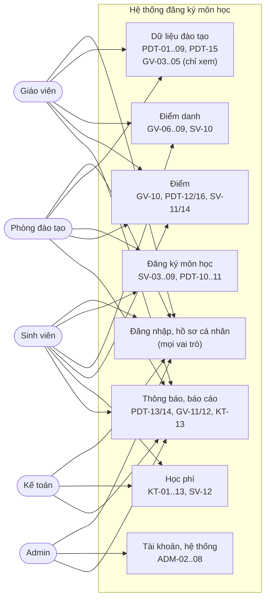

> Use case chi tiết từng vai trò: mục 7.1..7.5 (63 CN). Sơ đồ trên gom theo nhóm để đọc
> được; không vẽ 63 ô riêng.

### 17.2. Activity — SV đăng ký thủ công (Luồng 1, mục 11.1, BR-01..07)

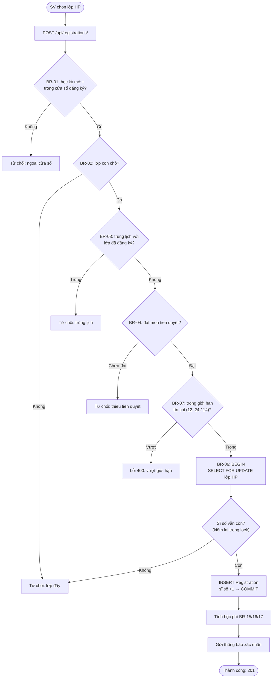

### 17.3. Activity — điểm danh & nhập điểm (Luồng 5, mục 11.5, BR-19/20/24 + BR-10..14)

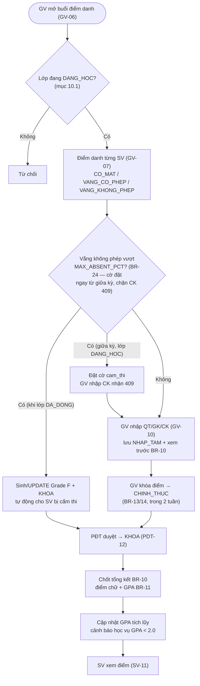

### 17.4. Sequence — chống overbook khi đăng ký đồng thời (BR-06)

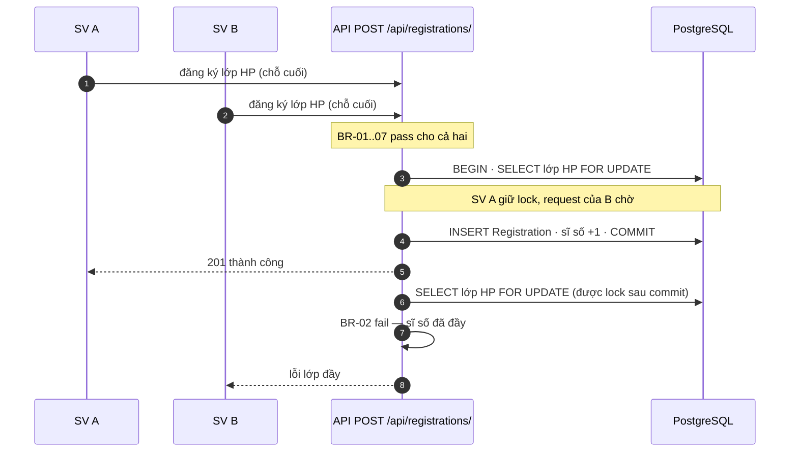

### 17.5. State — vòng đời các đối tượng (mục 10)

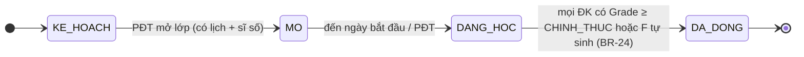

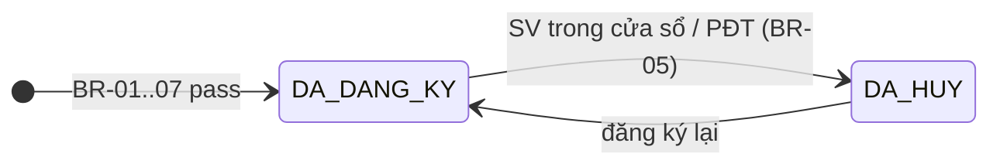

Cờ `cam_thi` là **thuộc tính** của `Registration`, không phải trạng thái — nó bật/tắt song song với `trang_thai`:

```mermaid
stateDiagram-v2
    direction LR
    [*] --> KHONG_CAM_THI
    KHONG_CAM_THI --> CAM_THI: vắng > MAX_ABSENT_PCT (job hằng ngày trên lớp DANG_HOC, BR-24)
    CAM_THI --> KHONG_CAM_THI: PĐT xóa cờ + lý do (ghi audit log) — chỉ khi lớp DANG_HOC; DA_DONG → 409
```

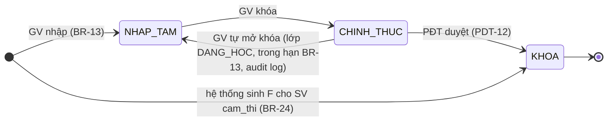

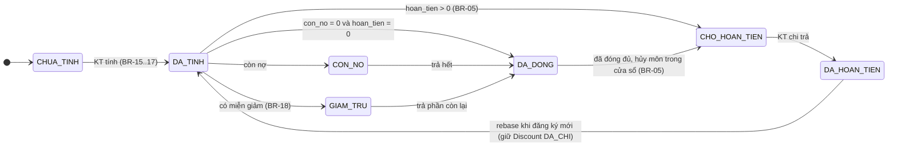

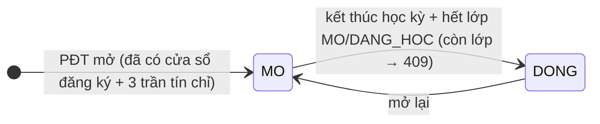

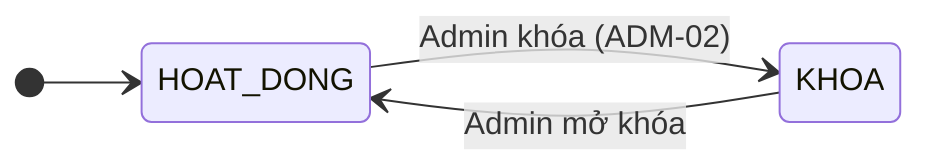

### 17.6. ERD — quan hệ 28 thực thể (mục 9)

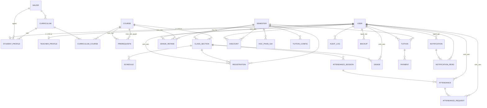

> Thuộc tính từng thực thể xem bảng mục 9. `SystemConfig` và `RolePermission` không có FK
> (độc lập). `HocPhanGia.tham_chieu` là **chuỗi**, trỏ tới `ma_nganh` (khi `pham_vi = NGANH`)
> hoặc tên khối kiến thức (khi `pham_vi ∈ {KHOI_KIEN_THUC, LECH_LT, LECH_TH, GIA_TH}`) —
> **không phải FK cứng**; `NULL` khi `pham_vi = MAC_DINH`.

---

# PHẦN III — TRIỂN KHAI

## 18. PHASES TRIỂN KHAI

### Pha 0 — Nền tảng (1 tuần)
- [ ] **Chuẩn bị repo:** commit hiện trạng (Flutter skeleton + tài liệu, hiện đang untracked); xóa `linux/`, `macos/`, `windows/` khỏi `dang_ky_mon_hoc/`; `.gitignore` bổ sung `.idea/`, `*.iml`, `.dart_tool/`
- [ ] Repo + CI (2 job theo path: `backend/**` → ruff+mypy+pytest; `dang_ky_mon_hoc/**` → analyze+test)
- [ ] Docker Compose (tại `backend/docker-compose.yml`): Django + PostgreSQL + Redis + Celery
- [ ] Django project skeleton theo cây mục 2, settings, env config (mục 23)
- [ ] Flutter: bổ sung cấu trúc `lib/` theo mục 15.2 (core/, features/, shared/) vào project `dang_ky_mon_hoc/` đã có; GoRouter, Riverpod, Dio
- [ ] Route map theo vai trò: Admin/PĐT/KT chỉ Web; SV/GV Web + App (mục 15.3)
- [ ] Swagger docs chạy (`/api/docs/`)
- [ ] `core/exceptions.py` — envelope lỗi + mã lỗi nghiệp vụ (mục 13.8)
- [ ] `django-filter` + phân trang + `Idempotency-Key` middleware (mục 13.7)
- [ ] `django-celery-beat` + 5 job rỗng (mục 11.8)
- [ ] Seed data: admin user, hệ thống cấu hình mặc định (SystemConfig)
- [ ] Seed CTĐT demo: 2 ngành × 8 môn + 2 học kỳ + 6 lớp HP đã có lịch (mục 24)

### Pha 1 — Auth & hồ sơ (1 tuần)
- [ ] `User` model, 5 role, `is_locked`
- [ ] JWT login/refresh (SimpleJWT), `LockedAwareJWTAuthentication`, `token_blacklist`
- [ ] Logout (blacklist refresh token) — UC-01/SV-01/GV-01/ADM-01
- [ ] Forgot/reset password (rate limit 3/15p/email) — **dev**: trả token trực tiếp trong response; **prod**: gửi email
- [ ] `StudentProfile`, `TeacherProfile` + API CRUD
- [ ] Flutter: login, forgot/reset, đổi mật khẩu, xem hồ sơ
- [ ] **Milestone:** đăng nhập được cả 5 role, token bị khóa khi Admin khóa tài khoản
- [ ] Password policy: tối thiểu 8 ký tự, có chữ + số (check tại đặt/reset/đổi mật khẩu, lỗi `400` field-level)

### Pha 2 — Dữ liệu đào tạo (1.5 tuần)
- [ ] `Major`, `Curriculum`, `CurriculumCourse`, `Course`, `Prerequisite`
- [ ] `Semester` + cửa sổ đăng ký (BR-01)
- [ ] `ClassSection`, `Schedule` (BR-08/09, ràng buộc tiết/phòng)
- [ ] API mở/đóng lớp + gia hạn nhập điểm (`class-sections/{id}/open|close|grade-deadline/`)
- [ ] Flutter: màn hình PĐT quản lý ngành/CTĐT/môn/HK/lớp/lịch
- [ ] **Milestone:** PĐT tạo đủ dữ liệu cho 1 học kỳ

### Pha 3 — Đăng ký (2 tuần) ⭐ critical — **2 BE pair (BE-1 + BE-2)**
- [ ] `Registration` + API đăng ký/hủy (BR-01..07)
- [ ] Transaction lock chống overbook (BR-06) + `Idempotency-Key` (mục 13.7)
- [ ] Kiểm tra tiên quyết, trùng lịch, giới hạn tín chỉ (BR-04/03/07) + trả `warnings`
      *(phụ thuộc: BR-04 đọc `Grade` (Pha 5) và `GradeRetake` (Pha 6b) — model + migration đã có từ Pha 0, nên Pha 3 chỉ **đọc** bảng; test dựng dữ liệu bằng factory-boy, chưa cần API nhập điểm/đơn học lại.)*
- [ ] Tính học phí tự động khi đăng ký (BR-15/16/17) — **ngoài transaction BR-06, không chặn đăng ký** (xem 11.1)
      *(phụ thuộc: dùng `apps/tuition/pricing.py` + model `Tuition`/`HocPhanGia` đã có từ Pha 0; Pha 3 chỉ gọi hàm tính; API cấu hình giá/thu tiền làm ở Pha 6. Chưa có bảng giá → `warnings`, không lỗi.)*
- [ ] Flutter: SV xem môn, đăng ký, hủy, xem lịch sử
- [ ] **Milestone:** SV đăng ký được, không overbook khi 2 SV cùng bấm

### Pha 4 — Điểm danh (1 tuần)
- [ ] `AttendanceSession`, `Attendance`, `AttendanceRequest`
- [ ] API tạo buổi, điểm danh, sửa, xin sửa (BR-19/20)
- [ ] Flutter: GV điểm danh theo buổi; SV xem + xin sửa
- [ ] **Milestone:** GV điểm danh được, SV xin sửa được

### Pha 5 — Điểm (1.5 tuần)
- [ ] `Grade` + API nhập/sửa/khóa/duyệt (BR-10..14)
- [ ] Công thức tổng kết + fallback + điểm chữ/GPA + band liên tục, `DAT_KHONG_DAT`→P (BR-10/11)
- [ ] BR-25: GPA học kỳ/tích lũy, loại P khỏi tử số & mẫu số, F vào mẫu số, học lại lấy mới nhất
- [ ] Duyệt theo lớp: `POST /api/grade-sheets/{lop_hoc_phan}/approve/`
- [ ] Cờ `CAM_THI` khi vắng quá ngưỡng (job hằng ngày trên lớp `DANG_HOC` + khi đóng lớp) + sinh/UPDATE `Grade` F/KHOA (BR-24)
- [ ] `ClassSection.ngay_ket_thuc` / `han_nhap_diem` + chặn quá hạn BR-13
- [ ] Flutter: GV nhập điểm, xem trước tổng kết; SV xem điểm
- [ ] **Milestone:** nhập điểm → khóa → PĐT duyệt → SV xem được

### Pha 6 — Học phí (1.5 tuần)
- [ ] `HocPhanGia`, `TuitionConfig`, `Discount`, `Payment`, `Tuition`
- [ ] API cấu hình giá, tính học phí, thu, công nợ, điều chỉnh (BR-15..18)
- [ ] Tra bảng giá 2 trục + `LECH_LT`/`LECH_TH`/`GIA_TH` (BR-16/17)
- [ ] `hoan_tien` tách khỏi `mien_giam` + trạng thái `CHO_HOAN_TIEN`/`DA_HOAN_TIEN` (BR-05)
- [ ] Flutter: KT cấu hình + thu; SV xem học phí
- [ ] **Milestone:** tính học phí đúng, thu được, công nợ chính xác

### Pha 6b — Học lại / cải thiện điểm (0.5 tuần) — luồng thủ công, xem mục 25
- [ ] `GradeRetake` + API `GET/POST /api/grade-retakes/` (SV), `PATCH /api/grade-retakes/{id}/` (PĐT)
- [ ] Flutter: form nộp đơn + màn hình PĐT xử lý
- [ ] **Milestone:** đơn cải thiện điểm chạy được, `Grade` cũ **không** bị sửa (BR-25c)

### Pha 7 — Thông báo & audit (1 tuần)
- [ ] `Notification`, `NotificationRead` + API gửi/đọc
- [ ] Trigger tự động (đăng ký, lớp đổi, mở cửa sổ, điểm khóa, quá hạn, cảnh báo)
- [ ] `AuditLog` + API xem log theo scope (Admin/PĐT/KT)
- [ ] Flutter: màn hình thông báo cả 5 role
- [ ] **Milestone:** thông báo gửi đúng đích, log đầy đủ

### Pha 8 — TKB tự động (1 tuần)
- [ ] `AutoScheduleService` (pure Dart, greedy MVP — xem mục 11.2)
- [ ] `GET /api/auto-schedule/available-courses/` (duy nhất — thuật toán chạy client-side)
- [ ] Flutter: SV chọn môn + ưu tiên → xem gợi ý → xác nhận
- [ ] **Milestone:** gợi ý được tối đa 3 tổ hợp hợp lệ

### Pha 9 — Báo cáo & xuất (1 tuần)
- [ ] Thư viện xuất: `openpyxl` (Excel) + `reportlab` (PDF) — backend sinh file, Flutter chỉ tải
- [ ] `core/export.py`: registry `(dataset, format) → file`, dùng chung cho mọi endpoint export
- [ ] API báo cáo đào tạo, tài chính + xuất Excel/PDF
- [ ] Flutter: PĐT/KT xem báo cáo, xuất file
- [ ] **Milestone:** báo cáo chạy đúng, xuất được file

### Pha 10 — Hoàn thiện & release (1 tuần)
- [ ] Audit log đầy đủ (mixin `AuditLogMixin` áp cho mọi ViewSet ghi), backup/restore (ADM-08) — gồm **thêm model `Backup`** (mục 9; Pha 0 chưa có)
- [ ] Rate limit, phân trang, xử lý lỗi thống nhất (mục 13.7/13.8)
- [ ] Luồng học lại / cải thiện điểm (mục 25) — **bắt buộc** nếu chưa làm ở Pha 6b, vì đây là nghiệp vụ thật của trường dù không tự động hoá
- [ ] Responsive Web + App (xem mục 15.4) — App chỉ cho SV/GV; Admin/PĐT/KT Web-only
- [ ] E2E test chính, load test đăng ký
- [ ] **Milestone:** production-ready

**Tổng: ~14 tuần** (có thể song song Pha 4/5/6 nếu đủ người).

---

## 19. TESTING

| Cấp | Công cụ | Phạm vi |
| :--- | :--- | :--- |
| Unit | pytest (backend), test (Flutter) | service, model, utils |
| Integration | pytest + APIClient | API endpoint, auth, permission |
| E2E | Flutter integration test | luồng chính: đăng ký → điểm → học phí |
| Load | locust | đăng ký đồng thời (BR-06) |

**Test bắt buộc:**
- 2 SV cùng bấm chỗ cuối → chỉ 1 SV thành công (BR-06) — test chạy **PostgreSQL thật, không mock DB**
- Replay `Idempotency-Key`: POST 2 lần cùng key (kể cả sau khi Redis hết hạn) → cùng response, không tạo 2 `Registration`; tương tự `POST /api/tuition/payments/` không thu 2 lần tiền
- SV vắng quá 20% → `CAM_THI = true` giữa kỳ (lớp `DANG_HOC`) → GV nhập CK nhận `409` (BR-24)
- Lớp đóng được khi SV bị cấm thi (2 SV đăng ký, 1 bị `CAM_THI` → lớp vẫn `DA_DONG`); SV `CAM_THI` đã có `Grade` từ trước → job **UPDATE** thành F/KHOA (không duplicate); lớp **không** đóng được khi còn ĐK chưa có `Grade` hoặc `Grade` còn `NHAP_TAM`; học phí chưa thu **không** chặn đóng lớp
- Đăng ký vào lớp `KE_HOACH` / `DA_DONG` → `LOP_CHUA_MO` (BR-01)
- SV đăng ký lại môn **đã đạt** (`Grade` `KHOA`, `diem_chu ≠ F`; điểm 4.0–4.99 = **D** vẫn là đạt) với `loai_dang_ky = BINH_THUONG` → `DA_DAT_MON` (BR-04); có đơn `GradeRetake` `DUYET` → đăng ký được
- Điểm thiếu GK → fallback 20/80 (BR-10)
- `diem_cuoi_ky = NULL` (chưa nhập) → fallback thiếu CK theo BR-10; `diem_cuoi_ky = 0` (GV nhập 0 = không thi) → tính công thức thường, không fallback
- Điểm **8.45 / 6.95 / 5.45** (sát dưới ngưỡng) ra đúng **B/C/D**; biên **8.50 / 7.00 / 5.50 / 4.00** ra đúng **A/B/C/D** (BR-11 band liên tục — không có khoảng trống)
- Môn `DAT_KHONG_DAT` điểm 6.0 → `P`, `gpa_thang_4 = null`, không vào tử số **lẫn** mẫu số GPA (BR-11, BR-25)
- Môn `F` vẫn nằm trong mẫu số GPA (BR-25)
- Học lại cùng môn → chỉ tính `Grade` `KHOA` lần **cuối cùng** (BR-25c)
- Học cải thiện điểm mới **thấp hơn** điểm cũ → GPA dùng điểm mới, không phải điểm cao nhất (BR-25c)
- Học phí đúng thứ tự ưu tiên giá: học kỳ → `NULL`; khối → ngành → mặc định (BR-16), đơn giá LT/TH (BR-17)
- Hủy hết môn đã thu tiền → `con_no = 0`, `hoan_tien > 0`, `trang_thai = CHO_HOAN_TIEN` (không âm, không `CON_NO`) — BR-05
- Không tìm được bảng giá → `POST /api/tuition/calculate/` trả `400` `CHUA_CAU_HINH_GIA` (BR-16); còn `POST /api/registrations/` vẫn `201` + `warnings` `CHUA_CAU_HINH_GIA`, `Tuition` = `CHUA_TINH`, đăng ký **không** rollback (11.1)
- Điểm tổng kết 4.0–4.99 (**D**) → môn **đạt**: thỏa tiên quyết (BR-04), cộng vào `tin_chi_tich_luy` (BR-25d), đăng ký lại bằng `BINH_THUONG` bị `DA_DAT_MON`; điểm < 4.0 (**F**) → chưa đạt
- Token bị khóa → mọi request bị chặn; refresh token của tài khoản đã khóa cũng bị chặn (BR-22)
- Logout → refresh token cũ không dùng lại được (blacklist)
- Đổi / reset mật khẩu → refresh token cũ của user đó đều bị blacklist (không dùng lại được)
- Token reset hết hạn 30 phút / chỉ dùng 1 lần (BR-22)
- Vượt trần tín chỉ → `VUOT_TIN_TC_TOI_DA`; thiếu tín chỉ tối thiểu → `201` + `warnings` (BR-07); SV diện cảnh báo vượt `tin_chi_toi_da_canh_bao` → `VUOT_TIN_TC_CANH_BAO`
- Quá `han_nhap_diem` → GV nhận `QUA_HAN_NHAP_DIEM`, PĐT gia hạn xong nhập được (BR-13)
- Tạo tiên quyết thành chu trình (A→B→A) → `400`; `mon_hoc = mon_tien_quyet` → `400` (mục 9 — Prerequisite)
- Lịch bù `ngay_hoc` cụ thể trùng tiết với lịch định kỳ cùng ngày → `TRUNG_LICH` (BR-03)
- Đóng học kỳ khi còn lớp `MO`/`DANG_HOC` → `409` `TRANG_THAI_KHONG_HOP_LE` (mục 10)
- SV đã `DA_DONG` học phí, hủy hết môn trong cửa sổ → `CHO_HOAN_TIEN` (transition `DA_DONG → CHO_HOAN_TIEN`, BR-05)
- GV tự mở khóa điểm `CHINH_THUC → NHAP_TAM` được trong hạn BR-13 (lớp `DANG_HOC`); sau khi lớp `DA_DONG` GV không sửa được nữa (mục 10.1)
- Re-activate Registration sau hủy giữ nguyên `request_id` cũ → replay key cũ vẫn trả response gốc; key bị ghi đè bởi re-activate mới → replay trả `409` `IDEMPOTENCY_KEY_REUSED`, không re-execute (mục 10)
- Rebase sau khi KT chi hoàn tiền (`Discount` `HOAN_TIEN` `DA_CHI`): SV đăng ký môn mới → `hoan_tien` **không tính lại** discount đã `DA_CHI` → không về `CHO_HOAN_TIEN` lần 2 (thực thể Tuition)
- Lớp đã `DA_DONG`: `PATCH /api/registrations/{id}/` xóa cờ `cam_thi` → `409` (BR-24 — `Grade` F đã `KHOA` bất biến)
- HocPhanGia: 2 bản ghi `MAC_DINH` cùng `hoc_ky` → violate UNIQUE (COALESCE/partial index) — mục 9
- Tuition `mien_giam > 0` và `con_no > 0` → `CON_NO` (ưu tiên `CHO_HOAN_TIEN > CON_NO > GIAM_TRU > DA_DONG`)

---

## 20. DEPLOYMENT

```
docker-compose up -d
├── web (Django + Gunicorn)  → :8000
├── db (PostgreSQL 16)        → :5432
├── redis                     → :6379
├── celery (worker + beat)
└── nginx (reverse proxy)     → :80/:443
```

**Checklist trước khi lên production:**
- [ ] `DEBUG=False`, secret từ env
- [ ] HTTPS (nginx + certbot)
- [ ] **`pg_dump` trước mỗi lần migrate prod** (rollback khi migration lỗi)
- [ ] Backup DB tự động (daily)
- [ ] Log tập trung (gunicorn + celery)
- [ ] Health check (`/api/health/`) + monitoring

---

## 21. RỦI RO & GIẢI PHÁP

| Rủi ro | Giải pháp |
| :--- | :--- |
| Overbook khi nhiều SV cùng đăng ký | `select_for_update` trên `ClassSection` + UNIQUE (BR-06) |
| Double-click / retry tạo đăng ký trùng | `Idempotency-Key` + `Registration.request_id` / `Payment.request_id` UNIQUE bền (mục 13.7) |
| Token bị khóa tài khoản | `LockedAwareJWTAuthentication` kiểm tra `is_locked` mỗi request, kể cả khi refresh |
| Điểm/học phí tính sai | Công thức chỉ nêu 1 chỗ (BR-10/11/15/25), test đầy đủ — xem mục 19 |
| Lớp kẹt không đóng được vì SV bị cấm thi | Job `scan_cam_thi` sinh/UPDATE `Grade` F/KHOA; điều kiện đóng lớp = `Grade` ≥ `CHINH_THUC` (mục 10) |
| GV quá hạn nhập điểm (BR-13) | `ClassSection.han_nhap_diem` chặn GV; PĐT gia hạn/nhập hộ có audit log |
| Thông báo gửi sai người | Phân giải `audience × target_refs` tại backend, test từng loại |
| TKB tự động chậm | Greedy MVP trước, backtracking sau (mục 11.2) |
| Responsive Web xấu | `LayoutBuilder` + breakpoint 600/1024 (mục 15.4) |
| Celery job hỏng âm thầm → dữ liệu lệch | Mỗi job idempotent + chạy lại được; `/api/health/` báo trạng thái worker; log job vào `AuditLog` (mục 11.8) |

---

## 22. DEFINITION OF DONE

Một phase khi:
1. Test pass (unit + integration) ≥ 80% coverage phần đó.
2. API chạy đúng trên Swagger, phân quyền đúng role, trả **đúng mã lỗi** mục 13.8 (không tự chế lỗi mới).
3. Flutter build được cả Web + App (App chỉ cho SV/GV), không lỗi console.
4. Review code + merge PR (kèm `🤖 Generated with [Claude Code](https://claude.com/claude-code)`).
5. Mọi thay đổi nghiệp vụ cập nhật **ngay trong file này** — `plan.md` là nguồn duy nhất (header mục 1). `chuc_nang.md` là bản lưu v2.0, **không sửa tiếp**.

---

## 23. BIẾN MÔI TRƯỜNG

`.env` (không commit), `docker-compose.yml` đọc từ đây. `.env.example` commit kèm giá trị mẫu.

| Biến | Mặc định | Ghi chú |
| :--- | :--- | :--- |
| `DJANGO_SETTINGS_MODULE` | `config.settings.dev` | `prod` khi deploy |
| `SECRET_KEY` | — | **bắt buộc**, sinh bằng `get_random_secret_key()` |
| `DEBUG` | `False` | `True` chỉ ở dev |
| `ALLOWED_HOSTS` | `localhost,127.0.0.1` | CSV |
| `CORS_ALLOWED_ORIGINS` | `http://localhost:*` | Flutter Web dev |
| `DB_NAME` / `DB_USER` / `DB_PASSWORD` / `DB_HOST` / `DB_PORT` | `hpsv` / `postgres` / — / `db` / `5432` | |
| `REDIS_URL` | `redis://redis:6379/0` | cache + rate limit |
| `CELERY_BROKER_URL` | `redis://redis:6379/1` | |
| `CELERY_RESULT_BACKEND` | `redis://redis:6379/2` | |
| `JWT_ACCESS_LIFETIME_MIN` | `60` | |
| `JWT_REFRESH_LIFETIME_DAYS` | `7` | |
| `EMAIL_HOST` / `EMAIL_PORT` / `EMAIL_HOST_USER` / `EMAIL_HOST_PASSWORD` | — | prod gửi mail reset; dev log ra console |
| `PASSWORD_RESET_RETURN_TOKEN_IN_RESPONSE` | `True` (dev) | **phải `False` ở prod** |
| `BACKUP_DIR` | `/backups` | volume cho `pg_dump`, ADM-08 |
| `SENTRY_DSN` | — | tùy chọn |

---

## 24. SEED DATA TỐI THIỂU

Migration + management command `seed_demo` phải đủ để chạy hết luồng 1→6 ngay sau Pha 0, không phải nhập tay.

| Nhóm | Dữ liệu |
| :--- | :--- |
| Tài khoản | 1 Admin, 2 PĐT, 2 KT, 3 GV, 10 SV — mật khẩu `Demo@12345` (log ra console, không ghi vào repo) |
| Ngành / CTĐT | 2 ngành × 1 CTĐT × 8 môn (6 bắt buộc + 2 tự chọn), đủ 5 khối kiến thức, 2 cặp tiên quyết |
| Môn | 1 môn `loai_danh_gia = DAT_KHONG_DAT` (để test P/F) |
| Học kỳ | 2 học kỳ: 1 đã `DONG` (có điểm `KHOA` — test tiên quyết + GPA), 1 đang `MO` + cửa sổ đăng ký mở |
| Lớp HP | 6 lớp: 4 `MO` (1 lớp `si_so_toi_da = 2` để test BR-02/BR-06), 1 `DANG_HOC`, 1 `DA_DONG` (test BR-24/PDT-12) |
| Lịch học | Mỗi lớp 2–3 `Schedule`, có 1 cặp lịch trùng giờ để test BR-03 |
| Bảng giá | `MAC_DINH` + 2 bản `NGANH` + 1 bản `KHOI_KIEN_THUC` + `LECH_LT` + `GIA_TH` (test BR-16/17) |
| Cấu hình | `SystemConfig`: tín chỉ 12–24 + `tin_chi_toi_da_canh_bao = 14`, `MAX_ABSENT_PCT = 20`, `so_ngay_cho_phep_nhap_diem = 14` |
| Điểm danh | 1 lớp có 10 buổi `DA_DIEM_DANH`, trong đó 1 SV vắng 3/10 = 30% > 20% (test BR-24) |

---

## 25. LUỒNG 8 — HỌC LẠI / CẢI THIỆN ĐIỂM (thủ công)

Ngoài phạm vi tự động hoá nhưng **có** trong hệ thống: SV đã có `Grade` `KHOA` muốn học lại/cải thiện thì nộp đơn, PĐT xử lý tay.

```
SV nộp đơn (chọn môn + học kỳ muốn học lại + lý do) → POST /api/grade-retakes/
  → PĐT xem xét → PATCH trạng thái CHO_DUYET → DUYET / TU_CHOI
  → Nếu DUYET: SV đăng ký lớp HP mới, Registration.loai_dang_ky đặt theo loai đơn (BR-01..07).
    **BR-04 tạm miễn tiên quyết** cho môn đang học lại — nếu không miễn thì môn tiên quyết
    của chính nó (nếu môn này là tiên quyết của nó) sẽ chặn.
    **BR-04 (đã có điểm môn này):** đơn DUYET là điều kiện để đăng ký lại (không thể BINH_THUONG).
  → Học xong: Grade mới (KHOA) và Grade cũ **vẫn giữ nguyên**
  → **BR-25(c):** GPA chỉ lấy `Grade` `KHOA` của lần học **mới nhất** mỗi môn → không cộng dồn 2 lần
  → Nếu là `HOC_CAI_THIEN`: lần cuối cùng được tính, **kể cả khi điểm mới thấp hơn điểm cũ**
  → Học phí: môn học lại tính tiền như môn thường (BR-15)
```

- Thực thể `GradeRetake`: `sinh_vien`, `mon_hoc`, `hoc_ky`, `ly_do`, `trang_thai` ∈ {`CHO_DUYET`, `DUYET`, `TU_CHOI`}, `nguoi_duyet`, `ngay_duyet` — `UNIQUE(sinh_vien, mon_hoc, hoc_ky)`.
- `GradeRetake.loai` ∈ {`HOC_LAI`, `HOC_CAI_THIEN`} (xem thực thể mục 9) — quyết định `Registration.loai_dang_ky` khi SV đăng ký. **Cả hai loại đều tính điểm lần cuối cùng** (BR-25c); `loai` chỉ để thống kê và để PĐT biết SV đang học lại (do rớt) hay học cải thiện (đã đạt nhưng muốn điểm cao hơn).
- Endpoint: `GET/POST /api/grade-retakes/` (SV), `PATCH /api/grade-retakes/{id}/` (PĐT).
- **Không** sửa/xoá `Grade` cũ — lịch sử điểm là bất biến.

---

## 26. PHÂN CÔNG CÔNG VIỆC

| Vai trò | Phụ trách | Pha chính |
| :--- | :--- | :--- |
| **BE-1 (core)** | Auth, User/Profile, phân quyền, middleware, exception handler | 0, 1, 10 |
| **BE-2 (đào tạo + đăng ký)** | Training, Registration, transaction lock, tiên quyết, tín chỉ | 2, 3 |
| **BE-3 (học vụ)** | Attendance, Grade, BR-10/11/24/25, job celery | 4, 5 |
| **BE-4 (tài chính + báo cáo)** | Tuition, Discount, Payment, export, báo cáo | 6, 9 |
| **FE-1** | Auth, layout responsive, admin, thông báo | 1, 7, 10 |
| **FE-2** | PĐT + KT (CRUD nặng, bảng, form) | 2, 6, 9 |
| **FE-3** | SV + GV (đăng ký, TKB, điểm danh, điểm) | 3, 4, 5, 8 |
| **QA** | pytest, locust, Flutter integration test | xuyên suốt |

> 5 người (3 BE + 2 FE) → ~20 tuần; 7 người (4 BE + 3 FE) + QA → ~14 tuần. Bảng trên là **7 người**. Pha 3 (critical) gộp BE-1 + BE-2 pair review để không trượt nếu 1 người nghỉ. Ít người hơn thì cắt theo thứ tự: Pha 8 (TKB tự động) → Pha 6b (học lại) → Pha 9 (báo cáo) — **không cắt** Pha 3/5/6.

---

## 27. TOOLING & PHONG CÁCH CODE

| Việc | Công cụ | Cấu hình |
| :--- | :--- | :--- |
| Format Python | `black` | line-length 100 |
| Lint Python | `ruff` | `E,F,I,B,UP`; bỏ `E501` |
| Type check | `mypy` | chạy trên `apps/` + `core/`, không `--strict` |
| Format Dart | `dart format` | mặc định |
| Lint Dart | `flutter analyze` | `analysis_options.yaml` với `flutter_lints` |
| Pre-commit | `pre-commit` | chạy black + ruff + dart format trước khi commit |
| CI | GitHub Actions | job `backend` (ruff + mypy + pytest) và job `flutter` (analyze + test), chạy mọi PR |
| Import ordering | `isort` qua ruff `I` | |
| Naming backend | model/view **tiếng Việt không dấu** (`hoc_ky`, `si_so_toi_da`) theo mục 9; class `PascalCase`, field `snake_case` | |
| Naming Dart | `lowerCamelCase` field, class `PascalCase`; map API snake_case → Dart camelCase trong `fromJson` | |

---

## 28. NHẬT KÝ THAY ĐỔI (v2.0 → v2.1 → v2.2 → v2.3 → v2.4 → v2.4.1 → v2.5 → v2.5.1)

Bản 2.1 vá các lỗi nghiệp vụ phát hiện khi review 2.0. Bản 2.2 (2026-10-07) vá 3 blocker
kiến trúc + các gap từ review vòng 2. Bản 2.3 (2026-10-08) vá 4 mâu thuẫn + các gap logic
từ review vòng 3. Bản 2.4 (2026-10-08) vá 3 blocker + 7 mục quan trọng + 8 mục nhỏ từ
review vòng 4. Bản 2.4.1 (2026-10-08) vá các tham chiếu sai + sync sót từ review vòng 5
(cuối). Các mục đã sửa:

| Nhóm | Nội dung |
| :--- | :--- |
| Đăng ký | BR-01 thêm điều kiện lớp phải `MO`; BR-06 chốt `FOR UPDATE` là bắt buộc (UNIQUE không chống overbook); BR-07 chốt **PĐT set cả 3 trần tín chỉ theo học kỳ** (`tin_chi_toi_thieu`, `tin_chi_toi_da`, `tin_chi_toi_da_canh_bao`) với fallback `SystemConfig`, và GPA `NULL` không tính cảnh báo |
| Điểm | BR-11 viết lại thành band liên tục (hết lỗ hổng 8.45/6.95/5.45) + tách nhánh `DAT_KHONG_DAT`→P; BR-13 thêm mốc `ngay_ket_thuc` + cơ chế gia hạn PĐT; BR-25 nêu đủ công thức GPA (P loại khỏi cả tử số lẫn mẫu số, F vào mẫu số) và chốt **học lại / cải thiện đều lấy lần cuối cùng** |
| Điểm danh | BR-24 chốt mẫu số (số buổi `DA_DIEM_DANH`), chốt ngưỡng `>`, và giải quyết mâu thuẫn với vòng đời lớp bằng `Grade` F/KHOA tự sinh |
| Học phí | `HOAN_TIEN` tách khỏi `mien_giam`, thêm `hoan_tien` + trạng thái `CHO_HOAN_TIEN`/`DA_HOAN_TIEN`, `con_no` kẹp `max(0, …)`; BR-16/17 chốt thuật toán tra bảng + công thức `LECH_LT`/`LECH_TH`/`GIA_TH` |
| Thực thể | Thêm `request_id`, `loai_dang_ky`, `AttendanceRequest.trang_thai_mong_muon`, `Course.loai_danh_gia`, `Semester.tin_chi_*`, `ClassSection.ngay_ket_thuc`/`han_nhap_diem`, `Notification.trang_thai`, `SystemConfig.kieu`, `GradeRetake`; `HocPhanGia` thêm `LECH_TH`/`hieu_luc_tu`/UNIQUE; `Discount.trang_thai` |
| API | Thêm logout (blacklist), open/close lớp, gia hạn nhập điểm, `PATCH /registrations/{id}/`, thu hồi thông báo, duyệt điểm theo lớp (`/api/grade-sheets/{lop}/approve/`), đơn học lại (`/api/grade-retakes/`); bỏ POST/PATCH tạo vai trò; thống nhất `timetable/my/`; mặc định `?hoc_ky=`; filter/search/ordering; rate limit bổ sung |
| Bổ sung | Mục 11.8 lịch celery · 13.8 định dạng lỗi + mã lỗi · 23 biến môi trường · 24 seed data · 25 luồng học lại · 26 phân công · 27 tooling · `Idempotency-Key` |
| Vệ sinh | Header BR-01..25; `SV-05/06`, luồng đăng ký, ERD, sơ đồ state đổi `BR-01..06` → `BR-01..07`; sơ đồ `cam_thi` tách khỏi `trang_thai`; sơ đồ state lớp HP/học phí sửa theo bảng mục 10; ERD thêm `MAJOR→STUDENT_PROFILE`; `Schedule.buoi`/`tiet_ket_thuc` ghi rõ là dẫn xuất; tổng thời lượng 14 tuần; DoD#5 chốt `plan.md` là nguồn duy nhất |

> **File `chuc_nang.md` giữ nguyên ở bản 2.0 làm bản lưu.** Mọi thay đổi từ nay chỉ ghi vào file này.

### v2.1 → v2.2 (2026-10-07)

| Nhóm | Nội dung |
| :--- | :--- |
| Blocker | **Sửa deadlock đóng lớp ↔ duyệt điểm:** điều kiện đóng lớp đổi thành "mọi ĐK có `Grade` ≥ `CHINH_THUC` (hoặc F tự sinh BR-24)" — điểm `KHOA` là bước **sau** đóng lớp (PDT-12); sửa đồng bộ 4 chỗ (mục 10, 10.1, job 11.8, endpoint 13.3, sơ đồ 17.5) + test §19 |
| Blocker | **BR-24 đặt cờ sớm:** `scan_cam_thi` chạy hằng ngày trên lớp `DANG_HOC` (chặn 409 có tác dụng thật từ giữa kỳ), không chỉ khi đóng lớp; lúc đóng lớp sinh **mới hoặc UPDATE** `Grade` sẵn có thành F/KHOA (tôn trọng UNIQUE), chốt `diem_tong_ket = 0` |
| Blocker | **BR-04 chặn đăng ký lại không đơn:** đã có `Grade` `KHOA` cho chính môn → bắt buộc `GradeRetake` `DUYET`; thêm mã lỗi `DA_DAT_MON` |
| Học phí | **Idempotency Payment:** `Payment.request_id` UNIQUE bền (chống thu 2 lần tiền); 13.7 chốt 1 cơ chế duy nhất, DB UNIQUE là backstop, Redis chỉ fast-path; key hết hạn Redis → tra DB trả response gốc |
| Học phí | **Thời điểm tính 2 tầng:** đột biến khi đăng ký/hủy trong cửa sổ + tính gộp rebase khi KT bấm/đóng cửa sổ (kết quả bấm là chuẩn); `tuition_overdue_notify` chỉ xét `DA_TINH`, job 00:05 nhắc KT học kỳ `DONG` còn `CHUA_TINH`; rebase giữ `Discount` đã `DA_CHI` (thêm transition `DA_HOAN_TIEN → DA_TINH` vào bảng mục 10 khớp sơ đồ 17.5) |
| Thực thể | Thêm `ClassSection.ngay_bat_dau` (nullable, fallback theo học kỳ) — job 11.8 cần; `UNIQUE(lop_hoc_phan, ngay_hoc, buoi)` cho `AttendanceSession` (2 buổi cùng ngày); `Notification.target_refs` định nghĩa kiểu JSON theo `audience`; `AuditLog.doi_tuong_id` chốt UUID polymorphic **không FK** |
| Nghiệp vụ | BR-10 phân biệt `diem_cuoi_ky NULL` (chưa nhập → fallback) vs `0` (GV nhập 0 → công thức thường); BR-11 bỏ trích "Thông tư 08/2021" (band đơn giản, tránh copy nhầm thang TT); BR-17 chốt `LECH_LT`/`GIA_TH` khớp theo **khối đã resolve**, bỏ trục ngành; auto-schedule chốt **client-side pure Dart**, bỏ endpoint `/suggest/` |
| API | Login rate limit thêm 10/min/account (NAT); token reset TTL 30 phút/1 lần; đổi/reset mật khẩu blacklist refresh token cũ; bỏ `/api/auth/register/` (tài khoản trường cấp) |
| Pha 0 | Seed theo mục 24: 2 học kỳ + 6 lớp (khớp 24) |
| Route | Thêm `/admin/config` (ADM-05) + `/pdt/grade-sheets` (PDT-12 duyệt điểm) |
| Test | Bổ sung: overbook chạy **PostgreSQL thật không mock**; replay Idempotency-Key (kể cả hết hạn Redis) + Payment không thu 2 lần; `DA_DAT_MON`; NULL vs 0 CK; đổi mật khẩu blacklist; `CAM_THI` giữa kỳ chặn 409; job UPDATE Grade không duplicate |
| Triển khai | `pg_dump` trước mỗi migrate prod (rollback); `backup_daily` ghi rõ backup gì/lưu đâu/giữ bao lâu; Pha 3 pair BE-1+BE-2 |

### v2.2 → v2.3 → v2.4 (2026-10-08)

Hai vòng review trong cùng ngày gộp chung mục này; chi tiết từng fix ở các dòng có nhãn
"(vòng 4)" trong bảng dưới và ở các mục tương ứng trong file.

| Nhóm | Nội dung |
| :--- | :--- |
| Blocker | **Transition học phí `DA_DONG → CHO_HOAN_TIEN`:** SV đã đóng đủ rồi hủy hết môn trong cửa sổ → phát sinh hoàn tiền — state machine cũ không có đường đi (test §19 có kịch bản nhưng bảng mục 10 + sơ đồ 17.5 thiếu); sửa đồng bộ 3 chỗ |
| Blocker | **GV nhập/sửa điểm khi lớp `DA_DONG` là đường chết:** điều kiện đóng lớp = mọi `Grade ≥ CHINH_THUC` → không còn `NHAP_TAM` để sửa; bỏ dòng `DA_DONG` khỏi 10.1 (GV-10/BR-14 chỉ `DANG_HOC`), thêm transition `CHINH_THUC → NHAP_TAM` (GV tự mở khóa, trong hạn BR-13, audit log); chốt `KHOA` bất biến |
| Blocker | **SV ↔ CTĐT thiếu đường resolve:** thêm `StudentProfile.ctdt` (FK tường minh, gán lúc tạo hồ sơ) + unique một phần `(nganh, khoa_tuyen_sinh) WHERE trang_thai = HOAT_DONG` cho Curriculum; fallback suy từ `(nganh, khoa_nhap_hoc)`; ERD thêm `CURRICULUM → STUDENT_PROFILE` |
| Gap | **Idempotency re-activate:** đăng ký lại sau hủy giữ nguyên `request_id` cũ — key cũ replay được, key mới ghi đè (mục 10) |
| Gap | **BR-03 định nghĩa "trùng":** lịch định kỳ theo `thu × giao tiết`; lịch bù (`ngay_hoc`) so ngày thật với mọi lịch trùng ngày; Schedule dùng khoảng tiết — 2 lịch cùng buổi không giao tiết vẫn hợp lệ |
| Gap | **`AttendanceSession` UNIQUE chốt ý nghĩa:** 1 buổi điểm danh/(lớp, ngày, buổi) — lịch rời tiết cùng buổi gộp 1 buổi điểm danh |
| Gap | **`HocPhanGia.hieu_luc_tu` loại khỏi thuật toán** (BR-16 không xét, để dùng tương lai); BR-17 chốt "khớp khối" = `CurriculumCourse.khoi_kien_thuc` của môn trong CTĐT của SV, không phụ thuộc trục resolve |
| Gap | **BR-24 cam_thi chỉ set không unset:** duyệt AttendanceRequest làm tỷ lệ tụt → notification cho PĐT xóa tay (không tự hạ); GV sửa điểm danh chỉ trong 24h / session chưa `DA_DONG` lớp |
| Gap | **Prerequisite chống chu trình** (DFS + `mon_hoc ≠ mon_tien_quyet`, test §19); **Password policy** 8 ký tự + chữ + số (Pha 1); **Course.trang_thai = NGUNG_SU_DUNG** chặn mở lớp mới; **đóng học kỳ** cần hết lớp `MO`/`DANG_HOC` (`409`) |
| API | Phân biệt `/api/courses/available/` (lọc trùng lịch) vs `/api/auto-schedule/available-courses/` (toàn bộ lớp mở, không lọc trùng) |
| BR-10 | Chốt `diem_cuoi_ky` giữ `NULL` trong DB kể cả khi `KHOA` (fallback chỉ áp lúc tính) — phân biệt với "GV nhập 0" |
| Route | Thêm `/admin/notifications` (ADM-07) vào 15.3 |
| Sơ đồ | 17.3 thêm nhánh "Có (giữa kỳ)" — cờ chặn 409 không chỉ khi đóng lớp; 17.5 Grade thêm `CHINH_THUC → NHAP_TAM` + `[*] → KHOA` (BR-24) |
| Test | Bổ sung §19: tiên quyết chu trình, lịch bù trùng, đóng học kỳ còn lớp, `DA_DONG → CHO_HOAN_TIEN`, GV mở khóa điểm, re-activate idempotency; **vòng 4 (2026-10-08, cùng ngày):** test BR-11 sát ngưỡng B/C/D + biên A/B/C/D, replay key bị ghi đè `409`, rebase không hoàn tiền 2 lần, UNIQUE HocPhanGia với NULL, ưu tiên trạng thái Tuition, xóa cờ cam_thi lớp DA_DONG |
| Blocker (vòng 4) | **Test BR-11 sai band:** 8.45/6.95/5.45 phải ra **B/C/D** (sát dưới ngưỡng) — test cũ ghi A/B/C; thêm cả biên 8.50/7.00/5.50/4.00 → A/B/C/D. **HocPhanGia UNIQUE với `tham_chieu = NULL`:** PostgreSQL `NULL ≠ NULL` → dùng functional/partial unique index. **Rebase tính `HOAN_TIEN` đã `DA_CHI`:** `mien_giam`/`hoan_tien` chỉ tính `Discount` `AP_DUNG` — `DA_CHI` là lịch sử (chống hoàn tiền 2 lần) |
| Quan trọng (vòng 4) | Replay key bị ghi đè → `409` `IDEMPOTENCY_KEY_REUSED` (thêm mã 13.8); BR-17 adjustment records tra **cùng 2 trục `hoc_ky`** như BR-16; Tuition thêm **thứ tự ưu tiên trạng thái** `CHO_HOAN_TIEN > CON_NO > GIAM_TRU > DA_DONG`; BR-24 **skip khi mẫu số = 0** + PĐT xóa cờ chỉ khi lớp `DANG_HOC` (lớp `DA_DONG` → `409`) + notification PĐT **1 lần** (cờ `notified_cam_thi_review` trên Registration); ADM-05/SystemConfig bổ sung `tin_chi_toi_da_canh_bao`; AuditLog thêm **bảng mapping scope** đầy đủ |
| Nhỏ (vòng 4) | Thêm route `/student/profile` + `/teacher/profile` (SV-02, GV-02); API: `PATCH /api/profiles/me/` (sửa email/sdt), `GET /api/attendance/requests/`, `GET /api/admin/backups/` (lịch sử), `POST /api/notifications/read-all/` (bulk); BR-04 chốt điểm đạt **không phân biệt CTĐT**; BR-25 tie-break `id` khi cùng `ngay_nhap`; ghi chú "PWA-ready" đổi thành offline cache-API minimal (mục 4, 15, 16); 10.1 hướng xử lý rebase khi SV đã đóng tiền; sửa typo "算" (mục 9 AttendanceSession), "cỏ" (job scan_cam_thi) |

### v2.4 → v2.4.1 (2026-10-08 — review vòng 5, cuối)

| Nhóm | Nội dung |
| :--- | :--- |
| Tham chiếu | Mục 11.2: endpoint cho auto-schedule đổi `GET /api/courses/available/` (đã lọc trùng lịch) → **`GET /api/auto-schedule/available-courses/`** (không lọc — client cần lớp trùng để tạo tổ hợp); `Course.trang_thai` "mục 6.4" → **mục 13.4**; Pha 8 + mục 21 bỏ ref "sơ đồ 17.2" sai (17.2 là sơ đồ đăng ký thủ công) |
| API | `PATCH /api/grades/{id}/lock/` nhận body `{action: "lock" \| "unlock"}` — có cơ chế **mở khóa** `CHINH_THUC → NHAP_TAM` khớp state machine mục 10/17.5/test §19; `KHOA` không unlock được |
| BR-14 | Bổ sung mệnh đề mở khóa GV (điều kiện + audit log) — khớp transition đã có từ v2.3 |
| 13.7 | Giới hạn phạm vi `Idempotency-Key` về **2 endpoint có replay semantics** (`registrations`, `tuition/payments` — 2 thực thể có `request_id`); các POST khác không nhận key (muốn thêm thì thêm trường + UNIQUE) |
| Sơ đồ | 17.5 state Học kỳ: nhãn `MO → DONG` ghi đủ điều kiện đóng mới (hết lớp `MO`/`DANG_HOC`, còn lớp → `409`); nhãn mở thêm "3 trần tín chỉ" |
| Chỉnh tay (đã có sẵn trong 2.4.1) | GV-08 diễn đạt lại mốc 24h ("tính từ thời điểm session được chốt"); nhãn 17.5 cam_thi ghi rõ "chỉ khi lớp DANG_HOC; DA_DONG → 409" — 2 chỗ này khớp BR-24, giữ nguyên |

### v2.4.1 → v2.5 (2026-10-08 — tách nền tảng theo vai trò)

| Nhóm | Nội dung |
| :--- | :--- |
| Nền tảng | **SV + GV = Flutter Web + App; Admin + PĐT + KT = chỉ Flutter Web.** Sửa đồng bộ: header đầu file, sơ đồ kiến trúc (mục 1), bảng ứng dụng (mục 4), bảng 5 vai trò (mục 5), mục 15 (bảng công nghệ, route map thêm cột Nền tảng, responsive), mục 16 (công nghệ tổng hợp), Pha 0 (route map theo vai trò), Pha 10, DoD mục 22.3. Changelog này. |
| Lý do | Admin/PĐT/KT là nghiệp vụ heavy (bảng dữ liệu lớn, CRUD nhiều, thao tác bàn phím) → Web desktop; SV/GV cần di động (đăng ký, điểm danh, xem điểm) → cả 2 nền tảng. |
| Bổ sung monorepo (cùng v2.5) | Chốt bố cục repo theo trạng thái hiện có: Flutter project giữ nguyên tại `dang_ky_mon_hoc/` (không đổi tên/thư mục); thêm `backend/` cùng cấp; docker-compose đặt tại `backend/`; CI 2 job trigger theo path. Platform Flutter chỉ giữ `android/ios/web` — xóa `linux/macos/windows` (mặc định `flutter create`, không dùng). Cập nhật mục 2, mục 15.2, Pha 0. |

---

### v2.5 → v2.5.1 (2026-10-10 — review nhất quán, không đổi phạm vi)

| Nhóm | Nội dung |
| :--- | :--- |
| Nghiệp vụ | **Chốt "đạt" = `diem_chu ≠ F`** (BR-11): điểm D (4.0–4.99) là đạt — thống nhất BR-04, BR-25d, test §19. Trước đó BR-11 cho D nhưng BR-04/25d đòi ≥ 5.0 → D có GPA mà không có tín chỉ tích lũy. |
| Luồng 1 | Tính học phí nằm **ngoài** transaction BR-06 và **không chặn đăng ký**: lỗi `CHUA_CAU_HINH_GIA` → `201` + `warnings`, `Tuition` giữ `CHUA_TINH` (11.1, 13.8, test §19). |
| Thực thể | Thêm **`Backup`** (lịch sử sao lưu, ADM-08) — thực thể thứ 28; ERD cập nhật. Model chưa có trong code, làm ở Pha 10. |
| Pha | Pha 3 ghi rõ phụ thuộc Grade/GradeRetake/Tuition/pricing: model đã có từ Pha 0, Pha 3 chỉ đọc/gọi hàm. |
| Vệ sinh | Bố cục repo: `design/` → `design.md`; thư mục `features/*` lạc ngoài `lib/` chuyển vào `lib/features/`; bỏ nhãn "(v4)", "mục 0", "PVA" trong changelog. |
