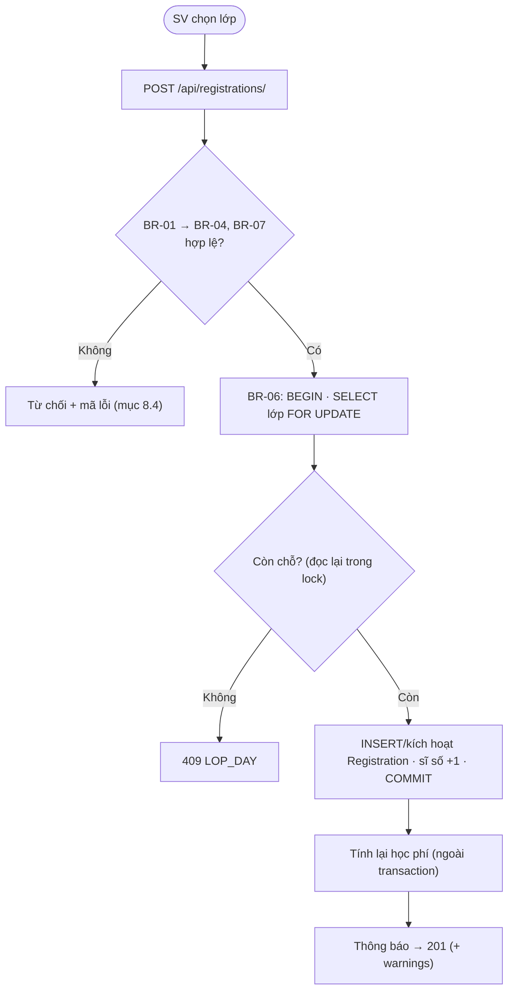
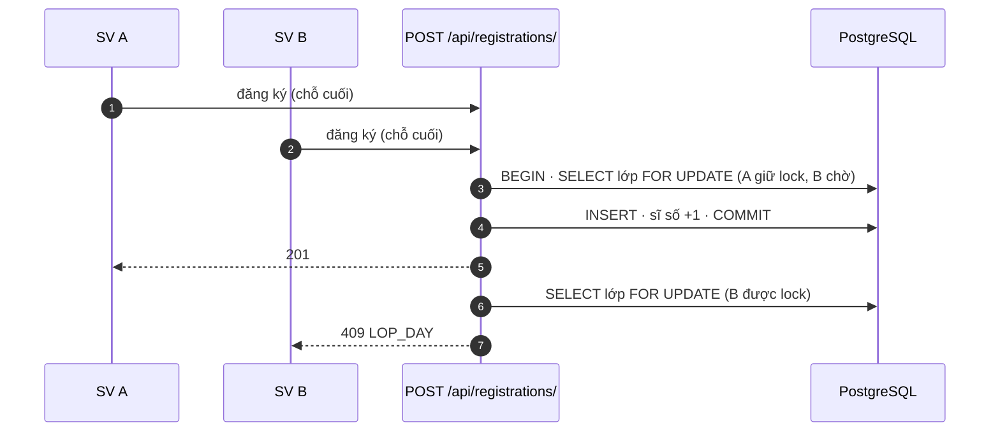
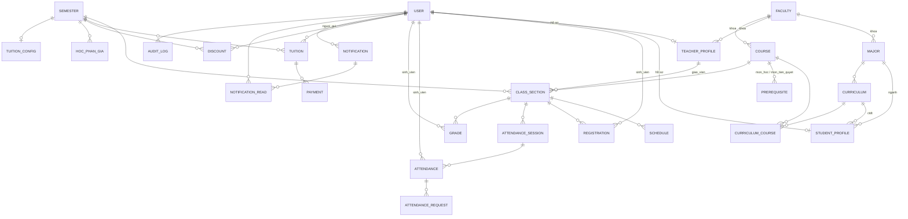

# KẾ HOẠCH TRIỂN KHAI & ĐẶC TẢ — HỆ THỐNG ĐĂNG KÝ MÔN HỌC

**Phiên bản:** 3.8 — 5 vai trò · 59 chức năng · 26 thực thể · BR-01..26 (BR-24 đã gỡ) · Flutter Web + App (SV/GV) · Django REST · PostgreSQL 16

> **Nền tảng theo vai trò:** **SV + GV = Flutter Web + Flutter App (Android/iOS)**;
> **Admin + PĐT + KT = chỉ Flutter Web**. Một codebase Flutter; hai entrypoint (mục 10.2).

> **Nguyên tắc tài liệu:** mỗi quy tắc nghiệp vụ được **định nghĩa ở đúng một nơi** (mục 4 hoặc 5);
> các mục khác chỉ **tham chiếu** (“xem BR-xx”). Sửa quy tắc ⇒ chỉ sửa chỗ định nghĩa.
> File này là nguồn **duy nhất** để build. Bản v2.5.1 đầy đủ (trước khi rút gọn) lưu ở
> `docs/plan_v2.5.1_archive.md`; `chuc_nang.md` là bản lưu v2.0 — **không sửa tiếp**.

---

## 0. PHẠM VI

Hệ thống hỗ trợ trường quản lý quy trình đào tạo: tài khoản, ngành, CTĐT, môn, học kỳ, lớp học phần,
lịch học, đăng ký môn, điểm danh, điểm, học phí, thông báo, báo cáo.

**Ngoài phạm vi (đã chủ động bỏ ở v3.0 để đội nhỏ làm được):**

| Hạng mục bỏ | Thay bằng |
| :--- | :--- |
| Cấm thi tự động (cờ `cam_thi`, job quét, tự sinh điểm F) | Hiển thị **tỷ lệ vắng + cờ cảnh báo** (BR-20); GV/PĐT tự quyết |
| Đơn học lại / cải thiện điểm (`GradeRetake`) | Môn **chưa đạt (F)** đăng ký lại như môn thường; môn **đã đạt** không đăng ký lại (BR-04). Không có cải thiện điểm |
| Lịch học bù theo ngày cụ thể | Chỉ lịch định kỳ theo thứ × tiết (BR-03) |
| Phân quyền động (`RolePermission`) | Ma trận quyền **cố định trong code** (mục 9); Admin chỉ gán vai trò cho tài khoản |
| Phục hồi (restore) DB qua API | Chỉ tạo + liệt kê backup; restore làm tay bằng `pg_restore` |
| Bảng giá `LECH_LT`/`LECH_TH`, hoàn tiền/miễn giảm nhiều trạng thái | Bảng giá gọn (BR-16/17); hoàn tiền = `Payment` loại `HOAN` (BR-26) |
| Xuất PDF | Chỉ Excel (`openpyxl`) |
| Cổng thanh toán online tự động đối soát, quản lý phòng học, xếp lớp theo khóa | SV **chuyển khoản qua mã QR** (thông tin tài khoản trong `SystemConfig`), **KT đối soát và ghi `Payment`** (KT-08) — không tích hợp cổng; phòng chỉ là thuộc tính lịch; SV gắn 1 CTĐT cố định |

| Thành phần | Mô tả |
| :--- | :--- |
| **Ứng dụng Flutter** | Web (responsive, offline chỉ là cache-API read-only, mọi thao tác ghi cần mạng) + App Android/iOS **chỉ cho SV/GV**. |
| **Backend API** | Django REST Framework: nghiệp vụ, phân quyền, đăng ký, học phí, điểm danh, điểm. |
| **CSDL** | PostgreSQL 16. |
| **Dịch vụ hỗ trợ** | JWT, Swagger/OpenAPI, Celery + Redis, Docker. |

---

## 1. KIẾN TRÚC TỔNG THỂ

```
┌─────────────────────────────────────────────────────────────┐
│  Flutter Web (5 vai trò)   │  Flutter App (chỉ SV + GV)     │
│  Material 3 · GoRouter · Riverpod · Dio                     │
└──────────────────────────┬──────────────────────────────────┘
                           │ HTTPS · JWT (access 60m / refresh 7d)
┌──────────────────────────▼──────────────────────────────────┐
│  Django REST Framework (Python 3.12)                        │
│  views/serializers (HTTP) → services.py (nghiệp vụ, BR-xx)  │
│     → Django ORM (đóng vai trò repository)                  │
│  LockedAwareJWTAuthentication · drf-spectacular (/api/docs/)│
│  Celery + beat: 4 job nền (mục 7.8)                         │
└──────────────────────────┬──────────────────────────────────┘
                           │ transaction · select_for_update
┌──────────────────────────▼──────────────────────────────────┐
│  PostgreSQL 16 — 26 thực thể (mục 5, ERD 11.2)              │
└─────────────────────────────────────────────────────────────┘
```

**Nguyên tắc:**
- **Backend là nguồn sự thật duy nhất** — mọi BR kiểm tra tại API.
- **Logic nghiệp vụ nằm ở `services.py` của từng app**, view chỉ parse/permission/serialize
  (mẫu `router → service → ORM`).
- **Mọi thao tác ghi cạnh tranh nhau chạy trong transaction + khóa dòng**: đăng ký (BR-06),
  thanh toán (BR-26), duyệt/nhập điểm cùng lớp.
- **Idempotent** cho 2 endpoint tiền/đăng ký (mục 8.3).
- **Phân quyền tại API** (BR-21/23).
- **Phiên bản chốt:** Python **3.12** (Docker, CI, venv local), Django 5.1.x. Không dùng venv Python 3.14 (Django 5.1 chưa hỗ trợ).

### 1.1. Bố cục repo (monorepo)

```
HeThongDangKyMonHoc/
├── backend/                # Django (cây mục 1.2) — docker-compose đặt tại đây
├── dang_ky_mon_hoc/        # Flutter project (giữ nguyên tên thư mục)
├── docs/                   # bản lưu plan cũ
├── design.md               # hướng UI (Material 3, indigo/teal)
├── plan.md · checklist.md · chuc_nang.md (lưu v2.0)
└── .github/workflows/ci.yml   # 2 job theo path: backend (ruff+mypy+pytest) / flutter (analyze+test)
```
Flutter chỉ giữ `android/`, `ios/`, `web/`.

### 1.2. Cấu trúc backend

```
backend/
├── config/            # settings (base/dev/prod), urls, celery
├── apps/
│   ├── auth/          # User (label "user"), JWT, LockedAwareJWTAuthentication
│   ├── profiles/      # StudentProfile, TeacherProfile
│   ├── training/      # Faculty, Major, Curriculum, CurriculumCourse, Course, Prerequisite,
│   │                  #   Semester, ClassSection, Schedule
│   ├── registration/  # Registration
│   ├── attendance/    # AttendanceSession, Attendance, AttendanceRequest
│   ├── grades/        # Grade
│   ├── tuition/       # HocPhanGia, TuitionConfig, Discount, Payment, Tuition (+ pricing.py)
│   ├── notifications/ # Notification, NotificationRead
│   ├── audit/         # AuditLog
│   └── config/        # SystemConfig
│   (mỗi app: models.py · services.py · serializers.py · views.py · tests/)
├── core/              # permissions, pagination, exceptions, idempotency, mixins (AuditLogMixin)
├── jobs/              # task Celery
├── requirements.txt · Dockerfile · docker-compose.yml
```
**Thư viện:** Django 5.1, DRF, SimpleJWT (+ `token_blacklist`), drf-spectacular, django-filter,
django-cors-headers, celery + django-celery-beat, redis, psycopg 3, openpyxl, pytest, factory-boy.

---

## 2. ĐỐI TƯỢNG SỬ DỤNG

| Vai trò | Trách nhiệm | Nền tảng |
| :--- | :--- | :--- |
| **Admin** | Tài khoản, gán vai trò, cấu hình hệ thống, audit log, backup | Web |
| **Phòng đào tạo (PĐT)** | Ngành, CTĐT, môn, học kỳ, lớp HP, lịch, theo dõi/hủy đăng ký, duyệt điểm, thông báo, báo cáo | Web |
| **Sinh viên (SV)** | Đăng ký/hủy, TKB tự động, xem lịch/điểm/điểm danh/học phí, thông báo | Web + App |
| **Giáo viên (GV)** | Lớp phụ trách, điểm danh, nhập điểm, thông báo cho lớp | Web + App |
| **Kế toán (KT)** | Bảng giá, tính học phí, thu/hoàn, miễn giảm, công nợ, báo cáo tài chính | Web |

Admin xử lý *tài khoản & hệ thống*; PĐT xử lý *nghiệp vụ đào tạo*. Hai vai trò không giao thoa quyền.
Phạm vi quyền chi tiết: ma trận ở **mục 9** (nguồn duy nhất).

---

## 3. DANH SÁCH CHỨC NĂNG (59)

| Nhóm | Mã | Số CN |
| :--- | :---: | :---: |
| Phòng đào tạo | `PDT-01..15` | 15 |
| Sinh viên | `SV-01..13` | 13 |
| Giáo viên | `GV-01..12` | 12 |
| Kế toán | `KT-01..11` | 11 |
| Admin | `ADM-01..08` | 8 |
| **Tổng** | | **59** |

### 3.1. Phòng đào tạo

| Mã | Chức năng | Mô tả |
| :--- | :--- | :--- |
| PDT-01 | Quản lý hồ sơ người dùng | Mã SV/GV, ngành, khoa/viện, liên hệ; gán `ctdt` cho SV. |
| PDT-02 | Quản lý khoa/viện và ngành | Thêm/sửa/ngừng khoa/viện và ngành; mỗi ngành thuộc một khoa/viện. **Do PĐT quản lý** (Admin chỉ cấp tài khoản). |
| PDT-03 | Quản lý CTĐT | CTĐT theo ngành × khóa; gán môn với `khoi_kien_thuc`, `loai_mon`, `hoc_ky_goi_y`. |
| PDT-04 | Quản lý môn học | Tín chỉ (tổng/LT/TH), số tiết, `loai_danh_gia`, trạng thái. |
| PDT-05 | Quản lý môn tiên quyết | Thiết lập tiên quyết (chống chu trình). |
| PDT-06 | Quản lý học kỳ | Tạo, đặt thời gian, mở/đóng. |
| PDT-07 | Cấu hình đăng ký của học kỳ | Cửa sổ đăng ký (bắt đầu/kết thúc) **và giới hạn tín chỉ** (tối thiểu, tối đa, tối đa khi SV bị cảnh báo học vụ) — do PĐT đặt theo từng học kỳ. |
| PDT-08 | Quản lý lớp học phần | Mở lớp, phân công GV, sĩ số, trạng thái, gia hạn nhập điểm. |
| PDT-09 | Quản lý lịch học | Thứ, tiết bắt đầu, số tiết, phòng. |
| PDT-10 | Theo dõi đăng ký | Xem danh sách đăng ký theo môn/lớp/ngành/học kỳ; xuất Excel. |
| PDT-11 | Hủy đăng ký khi cần | Hủy hộ SV có lý do (BR-05). |
| PDT-12 | Duyệt điểm | Duyệt điểm cả lớp `CHINH_THUC` → `KHOA`; nhập hộ khi GV quá hạn (BR-13/14). |
| PDT-13 | Gửi thông báo | Đến vai trò / lớp / SV cụ thể. |
| PDT-14 | Báo cáo đào tạo | SV, lớp HP, số đăng ký, lớp đầy/còn chỗ; xuất Excel. |
| PDT-15 | Tra cứu dữ liệu đào tạo | Tìm kiếm, lọc, xem chi tiết. |

### 3.2. Sinh viên

| Mã | Chức năng | Mô tả |
| :--- | :--- | :--- |
| SV-01 | Đăng nhập / đăng xuất | |
| SV-02 | Hồ sơ cá nhân | Xem thông tin, GPA, tín chỉ tích lũy; sửa email/sdt; đổi mật khẩu. |
| SV-03 | Xem CTĐT | Môn bắt buộc/tự chọn, khối kiến thức, học kỳ gợi ý. |
| SV-04 | Xem lớp đang mở | Đã lọc theo CTĐT, còn chỗ, không trùng lịch. Client thêm bộ lọc *Môn chưa học* / *Theo CTĐT* + chọn *kỳ trong CTĐT* (ghép với `curriculums/my`, không thêm endpoint). |
| SV-05 | Đăng ký môn thủ công | BR-01..07. |
| SV-06 | Tạo TKB tự động | Gợi ý tổ hợp (client-side), SV xác nhận rồi đăng ký (Pha 8, **tùy chọn**). |
| SV-07 | Hủy đăng ký | BR-05. |
| SV-08 | Xem thời khóa biểu | Tuần/học kỳ. |
| SV-09 | Lịch sử đăng ký | Đã đăng ký/đã hủy, lý do hủy. |
| SV-10 | Xem điểm danh & xin sửa | Xem từng buổi + tỷ lệ vắng; gửi yêu cầu sửa. |
| SV-11 | Xem điểm | Chỉ điểm `KHOA` hiển thị chính thức; GPA. |
| SV-12 | Xem học phí | Tổng tiền, miễn giảm, đã thu, còn nợ, chờ hoàn. |
| SV-13 | Nhận thông báo | Xem, đánh dấu đã đọc. |

### 3.3. Giáo viên

| Mã | Chức năng | Mô tả |
| :--- | :--- | :--- |
| GV-01 | Đăng nhập / đăng xuất | |
| GV-02 | Hồ sơ cá nhân | Xem; sửa email/sdt; đổi mật khẩu. |
| GV-03 | Xem lớp phụ trách | |
| GV-04 | Xem chi tiết lớp | Môn, lịch, phòng, sĩ số, danh sách SV. |
| GV-05 | Xem TKB cá nhân | Lịch dạy. |
| GV-06 | Chọn buổi điểm danh | Buổi do hệ thống **sinh sẵn** theo lịch học × thời gian lớp (BR-20); GV chọn buổi đã đến ngày để điểm danh (lớp `DANG_HOC`). Không tạo buổi tay. |
| GV-07 | Điểm danh | `CO_MAT` / `VANG_CO_PHEP` / `VANG_KHONG_PHEP` + cờ `di_tre` (BR-19). |
| GV-08 | Sửa điểm danh | Khi lớp còn `DANG_HOC`; xử lý yêu cầu sửa của SV. |
| GV-09 | Lịch sử điểm danh | Theo buổi. |
| GV-10 | Nhập điểm | QT/GK/CK cả lớp, xem trước tổng kết (BR-10), khóa/mở khóa (BR-14). |
| GV-11 | Thông báo cho lớp | |
| GV-12 | Xuất danh sách lớp | Excel: SV, bảng điểm, bảng điểm danh. |

### 3.4. Kế toán

| Mã | Chức năng | Mô tả |
| :--- | :--- | :--- |
| KT-01 | Chính sách học phí | Hạn đóng theo học kỳ (`TuitionConfig`). |
| KT-02 | Giá theo ngành | `HocPhanGia` phạm vi `NGANH`. |
| KT-03 | Giá theo khối kiến thức | Phạm vi `KHOI_KIEN_THUC` (5 khối). |
| KT-04 | Giá tín chỉ thực hành | Phạm vi `GIA_TH`. |
| KT-05 | Miễn giảm / học bổng | `Discount` (BR-18). |
| KT-06 | Tính học phí | Tự động khi đăng ký/hủy + KT bấm tính lại (BR-15..17). |
| KT-07 | Danh sách học phí | Theo học kỳ/ngành/lớp/trạng thái. |
| KT-08 | Xác nhận thu / hoàn tiền | Ghi `Payment` loại `THU` hoặc `HOAN` (BR-26); đối soát khoản SV chuyển khoản theo nội dung `HOCPHI <ma_sv> <hoc_ky>`. |
| KT-09 | Công nợ | SV còn nợ, quá hạn, chờ hoàn tiền. |
| KT-10 | Biên lai | Xuất phiếu thu Excel. |
| KT-11 | Báo cáo tài chính | Phải thu/đã thu/còn nợ theo học kỳ/ngành/lớp/SV; xuất Excel. |

### 3.5. Admin

| Mã | Chức năng | Mô tả |
| :--- | :--- | :--- |
| ADM-01 | Đăng nhập / đăng xuất | |
| ADM-02 | Quản lý tài khoản | Tạo/sửa/khóa/mở khóa/reset mật khẩu cho 5 vai trò. |
| ADM-03 | Tra cứu hồ sơ | Chỉ đọc (sửa hồ sơ học vụ là của PĐT, PDT-01). |
| ADM-04 | Xem ma trận quyền | **Chỉ đọc** ma trận mục 9; gán vai trò khi tạo tài khoản (ADM-02). |
| ADM-05 | Cấu hình hệ thống | `SystemConfig`: `max_absent_pct`, `so_ngay_cho_phep_nhap_diem`, `backup_retention_days`, thông tin nhận chuyển khoản học phí (`ck_ngan_hang`, `ck_so_tai_khoan`, `ck_chu_tai_khoan`). |
| ADM-06 | Audit log | Admin xem tất cả; PĐT chỉ scope `training`; KT chỉ scope `finance`. |
| ADM-07 | Thông báo hệ thống | Soạn/thu hồi thông báo toàn hệ thống. |
| ADM-08 | Sao lưu | Tạo backup, xem danh sách (restore làm tay — mục 0). |

---

## 4. QUY TẮC NGHIỆP VỤ (BR-01..26, BR-24 đã gỡ)

### 4.1. Đăng ký

| Mã | Quy tắc |
| :--- | :--- |
| BR-01 | SV chỉ đăng ký khi: học kỳ `MO` **và** trong cửa sổ đăng ký (PDT-07) **và** lớp `MO`. Sai → `NGOAI_CUA_SO_DANG_KY` / `LOP_CHUA_MO`. |
| BR-02 | Không đăng ký khi `si_so_hien_tai ≥ si_so_toi_da` (`LOP_DAY`). |
| BR-03 | **Trùng lịch:** hai lịch trùng khi cùng `thu` **và** khoảng tiết `[tiet_bat_dau, tiet_ket_thuc]` giao nhau. So giữa lớp mới với mọi lớp `DA_DANG_KY` cùng học kỳ của SV (`TRUNG_LICH`). Chỉ có lịch định kỳ. |
| BR-04 | **Tiên quyết & đã đạt.** *Đạt* một môn = tồn tại `Grade` `KHOA` của môn đó với `diem_chu ≠ F` (D vẫn đạt; môn `DAT_KHONG_DAT` đạt khi `P`) — không phân biệt CTĐT. (a) Mọi môn tiên quyết phải đạt, sai → `THIEU_TIEN_QUYET`. (b) Môn **đã đạt** không đăng ký lại, → `DA_DAT_MON`. (c) Môn đã học nhưng **chưa đạt (F)** đăng ký lại bình thường (lớp mới); GPA lấy lần mới nhất (BR-25). (d) **Mỗi môn chỉ một lớp trong một học kỳ:** nếu SV đã có `Registration` `DA_DANG_KY` của **cùng `mon_hoc`** trong học kỳ của lớp mới (kể cả lớp khác) → `DA_DANG_KY_MON`. Hủy lớp đó thì đăng ký lớp khác của môn được. |
| BR-05 | **Hủy.** *SV:* chỉ khi lớp `MO` **và** trong cửa sổ đăng ký; học phí môn đó bị trừ (tính lại, BR-15). *PĐT (force-cancel, PDT-11):* khi lớp `MO` **hoặc `DANG_HOC`**, bắt buộc `ly_do`, ghi audit log; học phí tính lại, nếu SV đã thu dư thì phát sinh `can_hoan` (BR-26). Hủy luôn `si_so_hien_tai −= 1` trong transaction (BR-06), không xuống dưới 0. |
| BR-06 | **Chống overbook.** Đăng ký/hủy chạy trong **một transaction**: `SELECT … FOR UPDATE` dòng `ClassSection` → **đọc lại** `si_so_hien_tai` trong lock → còn chỗ mới tạo/kích hoạt `Registration` và `+= 1` → COMMIT. `UNIQUE(sinh_vien, lop_hoc_phan)` chỉ chống trùng 1 SV, **không** chống overbook. |
| BR-07 | **Giới hạn tín chỉ** (đọc từ `Semester` của lớp: `tin_chi_toi_thieu`, `tin_chi_toi_da`, `tin_chi_toi_da_canh_bao` — PĐT đặt theo từng học kỳ, mặc định 12 / 24 / 14), tính trên tổng tín chỉ các `Registration` `DA_DANG_KY` cùng học kỳ **cộng** môn mới. Vượt tối đa → chặn `VUOT_TIN_TC_TOI_DA`. Dưới tối thiểu → **chỉ cảnh báo** (`warnings[]`). SV diện cảnh báo học vụ (`StudentProfile.gpa` không NULL và `< 2.0`) bị giới hạn `min(tối đa, tín chỉ cảnh báo)` → `VUOT_TIN_TC_CANH_BAO`. `gpa IS NULL` (học kỳ đầu) không thuộc diện cảnh báo. |
| BR-08 | TKB 15 tiết/ngày: sáng 1–5, chiều 6–10, tối 11–15; `thu` ∈ 2..8 (thứ 2 → thứ 7; **8 = Chủ nhật**). |
| BR-09 | Khi tạo lịch bắt buộc nhập `so_tiet_moi_buoi`; `tiet_bat_dau + so_tiet_moi_buoi − 1` **không vượt hết nhóm tiết** của buổi chứa `tiet_bat_dau`. |

### 4.2. Điểm

| Mã | Quy tắc |
| :--- | :--- |
| BR-10 | **Tổng kết** = `QT×0.1 + GK×0.4 + CK×0.5`, làm tròn 2 chữ số. Thiếu GK (NULL) → bỏ GK, QT/CK = 20%/80%. Thiếu CK (NULL) → coi `CK = 0`. **NULL ≠ 0:** NULL = chưa nhập (áp fallback); `0` = GV nhập 0 (tính công thức thường). Cột `diem_cuoi_ky` giữ NULL trong DB ngay cả khi `KHOA`. |
| BR-11 | **Thang chữ** (band liên tục): `≥8.50` A(4.0); `≥7.00` B(3.0); `≥5.50` C(2.0); `≥4.00` D(1.0); `<4.00` F(0.0). Môn `loai_danh_gia = DAT_KHONG_DAT`: `≥5.00` → `P` (`gpa_thang_4 = NULL`, không vào GPA), ngược lại `F`. **Đạt = `diem_chu ≠ F`** (dùng ở BR-04, BR-25). |
| BR-12 | GV chỉ nhập/sửa điểm của lớp mình phụ trách. |
| BR-13 | **Hạn nhập điểm** = `han_nhap_diem` của lớp; nếu NULL thì = `(ClassSection.ngay_ket_thuc ?? Semester.ngay_ket_thuc) + SystemConfig.so_ngay_cho_phep_nhap_diem` ngày (mặc định 14). Quá hạn → `QUA_HAN_NHAP_DIEM`. PĐT **gia hạn** (đặt `han_nhap_diem` mới) hoặc **nhập hộ** (điểm lưu thẳng ở `CHINH_THUC`, vì PĐT không có quyền khóa); cả hai ghi audit log. |
| BR-14 | **Trạng thái điểm:** `NHAP_TAM` → `CHINH_THUC` (GV khóa) → `KHOA` (PĐT duyệt cả lớp, lớp đã `DA_DONG`). GV **mở khóa** `CHINH_THUC` → `NHAP_TAM` được khi lớp còn `DANG_HOC` và trong hạn (ghi audit log). `KHOA` bất biến. SV chỉ thấy điểm `KHOA`. |
| BR-25 | **GPA & xếp loại.** (a) GPA học kỳ = Σ(`gpa_thang_4`×tín chỉ)/Σ tín chỉ trên `Grade` `KHOA` thuộc học kỳ đó; GPA tích lũy trên toàn bộ. (b) `P` bị loại cả tử lẫn mẫu; `F` vẫn vào mẫu. (c) Mỗi `(sinh_vien, mon_hoc)` chỉ tính **lần học mới nhất**: `Grade` `KHOA` có `lop_hoc_phan.hoc_ky.ngay_bat_dau` lớn nhất (không dùng thời điểm tạo bản ghi). (d) `tin_chi_tich_luy` = Σ tín chỉ môn có `Grade` `KHOA` đạt (BR-11). (e) Cập nhật `StudentProfile.gpa` / `tin_chi_tich_luy` **đồng bộ** khi PĐT duyệt `KHOA` (không cần job). (f) Xếp loại thang 4: Xuất sắc 3.60–4.00, Giỏi 3.20–3.59, Khá 2.50–3.19, TB 2.00–2.49, Yếu 1.00–1.99, Kém <1.00. (g) **Thống kê học kỳ:** `tin_chi_hoc` = Σ tín chỉ mọi môn của học kỳ; `tin_chi_dat` = Σ tín chỉ môn không `F`; **điểm TB (hệ 10)** = Σ(`diem_tong_ket`×tín chỉ)/Σ tín chỉ, loại môn `P` (như GPA); `xep_loai` theo (f) trên GPA học kỳ. |

### 4.3. Học phí

| Mã | Quy tắc |
| :--- | :--- |
| BR-15 | Học phí = Σ học phí từng môn của các `Registration` `DA_DANG_KY` trong học kỳ, tính theo BR-16/17. **Tính lại bất cứ lúc nào** chỉ từ danh sách đăng ký hiện tại + bảng giá hiện tại; không đụng `Payment`/`Discount`. |
| BR-16 | **Đơn giá gốc của 1 môn × 1 học kỳ:** tra theo thứ tự — trục (1) bản ghi `hoc_ky` = học kỳ đang tính, trục (2) `hoc_ky IS NULL`; trong mỗi trục xét `pham_vi`: `KHOI_KIEN_THUC` (khớp `CurriculumCourse.khoi_kien_thuc` của môn trong CTĐT của SV) → `NGANH` (khớp `StudentProfile.nganh`) → `MAC_DINH`. Dừng ở bản ghi đầu tiên khớp. Không có bản ghi nào → `CHUA_CAU_HINH_GIA`. |
| BR-17 | Học phí môn = `tin_chi_ly_thuyet × đơn giá gốc + tin_chi_thuc_hanh × đơn giá TH`. Đơn giá TH = `don_gia` của bản ghi `GIA_TH` (tra cùng 2 trục `hoc_ky`) nếu có, ngược lại = đơn giá gốc. |
| BR-18 | KT quyết định miễn giảm theo hồ sơ PĐT/SV; mọi thay đổi ghi audit log. |
| BR-26 | **Thu / hoàn tiền (`Payment`).** `so_tien > 0`; `Tuition` phải `DA_TINH`; chạy trong transaction với `SELECT … FOR UPDATE` trên `Tuition`. Loại `THU`: không vượt `con_no` (→ `SO_TIEN_KHONG_HOP_LE`). Loại `HOAN`: không vượt `can_hoan`. Công thức dẫn xuất ở mục 5 (Tuition). Idempotent theo `request_id` (mục 8.3). |

### 4.4. Điểm danh

| Mã | Quy tắc |
| :--- | :--- |
| BR-19 | Trạng thái: `CO_MAT`, `VANG_CO_PHEP`, `VANG_KHONG_PHEP`; `di_tre` là cờ riêng. |
| BR-20 | **Buổi điểm danh sinh sẵn & tỷ lệ vắng.** (a) Khi lớp chuyển `MO` (và mỗi lần PĐT sửa lịch/ngày của lớp `MO`/`DANG_HOC`) hệ thống sinh `AttendanceSession` `MO` cho **mọi ngày** trong `[ngay_bat_dau, ngay_ket_thuc]` của lớp (NULL → theo học kỳ) có `thu` trùng một `Schedule` (mỗi ngày × lịch một buổi). Sửa lịch chỉ sinh/xóa các buổi **tương lai chưa điểm danh**; buổi đã điểm danh giữ nguyên. (b) `tong_so_buoi` = số buổi sinh ra — **cố định cả khóa**, là mẫu số (kể cả buổi chưa tới ngày). Ví dụ: lớp học từ 01/10 đến 05/11, chỉ học thứ 5 → 01, 08, 15, 22, 29/10 và 05/11 = **6 buổi**. (c) **Tỷ lệ vắng** = số `VANG_KHONG_PHEP` của SV / `tong_so_buoi`; `VANG_CO_PHEP` không tính. Khi `> SystemConfig.max_absent_pct` (mặc định 20%) hệ thống chỉ **hiển thị cờ “nguy cơ cấm thi”** cho GV, PĐT, SV (ví dụ 6 buổi: 20% = 1,2 ⇒ vắng không phép **từ 2 buổi** bị cờ). Không tự chặn, không tự sinh điểm. (d) Chỉ điểm danh được buổi có `ngay_hoc` ≤ hôm nay (buổi tương lai → `TRANG_THAI_KHONG_HOP_LE`). |
| BR-24 | *(đã gỡ ở v3.0 — cấm thi tự động; xem mục 0).* |

### 4.5. Hệ thống

| Mã | Quy tắc |
| :--- | :--- |
| BR-21 | Phân quyền theo 5 vai trò (ma trận mục 9). |
| BR-22 | Mọi chức năng nội bộ yêu cầu JWT hợp lệ; tài khoản `is_locked` bị chặn cả login lẫn refresh. |
| BR-23 | SV chỉ xem dữ liệu của mình; GV chỉ lớp phụ trách; KT/Admin theo phạm vi mục 9. |

---

## 5. THỰC THỂ (26)

Quy ước: FK người dùng trỏ `User`; SV/GV phân biệt qua `role` + profile.

| Thực thể | Thuộc tính chính | Ràng buộc |
| :--- | :--- | :--- |
| **User** | `username`, `password`, `role` ∈ {`ADMIN`, `PHONG_DAO_TAO`, `SINH_VIEN`, `GIAO_VIEN`, `KE_TOAN`}, `is_locked`, `last_login`, `email` | `role` là enum cứng. `is_locked` chặn login + refresh. Dùng `is_locked` thay cho `is_active`; không dùng Django admin site cho nghiệp vụ. |
| **StudentProfile** | `user` (1-1), `ma_sv`, `ho_ten`, `nganh`, `khoa_nhap_hoc`, `ctdt`, `gpa` (NULL = chưa có), `tin_chi_tich_luy`, `email`, `sdt` | `ma_sv` duy nhất. `ctdt` gán lúc tạo hồ sơ (CTĐT `HOAT_DONG` khớp ngành + khóa); cố định cho SV. `gpa`/`tin_chi_tich_luy` là cache BR-25, không nhập tay. |
| **TeacherProfile** | `user` (1-1), `ma_gv`, `ho_ten`, `khoa` (FK Faculty), `hoc_vi`, `email`, `sdt` | `ma_gv` duy nhất. |
| **Faculty** | `ma_khoa`, `ten_khoa`, `trang_thai` ∈ {`HOAT_DONG`, `NGUNG`} | `ma_khoa` duy nhất. Không xóa; chỉ **ngừng** được khi không còn ngành hoặc giáo viên đang hoạt động thuộc về (`TRANG_THAI_KHONG_HOP_LE`). |
| **Major** | `ma_nganh`, `ten_nganh`, `thoi_gian_dao_tao`, `khoa` (FK Faculty), `trang_thai` ∈ {`HOAT_DONG`, `NGUNG`} | `ma_nganh` duy nhất. |
| **Curriculum** | `ma_ctdt`, `nganh`, `khoa_tuyen_sinh`, `tong_tin_chi_yeu_cau`, `trang_thai` ∈ {`HOAT_DONG`, `NGUNG`} | `tong_tin_chi_yeu_cau > 0`. Chỉ 1 `HOAT_DONG` mỗi `(nganh, khoa_tuyen_sinh)` (unique có điều kiện). |
| **CurriculumCourse** | `ctdt`, `mon_hoc`, `khoi_kien_thuc` ∈ {`chung`, `co_so_nganh`, `chuyen_nganh`, `tu_chon`, `tot_nghiep`}, `loai_mon` ∈ {`bat_buoc`, `tu_chon`}, `hoc_ky_goi_y` | `(ctdt, mon_hoc)` duy nhất. Nơi gán khối kiến thức. |
| **Course** | `ma_mon`, `ten_mon`, `tong_tin_chi`, `tin_chi_ly_thuyet`, `tin_chi_thuc_hanh`, `so_tiet_ly_thuyet`, `so_tiet_thuc_hanh`, `loai_danh_gia` ∈ {`DIEM`, `DAT_KHONG_DAT`}, `khoa` (FK Faculty — khoa/viện phụ trách), `trang_thai` ∈ {`HOAT_DONG`, `NGUNG_SU_DUNG`} | `tong_tin_chi = LT + TH`. `khoa` dùng để gợi ý giáo viên cùng khoa/viện khi tạo lớp. `so_tiet_*` chỉ để truyền dạy, không tính phí. `NGUNG_SU_DUNG`: chặn mở lớp mới; môn đã có lớp/CTĐT không xóa. |
| **Prerequisite** | `mon_hoc`, `mon_tien_quyet` | Cặp duy nhất; `mon_hoc ≠ mon_tien_quyet`; **không chu trình** (DFS, vi phạm → 400). |
| **Semester** | `ten_hk`, `nam_hoc`, `ngay_bat_dau`, `ngay_ket_thuc`, `cua_so_dk_bat_dau`, `cua_so_dk_ket_thuc`, `tin_chi_toi_thieu`, `tin_chi_toi_da`, `tin_chi_toi_da_canh_bao`, `trang_thai` ∈ {`MO`, `DONG`} | Cửa sổ đăng ký ⊂ thời gian học kỳ. `tin_chi_toi_thieu` (≥ 1) ≤ `tin_chi_toi_da`; `tin_chi_toi_da_canh_bao` ≤ `tin_chi_toi_da` (mặc định 12 / 24 / 14 khi tạo học kỳ). |
| **ClassSection** | `ma_lop`, `mon_hoc`, `hoc_ky`, `giao_vien`, `si_so_toi_da`, `si_so_hien_tai`, `ngay_bat_dau` (NULL = theo học kỳ), `ngay_ket_thuc` (NULL = theo học kỳ), `han_nhap_diem` (NULL, BR-13), `trang_thai` ∈ {`KE_HOACH`, `MO`, `DANG_HOC`, `DA_DONG`} | `0 ≤ si_so_hien_tai ≤ si_so_toi_da`. Chuyển trạng thái xem mục 6. |
| **Schedule** | `lop_hoc_phan`, `thu` (2..8; 8 = Chủ nhật), `tiet_bat_dau`, `so_tiet_moi_buoi`, `phong` | `tiet_ket_thuc = tiet_bat_dau + so_tiet_moi_buoi − 1` và `buoi` đều **dẫn xuất** (không lưu). Không vượt nhóm tiết (BR-09). **Phòng và GV không giao tiết cùng `thu`** (khoảng tiết `[bat_dau, ket_thuc]`). Cho phép 2 lịch cùng lớp/thứ/buổi nếu không giao tiết. |
| **Registration** | `sinh_vien`, `lop_hoc_phan`, `trang_thai` ∈ {`DA_DANG_KY`, `DA_HUY`}, `ngay_dang_ky`, `ngay_huy`, `ly_do_huy`, `request_id` (UUID, NULL) | `UNIQUE(sinh_vien, lop_hoc_phan)`. Học kỳ lấy qua `lop_hoc_phan.hoc_ky` (không lưu trùng). `request_id` UNIQUE khi khác NULL, **gán một lần lúc tạo, không ghi đè khi kích hoạt lại** (mục 8.3). |
| **AttendanceSession** | `lop_hoc_phan`, `ngay_hoc`, `buoi`, `tiet_bat_dau`, `trang_thai` ∈ {`MO`, `DA_DIEM_DANH`} | `UNIQUE(lop_hoc_phan, ngay_hoc, buoi)` — 1 buổi điểm danh mỗi (lớp, ngày, buổi). **Sinh tự động** (BR-20); tổng số buổi là mẫu số của tỷ lệ vắng. `MO` → `DA_DIEM_DANH` ở lần `PUT records` thành công đầu tiên. |
| **Attendance** | `attendance_session`, `lop_hoc_phan`, `ngay_hoc`, `sinh_vien`, `trang_thai`, `di_tre`, `ghi_chu`, `cap_nhat_luc` | `UNIQUE(attendance_session, sinh_vien)`. |
| **AttendanceRequest** | `attendance`, `sinh_vien`, `ly_do`, `trang_thai_mong_muon` (∈ `CO_MAT`/`VANG_CO_PHEP`), `di_tre_mong_muon` (bool), `minh_chung` (tệp ảnh/PDF ≤ 5 MB, tùy chọn), `ngay_gui`, `trang_thai` ∈ {`CHO_DUYET`, `DUYET`, `TU_CHOI`}, `nguoi_duyet`, `ngay_duyet`, `ghi_chu` | SV gửi cho buổi đã điểm danh (mỗi buổi tối đa 1 yêu cầu `CHO_DUYET`); **chỉ GV phụ trách lớp duyệt** (PĐT không tham gia); **chỉ gửi/duyệt khi lớp `DANG_HOC`** — khi lớp chuyển `DA_DONG`, mọi yêu cầu `CHO_DUYET` của lớp **tự chuyển `TU_CHOI`** (`nguoi_duyet` NULL, `ghi_chu` = "Quá hạn — lớp đã đóng"); `DUYET` ghi `Attendance.trang_thai = trang_thai_mong_muon` và `di_tre = di_tre_mong_muon`. `ly_do` bắt buộc. |
| **Grade** | `lop_hoc_phan`, `sinh_vien`, `diem_qua_trinh`, `diem_giua_ky`, `diem_cuoi_ky`, `diem_tong_ket`, `diem_chu`, `gpa_thang_4`, `trang_thai` ∈ {`NHAP_TAM`, `CHINH_THUC`, `KHOA`}, `ngay_nhap` | `UNIQUE(lop_hoc_phan, sinh_vien)`; điểm ∈ [0,10]. Tổng kết/chữ/GPA theo BR-10/11. |
| **HocPhanGia** | `hoc_ky` (NULL = mặc định), `pham_vi` ∈ {`MAC_DINH`, `KHOI_KIEN_THUC`, `NGANH`, `GIA_TH`}, `tham_chieu`, `don_gia` | `tham_chieu`: NULL khi `MAC_DINH`/`GIA_TH`; `ma_nganh` khi `NGANH`; tên khối khi `KHOI_KIEN_THUC`. `don_gia ≥ 0`. UNIQUE `(hoc_ky, pham_vi, tham_chieu)` bằng **functional index** `COALESCE(hoc_ky_id,0), pham_vi, COALESCE(tham_chieu,'')` (PostgreSQL: `NULL ≠ NULL` trong UNIQUE thường). |
| **TuitionConfig** | `hoc_ky` (1-1), `han_dong`, `ghi_chu` | KT-01. |
| **Discount** | `sinh_vien`, `hoc_ky`, `loai` ∈ {`MIEN_GIAM`, `HOC_BONG`}, `so_tien` **hoặc** `ty_le`, `ly_do` | Đúng một trong `so_tien`/`ty_le`. Mọi thay đổi ghi audit log (BR-18). |
| **Payment** | `tuition`, `loai` ∈ {`THU`, `HOAN`}, `so_tien`, `phuong_thuc` ∈ {`TIEN_MAT`, `CHUYEN_KHOAN`, `KHAC`}, `ngay`, `nguoi_thu`, `bien_lai_ma`, `request_id` | `so_tien > 0`; `request_id` UNIQUE khi khác NULL; không sửa/xóa (sai thì tạo `HOAN`). Quy tắc BR-26. |
| **Tuition** | `sinh_vien`, `hoc_ky`, `tong_tin_chi`, `tong_tien`, `trang_thai` ∈ {`CHUA_TINH`, `DA_TINH`} | `UNIQUE(sinh_vien, hoc_ky)`. **Chỉ lưu `tong_*` và `trang_thai`; các giá trị còn lại dẫn xuất (bên dưới).** |
| **Notification** | `tieu_de`, `noi_dung`, `audience` ∈ {`ROLE`, `CLASS`, `USER`}, `target_refs` (JSON array), `nguoi_gui`, `ngay_gui`, `trang_thai` ∈ {`DA_GUI`, `THU_HOI`} | `ROLE` → mã role; `CLASS` → id `ClassSection`; `USER` → id `User`. Thu hồi → `THU_HOI` (biến khỏi danh sách người nhận). |
| **NotificationRead** | `notification`, `user`, `da_doc`, `ngay_doc` | `(notification, user)` duy nhất. |
| **AuditLog** | `user`, `hanh_dong` ∈ {`CREATE`, `UPDATE`, `DELETE`, `LOGIN`, `PHAN_QUYEN`}, `doi_tuong`, `doi_tuong_id` (chuỗi id, không FK), `chi_tiet` (JSON), `thoi_gian`, `ip` | **Scope theo tiền tố `doi_tuong`:** `training` = User/Profile, Major, Curriculum, CurriculumCourse, Course, Prerequisite, Semester, ClassSection, Schedule, Registration, Attendance*, Grade, Notification; `finance` = HocPhanGia, TuitionConfig, Discount, Payment, Tuition; còn lại (SystemConfig, backup) chỉ Admin. |
| **SystemConfig** | `khoa`, `gia_tri` (chuỗi), `mo_ta` | ADM-05. Khóa: `max_absent_pct`, `so_ngay_cho_phep_nhap_diem`, `backup_retention_days`, `ck_ngan_hang`, `ck_so_tai_khoan`, `ck_chu_tai_khoan` (thông tin nhận chuyển khoản học phí). |

**Công thức dẫn xuất của Tuition** (tính khi đọc, không lưu):
```
mien_giam  = min(tong_tien, Σ Discount: so_tien  hoặc  ty_le% × tong_tien)
phai_nop   = tong_tien − mien_giam
thuc_thu   = Σ Payment THU − Σ Payment HOAN
con_no     = max(0, phai_nop − thuc_thu)
can_hoan   = max(0, thuc_thu − phai_nop)      # tiền cần trả lại SV
hien_thi   = CHUA_TINH nếu trang_thai = CHUA_TINH
           | CHO_HOAN_TIEN nếu can_hoan > 0
           | CON_NO nếu con_no > 0
           | DA_DONG
```
Hủy môn / giá đổi ⇒ chỉ tính lại `tong_*`; `con_no`/`can_hoan` tự đúng, không cần “rebase”, cờ `DA_CHI` hay sửa ngược `Payment`.

---

## 6. VÒNG ĐỜI TRẠNG THÁI & ĐIỀU KIỆN THEO LỚP

| Đối tượng | Chuyển hợp lệ | Điều kiện | Ai |
| :--- | :--- | :--- | :--- |
| **Học kỳ** | `MO` ↔ `DONG` | Mở: đã đặt cửa sổ đăng ký. Đóng: không còn lớp `MO`/`DANG_HOC` (còn → `409 TRANG_THAI_KHONG_HOP_LE`). | PĐT |
| **Lớp HP** | `KE_HOACH` → `MO` → `DANG_HOC` → `DA_DONG` | `MO`: có GV, sĩ số, ≥1 lịch (PĐT bấm `/open/`; môn `NGUNG_SU_DUNG` không mở được). `DANG_HOC`: **chỉ job daily** khi qua `ngay_bat_dau` (không có thao tác thủ công; muốn học sớm thì PĐT sửa `ngay_bat_dau`). `DA_DONG`: sau `ngay_ket_thuc`, **mọi `Registration` `DA_DANG_KY` đều có `Grade` ≥ `CHINH_THUC`** — job daily tự đóng khi đủ điều kiện, hoặc PĐT bấm. Override tay thắng job. Điểm `KHOA` là bước **sau** đóng lớp. Khi chuyển `DA_DONG`, các `AttendanceRequest` `CHO_DUYET` của lớp tự chuyển `TU_CHOI` (quá hạn). Học phí không phải điều kiện đóng lớp. | PĐT / job |
| **Đăng ký** | `DA_DANG_KY` ↔ `DA_HUY` | Hủy theo BR-05; đăng ký lại = kích hoạt lại bản ghi cũ và chạy lại BR-01..07. | SV / PĐT |
| **Điểm** | `NHAP_TAM` → `CHINH_THUC` → `KHOA`; `CHINH_THUC` → `NHAP_TAM` | BR-14. | GV → PĐT |
| **Học phí** | `CHUA_TINH` → `DA_TINH` | Lần tính đầu thành công (BR-15). Sau đó luôn `DA_TINH`; trạng thái hiển thị dẫn xuất (mục 5). | hệ thống / KT |
| **Tài khoản** | `is_locked` false ↔ true | Admin (ADM-02). | Admin |

**Thao tác theo trạng thái lớp** (kiểm tra ở `services.py` trước khi thực thi):

| Thao tác | Điều kiện |
| :--- | :--- |
| Xem lớp/lịch (GV) | mọi trạng thái |
| SV đăng ký / hủy | lớp `MO` + học kỳ `MO` + trong cửa sổ (BR-01, BR-05) |
| PĐT hủy hộ | lớp `MO` hoặc `DANG_HOC` (BR-05) |
| Điểm danh (GV-06/07/08) | lớp `DANG_HOC` + buổi có `ngay_hoc` ≤ hôm nay (BR-20) |
| SV gửi / GV duyệt yêu cầu sửa điểm danh | lớp `DANG_HOC` + buổi đã `DA_DIEM_DANH` |
| Nhập / khóa / mở khóa điểm | lớp `DANG_HOC` + trong hạn (BR-13/14) |
| PĐT duyệt `KHOA` | lớp `DA_DONG` |
| Tính / thu học phí | không phụ thuộc trạng thái lớp |

---

## 7. LUỒNG NGHIỆP VỤ

### 7.1. SV đăng ký thủ công (SV-05)
```
SV chọn lớp → POST /api/registrations/  (Idempotency-Key bắt buộc)
  ├─ BR-01 → BR-02 → BR-03 → BR-04 → BR-07      (kiểm tra, ngoài lock)
  ├─ BR-06: BEGIN · FOR UPDATE lớp · kiểm lại chỗ · INSERT/kích hoạt Registration · sĩ số +1 · COMMIT
  ├─ Tính lại học phí SV (BR-15..17)  — NGOÀI transaction BR-06, KHÔNG chặn đăng ký
  │     lỗi (vd CHUA_CAU_HINH_GIA) → vẫn 201 + warnings[], Tuition giữ CHUA_TINH;
  │     KT cấu hình giá xong bấm POST /api/tuition/calculate/
  └─ Tạo thông báo xác nhận → 201 {…, warnings: []}
```

### 7.2. TKB tự động (SV-06) — *tùy chọn, Pha 8*
```
SV chọn môn + ưu tiên → AutoScheduleService (pure Dart, client) → tối đa 3 tổ hợp gợi ý
  → SV xác nhận → POST /api/registrations/ từng môn (server chạy lại BR-01..07)
```
Gợi ý ≠ đăng ký. **Chọn môn** dùng cùng bộ lọc với SV-04 (*Tất cả môn đang mở / Theo CTĐT* + kỳ trong CTĐT, kết hợp được với nút *Môn chưa học*) và cùng cách gom *môn → các lớp học phần*; SV có thể chọn **giáo viên mong muốn** cho từng môn (mặc định *Tự động chọn*). MVP greedy: môn bắt buộc theo `hoc_ky_goi_y` trước, mỗi môn chọn lớp đầu tiên không trùng
lịch. **Ưu tiên cá nhân** (client): *tránh ngày* (T2–CN), *ngày muốn học*, *ca học ưu tiên* (sáng 1–5 / chiều 6–10 / tối 11–15). Điểm tổ hợp (40–99) = 70 − 12 cho mỗi buổi rơi vào ngày tránh + 6 cho mỗi môn vào ngày muốn học + 4 cho mỗi môn đúng ca ưu tiên + 4 nếu học ≤ 4 ngày/tuần + 8 cho mỗi môn xếp đúng giáo viên mong muốn − 10 cho mỗi môn không xếp được giáo viên đó; mỗi tổ hợp kèm **danh sách lý do** (điều kiện đạt/không đạt và chỗ bị vướng lịch) để SV hiểu vì sao điểm cao hoặc thấp. Dữ liệu từ `GET /api/auto-schedule/available-courses/` (toàn bộ lớp mở,
**không lọc trùng lịch** — khác `/api/courses/available/`). Không có endpoint suggest phía server.

### 7.3. PĐT chuẩn bị dữ liệu
Ngành → CTĐT → Môn + tiên quyết → `CurriculumCourse` → Học kỳ + cửa sổ → Lớp HP + lịch → mở học kỳ, mở lớp.

### 7.4. KT tính & thu học phí
Bảng giá (KT-02/03/04) → tính (KT-06) → SV nộp tiền → KT ghi `Payment THU` (KT-08) → công nợ (KT-09)
→ miễn giảm nếu có (KT-05). Hủy môn đã thu dư ⇒ `can_hoan > 0` ⇒ KT chi và ghi `Payment HOAN`.

### 7.5. GV điểm danh & nhập điểm
```
Hệ thống sinh sẵn các buổi khi mở lớp (BR-20) → GV chọn buổi đã đến ngày (GV-06) → điểm danh cả lớp (PUT records) → hệ thống tính tỷ lệ vắng + cờ (BR-20)
→ GV nhập QT/GK/CK cả lớp (NHAP_TAM, xem trước BR-10) → GV khóa cả lớp (CHINH_THUC)
   (quá hạn → PĐT gia hạn / nhập hộ, BR-13)
→ Lớp DA_DONG (mục 6) → PĐT duyệt cả lớp → KHOA → cập nhật GPA/tín chỉ tích lũy (BR-25) → thông báo SV
```

### 7.6. Thông báo
`audience` ∈ ROLE / CLASS / USER, người gửi soạn → lưu `Notification` → người nhận đọc → `NotificationRead`.

| Trigger tự động | Nhận | Khi nào |
| :--- | :--- | :--- |
| Đăng ký / hủy thành công | USER (SV) | sau COMMIT |
| Lớp đổi lịch / phòng / hủy | CLASS | PĐT sửa lớp |
| Điểm mới `KHOA` | USER (SV) | PĐT duyệt (không bắn ở `CHINH_THUC`) |
| Học phí quá hạn | USER (SV) + KT | job `tuition_overdue_notify` |

### 7.7. Admin tài khoản
Tạo tài khoản + vai trò → khóa/mở khóa/reset mật khẩu → mọi thao tác ghi audit log.

### 7.8. Celery jobs (4 job, `django-celery-beat`)

| Job | Lịch | Việc |
| :--- | :--- | :--- |
| `classes_transition_daily` | 00:05 | `MO` qua `ngay_bat_dau` → `DANG_HOC`; `DANG_HOC` qua `ngay_ket_thuc` và đủ điều kiện (mục 6) → `DA_DONG` (kèm tự từ chối yêu cầu sửa điểm danh còn chờ). Bỏ qua lớp đã ở trạng thái đích. |
| `tuition_overdue_notify` | 07:00 | `Tuition` `DA_TINH` có `con_no > 0` và quá `han_dong` → thông báo SV + KT. |
| `backup_daily` | 02:00 | `pg_dump` → `BACKUP_DIR`; xóa file quá `backup_retention_days`. |
| `flush_expired_tokens` | 03:00 | `flushexpiredtokens` của SimpleJWT blacklist. |

Mọi job idempotent, chạy lại được; lỗi job ghi vào log + `/api/health/`.
Thời gian dùng múi giờ `Asia/Ho_Chi_Minh` (`USE_TZ=True`, `CELERY_TIMEZONE` cùng giá trị).

---

## 8. ĐẶC TẢ API

Chi tiết schema: Swagger `/api/docs/`. Dưới đây liệt kê endpoint, vai trò, mô tả ngắn.

### 8.1. Endpoint

**Auth & chung**

| Method | Endpoint | Vai trò | Mô tả |
| :--- | :--- | :--- | :--- |
| POST | `/api/auth/login/` | Public | Trả `{access, refresh, user: {id, username, full_name, role, email}}`. Sai thông tin → `401` (cùng một lỗi cho user không tồn tại/sai mật khẩu); đúng mật khẩu nhưng bị khóa → `403 TAI_KHOAN_BI_KHOA`. Ghi audit `LOGIN`. |
| POST | `/api/auth/logout/` | Mọi vai trò | Body `{refresh}` → `204`, blacklist refresh token (token của người khác → `400`). |
| POST | `/api/auth/refresh/` | Public | Rotate + blacklist refresh cũ; chặn nếu `is_locked`. |
| POST | `/api/auth/forgot-password/` | Public | **Luôn trả cùng một phản hồi** dù email có tồn tại hay không (kể cả tài khoản khóa). Mã đặt lại có dạng `<uid>.<token>`, TTL 30 phút, dùng 1 lần; dev trả kèm `token` trong response. Đếm throttle theo email. |
| POST | `/api/auth/reset-password/` | Public | Body `{token, new_password}` → `204`; blacklist mọi refresh cũ. Token sai/hết hạn → `400` field `token`. |
| POST | `/api/auth/change-password/` | Mọi vai trò | Body `{old_password, new_password}` → `204`; blacklist refresh cũ (client phải đăng nhập lại). |
| GET/PATCH | `/api/profiles/me/` | Mọi vai trò | Xem hồ sơ; sửa `email`, `sdt` (không sửa trường học vụ). |
| GET | `/api/health/` · `/api/schema/` · `/api/docs/` | Public | Health, OpenAPI, Swagger. |
| GET | `/api/notifications/` | Mọi vai trò | Thông báo của mình. |
| PATCH | `/api/notifications/{id}/read/` · POST `/api/notifications/read-all/` | Mọi vai trò | Đánh dấu đã đọc. |
| POST | `/api/notifications/` | PĐT/GV/KT/Admin | Gửi (GV chỉ `CLASS` lớp mình). |
| DELETE | `/api/notifications/{id}/` | Admin / người gửi | Thu hồi. |

**Admin**

| Method | Endpoint | Mô tả |
| :--- | :--- | :--- |
| GET/POST/PATCH | `/api/users/` | Tài khoản (ADM-02). |
| PATCH | `/api/users/{id}/lock/` | Body `{is_locked}`. Không tự khóa chính mình (`409`); không tự đổi vai trò của mình. |
| POST | `/api/users/{id}/reset-password/` | Admin đặt mật khẩu mới (body `{new_password}`, áp chính sách mật khẩu) → `204`, thu hồi refresh cũ. |
| GET | `/api/admin/permissions/` | Ma trận quyền (**chỉ đọc**, ADM-04). |
| GET/PATCH | `/api/admin/config/` | `SystemConfig` (ADM-05). |
| GET | `/api/admin/audit-logs/` | Admin/PĐT/KT; `?scope=` server tự lọc theo role (ADM-06). |
| GET | `/api/admin/backups/` | Danh sách file trong `BACKUP_DIR` (tên, kích thước, thời gian). |
| POST | `/api/admin/backups/` | Tạo backup (chạy nền). Không có restore. |

**Phòng đào tạo**

| Method | Endpoint | Mô tả |
| :--- | :--- | :--- |
| GET/POST/PATCH | `/api/profiles/students/` · `/api/profiles/teachers/` | Hồ sơ (PĐT sửa, Admin đọc). Lọc `?khoa=` (giáo viên), `?nganh=` (sinh viên). |
| GET/POST/PATCH | `/api/faculties/` · `/api/majors/` · `/api/curriculums/` · `/api/curriculum-courses/` · `/api/courses/` · `/api/prerequisites/` | PDT-02..05. `/api/courses/` lọc `?nganh=` (qua CTĐT) và `?khoa=`; `/api/classes/` lọc thêm `?nganh=`. |
| GET/POST/PATCH | `/api/semesters/` | PDT-06; cửa sổ đăng ký sửa qua `PATCH /api/semesters/{id}/window/`, giới hạn tín chỉ qua `PATCH /api/semesters/{id}/` (PDT-07). |
| POST | `/api/semesters/{id}/open/` · `/close/` | Mở/đóng học kỳ. |
| GET/POST/PATCH | `/api/class-sections/` · `/api/schedules/` | PDT-08/09. |
| POST | `/api/class-sections/{id}/open/` · `/close/` | Mở lớp; đóng lớp. |
| POST | `/api/class-sections/{id}/grade-deadline/` | Gia hạn nhập điểm (BR-13). |
| POST | `/api/class-sections/{id}/grades/approve/` | **Duyệt cả lớp** `CHINH_THUC` → `KHOA` (PDT-12). |
| GET | `/api/registrations/` · `/api/registrations/export/` | Theo dõi; xuất Excel (PDT-10). |
| DELETE | `/api/registrations/{id}/` | Hủy hộ (PDT-11, BR-05), body `ly_do`. |
| GET | `/api/attendance/sessions/` | Xem điểm danh theo lớp (PDT-10). |
| GET | `/api/reports/training/` · `/api/reports/training/export/` | PDT-14. |

**Sinh viên**

| Method | Endpoint | Mô tả |
| :--- | :--- | :--- |
| GET | `/api/curriculums/my/` | CTĐT của mình (SV-03). |
| GET | `/api/courses/available/` | Lớp mở, **đã lọc** CTĐT/còn chỗ/không trùng lịch (SV-04). Kèm `meta{tin_chi_toi_da, tin_chi_toi_da_canh_bao}` (lấy từ `Semester`). |
| GET | `/api/auto-schedule/available-courses/` | Toàn bộ lớp mở, **không lọc** (SV-06). |
| POST | `/api/registrations/` | Đăng ký (BR-01..07). **Bắt buộc** `Idempotency-Key`. |
| DELETE | `/api/registrations/{id}/` | Hủy (BR-05). |
| GET | `/api/registrations/history/` | Lịch sử (SV-09). |
| GET | `/api/timetable/my/` | TKB (dùng chung cho GV; phân giải theo role token). |
| GET | `/api/attendance/my/` | Điểm danh + tỷ lệ vắng của mình; mỗi lớp kèm `tong_so_buoi`, `canh_bao_vang`, `so_buoi_vang_cho_phep` (BR-20). |
| GET/POST | `/api/attendance/requests/` | SV gửi / xem yêu cầu của mình; GV xem yêu cầu của lớp mình. POST dạng `multipart/form-data` (kèm tệp `minh_chung` tùy chọn); response GET có link tải minh chứng cho GV. |
| GET | `/api/grades/my/` | Điểm `KHOA` + GPA; kèm `thong_ke[]` theo học kỳ: `so_mon`, `tin_chi_hoc`, `tin_chi_dat`, `diem_tb`, `gpa`, `xep_loai` (BR-25g). |
| GET | `/api/tuition/my/` | Học phí (kèm giá trị dẫn xuất, `chi_tiet[]` từng môn, `payments[]` giao dịch, `thanh_toan{ngan_hang, so_tai_khoan, chu_tai_khoan, noi_dung_ck}` để SV chuyển khoản/quét QR). |

**Giáo viên**

| Method | Endpoint | Mô tả |
| :--- | :--- | :--- |
| GET | `/api/class-sections/my/` · `/api/class-sections/{id}/` | Lớp phụ trách; chi tiết (BR-23). |
| GET | `/api/class-sections/{id}/students/` | Danh sách SV (GV-04). |
| GET/PUT | `/api/attendance/sessions/{id}/records/` | Xem / **lưu cả lớp** (upsert danh sách, GV-07/08). |
| PATCH | `/api/attendance/requests/{id}/` | GV (lớp mình) duyệt / từ chối yêu cầu sửa điểm danh của SV (GV-08). |
| GET | `/api/attendance/sessions/?lop_hoc_phan=` | Danh sách buổi sinh sẵn của lớp + tổng số buổi (GV-06, GV-09). Không có endpoint tạo buổi. |
| GET/PUT | `/api/class-sections/{id}/grades/` | Xem / **nhập cả lớp** (upsert `NHAP_TAM`, GV-10). PĐT dùng PUT này để nhập hộ khi quá hạn. |
| POST | `/api/class-sections/{id}/grades/lock/` | Body `{action: "lock" \| "unlock"}` cả lớp (BR-14). |
| GET | `/api/class-sections/{id}/export/` | Excel (GV-12). |

**Kế toán**

| Method | Endpoint | Mô tả |
| :--- | :--- | :--- |
| GET/POST/PATCH | `/api/tuition/config/` · `/api/tuition/pricing/` · `/api/tuition/discounts/` | KT-01..05. |
| GET | `/api/tuition/` · `/api/tuition/debts/` | Danh sách; công nợ (gồm `can_hoan`). |
| POST | `/api/tuition/calculate/` | Tính lại hàng loạt theo `?hoc_ky=` (KT-06). |
| POST | `/api/tuition/payments/` | Ghi `THU`/`HOAN` (BR-26). Hỗ trợ `Idempotency-Key`. |
| GET | `/api/tuition/payments/{id}/receipt/` | Biên lai Excel (KT-10). |
| GET | `/api/reports/finance/` · `/api/reports/finance/export/` | KT-11. |

### 8.2. Thông số chung

| Thông số | Giá trị |
| :--- | :--- |
| Phân trang | 25 mặc định, tối đa 50 (`page`, `page_size`). |
| Rate limit | Login **10 lần/phút/IP** (không khóa theo tài khoản — tránh bị khóa hộ); quên mật khẩu 3/15 phút/email; đăng ký môn 30/phút/user; ghi dữ liệu chung 120/phút/user. |
| JWT | Access 60 phút, refresh 7 ngày, rotate + blacklist. Trên Web token nằm trong storage của trình duyệt (chấp nhận rủi ro XSS cho đồ án). |
| `?hoc_ky=` mặc định | Học kỳ chứa ngày hiện tại → học kỳ `MO` gần nhất → `400`. |
| Lọc / sắp xếp | `django-filter`: mỗi ViewSet khai báo `filterset_fields`, `search_fields`, `ordering_fields` tường minh (mặc định `-id`). |
| Xuất file | Excel (`openpyxl`) qua `?format=xlsx`; một registry `core/export.py`. |
| CORS | Dev: `CORS_ALLOWED_ORIGIN_REGEXES = [r"^http://localhost:\d+$"]` (không dùng `localhost:*` — không hợp lệ); prod: danh sách origin tường minh. |

### 8.3. Idempotency (chỉ 2 endpoint)

`POST /api/registrations/` (bắt buộc) và `POST /api/tuition/payments/` nhận header `Idempotency-Key` (UUID),
lưu vào `request_id` của thực thể với **UNIQUE ở DB** (không dùng Redis làm nguồn sự thật).
- Trùng key → trả **lại bản ghi/response đã có** (`201` lần đầu, replay trả cùng nội dung).
- `Registration.request_id` chỉ gán lúc **tạo**; kích hoạt lại bản đã hủy **không đổi** `request_id`.
- Đăng ký lớp đã `DA_DANG_KY` bằng key khác → `409 DA_DANG_KY`.

### 8.4. Lỗi

Envelope lỗi nghiệp vụ (`core/exceptions.py`): `{"error": {"code", "message", "details"}}`; lỗi field DRF giữ `{"field": ["…"]}`.
Cảnh báo không chặn trả ở `warnings: [{code, message}]` của response thành công.

| HTTP | `code` | Khi nào |
| :--- | :--- | :--- |
| 400 | `NGOAI_CUA_SO_DANG_KY` · `LOP_CHUA_MO` | BR-01 |
| 400 | `DA_DAT_MON` · `THIEU_TIEN_QUYET` | BR-04 |
| 400 | `VUOT_TIN_TC_TOI_DA` · `VUOT_TIN_TC_CANH_BAO` | BR-07 |
| 400 | `CHUA_CAU_HINH_GIA` | BR-16 — chỉ là lỗi ở `/tuition/calculate/`; trong luồng đăng ký là **warning** |
| 400 | `SO_TIEN_KHONG_HOP_LE` | BR-26 |
| 409 | `LOP_DAY` | BR-02 |
| 409 | `TRUNG_LICH` | BR-03 |
| 409 | `DA_DANG_KY` | đăng ký lớp đã đăng ký với key khác |
| 409 | `DA_DANG_KY_MON` | BR-04(d): đã đăng ký một lớp khác của cùng môn trong học kỳ |
| 409 | `QUA_HAN_NHAP_DIEM` | BR-13 |
| 409 | `TRANG_THAI_KHONG_HOP_LE` | vi phạm mục 6 |
| 403 | `KHONG_CO_QUYEN` · `TAI_KHOAN_BI_KHOA` | BR-21/23 · BR-22 |
| 429 | `QUA_NHIEU_YEU_CAU` | rate limit |

---

## 9. MA TRẬN PHÂN QUYỀN (CỐ ĐỊNH TRONG CODE)

✓ có · ✗ không · *(…)* có giới hạn phạm vi.

| Quyền | Admin | PĐT | SV | GV | KT |
| :--- | :---: | :---: | :---: | :---: | :---: |
| Đăng nhập, đổi/quên mật khẩu, xem hồ sơ mình | ✓ | ✓ | ✓ | ✓ | ✓ |
| Tạo/khóa tài khoản, reset mật khẩu | ✓ | ✗ | ✗ | ✗ | ✗ |
| Xem ma trận quyền, cấu hình hệ thống, backup | ✓ | ✗ | ✗ | ✗ | ✗ |
| Audit log | ✓ *(tất cả)* | ✓ *(training)* | ✗ | ✗ | ✓ *(finance)* |
| Hồ sơ SV/GV | ✓ *(đọc)* | ✓ *(đọc + sửa)* | ✗ | ✗ | ✗ |
| Ngành / CTĐT / Môn / Tiên quyết / Học kỳ / Lớp HP / Lịch | ✗ | ✓ | ✗ | ✗ | ✗ |
| Theo dõi đăng ký | ✗ | ✓ | *(của mình)* | ✗ | ✗ |
| Đăng ký / hủy đăng ký | ✗ | *(chỉ hủy hộ)* | ✓ | ✗ | ✗ |
| Điểm danh + sửa điểm danh (buổi sinh sẵn) | ✗ | ✗ | ✗ | ✓ *(lớp mình)* | ✗ |
| Xem điểm danh | ✗ | ✓ | *(của mình)* | *(lớp mình)* | ✗ |
| Xin sửa điểm danh | ✗ | ✗ | ✓ | ✗ | ✗ |
| Duyệt yêu cầu sửa điểm danh | ✗ | ✗ | ✗ | ✓ *(lớp mình)* | ✗ |
| Nhập / khóa / mở khóa điểm | ✗ | ✗ | ✗ | ✓ *(lớp mình, BR-13)* | ✗ |
| Duyệt điểm, gia hạn, nhập hộ | ✗ | ✓ | ✗ | ✗ | ✗ |
| Xem điểm | ✗ | ✓ | *(của mình, `KHOA`)* | *(lớp mình)* | ✗ |
| Bảng giá / miễn giảm / tính / thu / hoàn / công nợ / biên lai | ✗ | ✗ | ✗ | ✗ | ✓ |
| Xem học phí | ✗ | ✗ | *(của mình)* | ✗ | ✓ |
| Gửi thông báo | ✓ | ✓ | ✗ | *(lớp mình)* | ✓ |
| Nhận thông báo | ✓ | ✓ | ✓ | ✓ | ✓ |
| Báo cáo đào tạo / xuất đăng ký | ✗ | ✓ | ✗ | ✗ | ✗ |
| Báo cáo tài chính / xuất | ✗ | ✗ | ✗ | ✗ | ✓ |
| Xuất danh sách lớp | ✗ | ✓ | ✗ | *(lớp mình)* | ✗ |

KT xem học phí cần tên SV/ngành/lớp: serializer học phí của KT trả tối thiểu `ma_sv`, `ho_ten`, `nganh` (không lộ sdt/email/GPA).

---

## 10. FRONTEND — FLUTTER

### 10.1. Công nghệ

| Layer | Công nghệ |
| :--- | :--- |
| UI | Flutter (Dart), Material 3 (hướng thiết kế: `design.md`) |
| State / Routing / HTTP | Riverpod · GoRouter (theo role) · Dio (interceptor refresh token) |
| Lưu trữ | `flutter_secure_storage` (token), `shared_preferences` |
| Offline | Chỉ cache-API read-only (TKB, điểm đã tải). Không viết service worker riêng. |

### 10.2. Hai entrypoint (Web đủ 5 vai trò, App chỉ SV/GV)

Chỉ “khai báo route” không đủ để loại màn hình khỏi bản App, vì code vẫn được biên dịch nếu còn được import.

```
lib/
├── main.dart            # entrypoint WEB — router_web.dart: ghép routes của cả 5 vai trò
├── main_app.dart        # entrypoint APP — router_app.dart: chỉ routes_student + routes_teacher
├── app.dart             # DkmhApp(routerProvider)
├── core/
│   ├── api · auth · theme
│   └── router/          # app_router.dart (createRouterProvider), routes_<role>.dart (mỗi vai trò 1 file),
│                        #   router_web.dart, router_app.dart; vai trò không có trong router → '/web-only'
├── features/<domain>/   # auth · admin · training · registration · attendance · grades · tuition · notifications
└── shared/ (widgets · models · utils)
```
`router_app.dart` **không import** `routes_admin/pdt/accountant.dart` (nên không kéo màn hình Admin/PĐT/KT vào bản App); build: `flutter build apk -t lib/main_app.dart`, `flutter build web -t lib/main.dart`.

### 10.3. Route map

| Vai trò | Route | Nền tảng |
| :--- | :--- | :--- |
| Public | `/login`, `/forgot-password` | Web + App |
| Admin | `/admin`, `/admin/accounts`, `/admin/permissions`, `/admin/config`, `/admin/logs`, `/admin/backups`, `/admin/notifications` | Web |
| PĐT | `/pdt`, `/pdt/profiles`, `/pdt/faculties`, `/pdt/majors`, `/pdt/curriculums`, `/pdt/courses`, `/pdt/semesters`, `/pdt/classes`, `/pdt/registrations`, `/pdt/grade-sheets`, `/pdt/reports`, `/pdt/notifications`, `/pdt/logs` | Web |
| SV | `/student`, `/student/profile`, `/student/curriculum`, `/student/register`, `/student/auto-schedule`, `/student/schedule`, `/student/grades`, `/student/attendance`, `/student/tuition`, `/student/tuition/pay`, `/student/notifications` | Web + App |
| GV | `/teacher`, `/teacher/profile`, `/teacher/classes`, `/teacher/schedule`, `/teacher/attendance`, `/teacher/grades`, `/teacher/notifications` | Web + App |
| KT | `/accountant`, `/accountant/config`, `/accountant/tuition`, `/accountant/debts`, `/accountant/reports`, `/accountant/notifications`, `/accountant/logs` | Web |

### 10.4. Responsive

| Bề rộng | Layout |
| :--- | :--- |
| < 600px | Mobile: menu trượt / bottom nav |
| 600–1024px | Tablet: NavigationRail |
| > 1024px | Desktop: NavigationDrawer cố định + TopBar |

`LayoutBuilder` + `MediaQuery`; touch target ≥ 48px.

---

## 11. SƠ ĐỒ (MERMAID)

### 11.1. Đăng ký + chống overbook





### 11.2. ERD (26 thực thể)


`SystemConfig` không có FK. `HocPhanGia.tham_chieu` là chuỗi (mã ngành / tên khối), không phải FK; `AuditLog.doi_tuong_id` không FK.

---

# PHẦN III — TRIỂN KHAI

## 12. PHASES

Ước lượng cho đội ~4–5 người (đội nhỏ hơn thì nhân lên). Mỗi pha qua **Milestone + DoD** (mục 17) mới sang pha sau.

### Pha 0 — Nền tảng ✅ (đã xong)
Repo + CI; Docker Compose (Django + PostgreSQL + Redis + Celery); skeleton Django theo mục 1.2; skeleton Flutter; envelope lỗi + mã lỗi; django-filter + phân trang + idempotency; Celery beat; Swagger; `seed_demo`.

### Pha 1 — Auth & hồ sơ (1 tuần)
- [ ] `User` 5 role, `is_locked`; JWT login/refresh/logout (blacklist); `LockedAwareJWTAuthentication`
- [ ] Forgot/reset password (dev trả token trong response; prod gửi email; **phản hồi không lộ email có tồn tại**), password policy ≥8 ký tự có chữ + số
- [ ] `StudentProfile`, `TeacherProfile` + API; Flutter: login, forgot/reset, đổi mật khẩu, hồ sơ
- [ ] Job `flush_expired_tokens`
- [ ] **Milestone:** đăng nhập cả 5 role; khóa tài khoản chặn cả token đang dùng

### Pha 2 — Dữ liệu đào tạo (1.5 tuần)
- [ ] Faculty/Major/Curriculum/CurriculumCourse/Course/Prerequisite (chống chu trình)
- [ ] Semester + cửa sổ; ClassSection + Schedule (BR-03 dữ liệu, BR-08/09, phòng/GV không giao tiết); open/close lớp và học kỳ; `grade-deadline`
- [ ] Job `classes_transition_daily`
- [ ] Flutter (Web): PĐT quản lý ngành/CTĐT/môn/học kỳ/lớp/lịch
- [ ] **Milestone:** PĐT tạo đủ dữ liệu cho 1 học kỳ

### Pha 3 — Đăng ký (2 tuần) ⭐ critical — làm theo cặp
- [ ] `registration/services.py`: BR-01..07, hủy SV + hủy hộ PĐT (BR-05), lock chống overbook (BR-06), idempotency (mục 8.3)
- [ ] BR-04 chỉ **đọc** `Grade`; model đã có từ Pha 0, test dựng dữ liệu bằng factory-boy
- [ ] Tính lại học phí sau đăng ký/hủy (gọi `tuition/pricing.py`, ngoài transaction, lỗi → `warnings`)
- [ ] Flutter: SV xem lớp, đăng ký, hủy, lịch sử
- [ ] **Milestone:** 2 SV bấm chỗ cuối → chỉ 1 thành công

### Pha 4 — Điểm danh (1 tuần)
- [ ] Session, `PUT records` cả lớp, `AttendanceRequest`, tỷ lệ vắng + cờ (BR-19/20)
- [ ] Flutter: GV điểm danh; SV xem + xin sửa (trạng thái mong muốn, lý do, minh chứng tùy chọn); GV/PĐT xem minh chứng
- [ ] **Milestone:** GV điểm danh, SV xin sửa, GV duyệt

### Pha 5 — Điểm (1.5 tuần)
- [ ] `PUT grades` cả lớp, lock/unlock cả lớp, approve cả lớp (BR-10..14); hạn nhập điểm + gia hạn/nhập hộ (BR-13)
- [ ] Thang chữ, `DAT_KHONG_DAT` → P (BR-11); GPA/tín chỉ tích lũy đồng bộ khi duyệt (BR-25)
- [ ] Flutter: GV nhập điểm cả lớp (lưới) + xem trước; PĐT duyệt; SV xem điểm
- [ ] **Milestone:** nhập → khóa → đóng lớp → duyệt → SV xem; GPA đúng

### Pha 6 — Học phí (1.5 tuần)
- [ ] Bảng giá + tra giá (BR-16/17), `Tuition` dẫn xuất, `Discount`, `Payment` THU/HOAN (BR-26, lock, idempotency)
- [ ] `calculate` hàng loạt; công nợ; job `tuition_overdue_notify`
- [ ] Flutter: KT cấu hình + thu/hoàn; SV xem học phí
- [ ] **Milestone:** tính đúng, thu/hoàn đúng, hủy môn đã thu dư → `can_hoan`

### Pha 7 — Thông báo & audit (1 tuần)
- [ ] Notification/Read + trigger (mục 7.6); `AuditLogMixin` cho mọi ViewSet ghi; API xem log theo scope
- [ ] Flutter: thông báo cho 5 role; Web: audit log
- [ ] **Milestone:** gửi đúng đích, log đầy đủ

### Pha 8 — TKB tự động (1 tuần) — *tùy chọn, cắt đầu tiên nếu thiếu thời gian*
- [ ] `AutoScheduleService` (pure Dart, greedy, test độc lập) + màn hình gợi ý/xác nhận

### Pha 9 — Báo cáo & xuất Excel (0.5–1 tuần)
- [ ] `core/export.py` (openpyxl) + báo cáo đào tạo/tài chính + xuất đăng ký, danh sách lớp, biên lai

### Pha 10 — Hoàn thiện (1 tuần)
- [ ] Backup (tạo + liệt kê, ADM-08), `backup_daily`; ma trận quyền chỉ đọc (ADM-04)
- [ ] Rà rate limit/phân trang/lỗi; responsive; E2E; load test đăng ký
- [ ] **Milestone:** production-ready

**Thứ tự cắt khi thiếu thời gian:** Pha 8 → Pha 9. **Không cắt** Pha 3/5/6.

---

## 13. TESTING

| Cấp | Công cụ | Phạm vi |
| :--- | :--- | :--- |
| Unit | pytest / flutter test | `services.py`, tính điểm, tính giá |
| Integration | pytest + APIClient | endpoint, auth, phân quyền, mã lỗi |
| E2E | Flutter integration | đăng ký → điểm → học phí |
| Load | locust | đăng ký đồng thời |

**Test bắt buộc** (chạy PostgreSQL thật cho phần khóa):
- 2 SV cùng bấm chỗ cuối → 1 thành công (BR-06); `si_so_hien_tai` không lệch sau hủy/đăng ký lại
- Replay `Idempotency-Key` đăng ký và thanh toán → cùng response, không tạo thêm bản ghi; đăng ký lại sau hủy không đổi `request_id`; key khác khi đã `DA_DANG_KY` → `409 DA_DANG_KY`
- Thanh toán đồng thời 2 request cùng `con_no` → tổng thu không vượt `phai_nop`; thu vượt `con_no` / hoàn vượt `can_hoan` / `so_tien ≤ 0` → `SO_TIEN_KHONG_HOP_LE`
- Đăng ký lớp `KE_HOACH`/`DANG_HOC`/`DA_DONG` → `LOP_CHUA_MO`; ngoài cửa sổ → `NGOAI_CUA_SO_DANG_KY`
- Trùng lịch: cùng thứ giao tiết → `TRUNG_LICH`; cùng buổi nhưng không giao tiết (1–2 và 4–5) → hợp lệ; thứ 7 và Chủ nhật (`thu = 8`) hợp lệ; `thu = 1` hoặc `9` → 400
- Một môn một lớp (BR-04d): đã `DA_DANG_KY` lớp A của môn X, đăng ký lớp B của X cùng học kỳ → `409 DA_DANG_KY_MON`; hủy A rồi đăng ký B → hợp lệ; cùng môn ở học kỳ khác → hợp lệ
- Tiên quyết (BR-04): thiếu → `THIEU_TIEN_QUYET`; môn đã đạt (kể cả điểm D) → `DA_DAT_MON`; môn F → đăng ký lại được; chu trình tiên quyết → 400
- Tín chỉ (BR-07): vượt tối đa → 400; dưới tối thiểu → 201 + warning; GPA < 2.0 vượt 14 → `VUOT_TIN_TC_CANH_BAO`; GPA NULL không bị giới hạn
- Hủy: SV hủy khi lớp `DANG_HOC` → `TRANG_THAI_KHONG_HOP_LE`; PĐT hủy hộ lớp `DANG_HOC` thành công, bắt buộc lý do, sĩ số giảm, học phí tính lại
- BR-10: thiếu GK → 20/80; CK NULL vs CK = 0
- BR-11: 8.45/6.95/5.45 → B/C/D; biên 8.50/7.00/5.50/4.00 → A/B/C/D; 3.99 → F; `DAT_KHONG_DAT` 6.0 → P (không vào tử/mẫu GPA); F vào mẫu
- BR-25: học lại môn F → chỉ tính lần mới nhất (theo `hoc_ky.ngay_bat_dau`, kể cả khi `Grade` cũ tạo sau); điểm D đạt → cộng `tin_chi_tich_luy`
- BR-13: hạn mặc định tính qua fallback `ngay_ket_thuc` NULL → `Semester.ngay_ket_thuc`; quá hạn → `QUA_HAN_NHAP_DIEM`; PĐT gia hạn/nhập hộ có audit log
- BR-14: GV mở khóa khi `DANG_HOC` trong hạn; sau `DA_DONG` không mở; `KHOA` bất biến
- Đóng lớp: chỉ khi mọi ĐK `DA_DANG_KY` có `Grade ≥ CHINH_THUC`; học phí chưa thu không chặn; đóng học kỳ còn lớp `MO`/`DANG_HOC` → `409`
- Buổi sinh sẵn (BR-20): lớp 01/10–05/11 chỉ thứ 5 → đúng 6 buổi; thêm lịch thứ 7 → sinh thêm; sửa lịch sau khi đã điểm danh chỉ đổi buổi tương lai chưa điểm danh; điểm danh buổi tương lai → `TRANG_THAI_KHONG_HOP_LE`
- Yêu cầu sửa điểm danh: SV gửi khi lớp `DA_DONG` → `TRANG_THAI_KHONG_HOP_LE`; buổi chưa `DA_DIEM_DANH` → từ chối; buổi đã có yêu cầu `CHO_DUYET` → không gửi thêm; đóng lớp → yêu cầu chờ tự `TU_CHOI` (`ghi_chu` quá hạn, `nguoi_duyet` NULL); chỉ GV lớp đó duyệt được (GV khác / PĐT → `KHONG_CO_QUYEN`)
- Tỷ lệ vắng (BR-20): mẫu số = tổng buổi theo lịch (6): vắng không phép 1/6 = 16,7% → không cờ; 2/6 = 33% → cờ; `VANG_CO_PHEP` không tính; cờ **không** chặn GV nhập CK
- Học phí: ưu tiên `hoc_ky` → NULL; khối → ngành → mặc định; LT/TH; không có giá → `calculate` 400, nhưng đăng ký vẫn 201 + warning; hủy hết môn đã thu → `can_hoan > 0`, `con_no = 0`; `UNIQUE` `MAC_DINH` cùng `hoc_ky` bị chặn
- Token: khóa tài khoản chặn mọi request và refresh; logout / đổi / reset mật khẩu blacklist refresh cũ; reset token hết hạn 30 phút, dùng 1 lần; forgot-password trả cùng phản hồi dù email có/không tồn tại
- Phân quyền: mỗi endpoint một test sai role; SV không xem dữ liệu SV khác; GV không xem lớp khác

---

## 14. DEPLOYMENT & BIẾN MÔI TRƯỜNG

```
docker-compose up -d:  web (Gunicorn :8000) · db (PostgreSQL 16) · redis · celery (worker + beat) · nginx (:80/:443)
```
**Checklist production:** `DEBUG=False`, secret từ env · HTTPS (nginx + certbot) · `pg_dump` trước mỗi migrate · backup daily · log tập trung · `/api/health/` + monitoring · `PASSWORD_RESET_RETURN_TOKEN_IN_RESPONSE=False`.

| Biến | Mặc định | Ghi chú |
| :--- | :--- | :--- |
| `DJANGO_SETTINGS_MODULE` | `config.settings.dev` | `prod` khi deploy |
| `SECRET_KEY` | — | bắt buộc |
| `DEBUG` | `False` | `True` chỉ ở dev |
| `ALLOWED_HOSTS` | `localhost,127.0.0.1` | CSV |
| `CORS_ALLOWED_ORIGINS` | *(rỗng)* | prod: danh sách origin; dev dùng regex `^http://localhost:\d+$` |
| `DB_NAME`/`DB_USER`/`DB_PASSWORD`/`DB_HOST`/`DB_PORT` | `hpsv`/`postgres`/—/`db`/`5432` | |
| `REDIS_URL` · `CELERY_BROKER_URL` · `CELERY_RESULT_BACKEND` | `redis://redis:6379/0·1·2` | |
| `JWT_ACCESS_LIFETIME_MIN` · `JWT_REFRESH_LIFETIME_DAYS` | `60` · `7` | |
| `EMAIL_HOST`/`PORT`/`HOST_USER`/`HOST_PASSWORD` | — | prod gửi mail reset; dev log console |
| `PASSWORD_RESET_RETURN_TOKEN_IN_RESPONSE` | `True` (dev) | **phải `False` ở prod** |
| `BACKUP_DIR` | `/backups` | volume cho `pg_dump` |
| `TZ` | `Asia/Ho_Chi_Minh` | |

---

## 15. SEED DATA TỐI THIỂU (`seed_demo`)

| Nhóm | Dữ liệu |
| :--- | :--- |
| Tài khoản | 1 Admin, 2 PĐT, 2 KT, 3 GV, 10 SV — mật khẩu `Demo@12345` (log ra console, không ghi vào repo) |
| Ngành / CTĐT | 2 ngành × 1 CTĐT × 8 môn (6 bắt buộc + 2 tự chọn), đủ 5 khối kiến thức, 2 cặp tiên quyết |
| Môn | 1 môn `DAT_KHONG_DAT` (test P/F) |
| Học kỳ | 1 `DONG` (có điểm `KHOA`, gồm 1 SV điểm D và 1 SV điểm F), 1 `MO` + cửa sổ đang mở |
| Lớp HP | 6 lớp: 4 `MO` (1 lớp `si_so_toi_da = 2`), 1 `DANG_HOC`, 1 `DA_DONG` |
| Lịch | Mỗi lớp 2–3 lịch, có 1 cặp trùng giờ (BR-03), có 1 lịch thứ 7 và 1 lịch Chủ nhật (`thu = 8`) |
| Bảng giá | `MAC_DINH` + 2 `NGANH` + 1 `KHOI_KIEN_THUC` + `GIA_TH` |
| Cấu hình | tín chỉ 12–24, cảnh báo 14, `max_absent_pct = 20`, `so_ngay_cho_phep_nhap_diem = 14` |
| Điểm danh | 1 lớp có 10 buổi theo lịch (sinh sẵn, đã `DA_DIEM_DANH` 8 buổi), 1 SV vắng không phép 3/10 (test cờ cảnh báo) |

---

## 16. RỦI RO

| Rủi ro | Giải pháp |
| :--- | :--- |
| Overbook / thu tiền trùng | `FOR UPDATE` (BR-06, BR-26) + `request_id` UNIQUE |
| Token bị khóa vẫn dùng được | `LockedAwareJWTAuthentication` kiểm tra mỗi request và khi refresh |
| Điểm/học phí tính sai | Công thức chỉ định nghĩa một chỗ (BR-10/11/15–17/25/26) + test mục 13 |
| Lớp kẹt không đóng được vì GV chưa nhập điểm | PĐT gia hạn / nhập hộ (BR-13), có audit log |
| Thông báo sai người | Phân giải `audience × target_refs` tại backend, test từng loại |
| Job nền hỏng âm thầm | Idempotent, chạy lại được, báo `/api/health/` |
| Môi trường lệch (Python) | Chốt 3.12 ở Dockerfile, CI, venv |
| Spec phình lại | Mỗi quy tắc một nơi; thay đổi phạm vi phải ghi ở mục 0 và changelog |

---

## 17. DEFINITION OF DONE · TOOLING · PHÂN CÔNG

**Một pha xong khi:**
1. Test pass, coverage `services.py` của pha ≥ 80%.
2. API chạy đúng trên Swagger, đúng role, đúng mã lỗi mục 8.4 (không tự chế lỗi mới).
3. Flutter build được Web (`lib/main.dart`) và App (`lib/main_app.dart`, SV/GV), không lỗi console.
4. Review + merge PR.
5. Thay đổi nghiệp vụ cập nhật **ngay trong file này** (đúng chỗ định nghĩa).

| Việc | Công cụ |
| :--- | :--- |
| Python | `black` (line 100), `ruff` (`E,F,I,B,UP`, bỏ `E501`), `mypy` (không `--strict`) |
| Dart | `dart format`, `flutter analyze` + `flutter_lints` |
| Pre-commit | black + ruff + dart format |
| CI | GitHub Actions: job `backend`, job `flutter`, chạy mọi PR |
| Naming | Backend tiếng Việt không dấu theo mục 5 (`hoc_ky`, `si_so_toi_da`); Dart `lowerCamelCase`, map từ snake_case trong `fromJson` |

**Phân công (điều chỉnh theo số người):**

| Mảng | Nội dung | Pha |
| :--- | :--- | :--- |
| Core & Auth | Auth, profile, quyền, middleware, exception handler, audit | 0, 1, 7, 10 |
| Đào tạo + Đăng ký | Training, Registration, lock | 2, 3 |
| Học vụ | Attendance, Grade, GPA, job lớp | 4, 5 |
| Tài chính + báo cáo | Tuition, Payment, export | 6, 9 |
| Flutter | Auth/layout/admin; PĐT+KT (bảng, form); SV+GV (đăng ký, điểm danh, điểm, TKB) | theo pha |
| QA | pytest, locust, Flutter integration | xuyên suốt |

Pha 3 làm theo cặp để không trượt nếu một người nghỉ.

---

## 18. NHẬT KÝ THAY ĐỔI

| Phiên bản | Nội dung |
| :--- | :--- |
| v2.0–v2.5.1 | Lịch sử chi tiết nằm trong `docs/plan_v2.5.1_archive.md`. |
| **v3.0** (2026-10-10) | **Viết lại và rút gọn** (1500 → ~900 dòng; 63 → 59 CN; 27 → 25 thực thể; 5 → 4 job). Gỡ: cấm thi tự động (BR-24), `GradeRetake`, lịch bù, `RolePermission`, restore, trần tín chỉ theo học kỳ, `LECH_LT/LECH_TH`, hoàn tiền nhiều trạng thái, PDF. Thay: học phí dẫn xuất + `Payment` loại `HOAN`; idempotency chỉ dựa DB; thông báo 3 audience. **Sửa lỗi:** PĐT hủy hộ khi lớp `DANG_HOC` (BR-05); `thu` 2..8 (có Chủ nhật); fallback `ngay_ket_thuc` (BR-13); “lần học mới nhất” theo `hoc_ky.ngay_bat_dau` (BR-25); “đạt” = `diem_chu ≠ F`; quy tắc thanh toán + khóa (BR-26); API điểm/điểm danh theo cả lớp; CORS regex; hai entrypoint Flutter; Python 3.12; job dọn token; forgot-password không lộ email; bỏ khóa đăng nhập theo tài khoản; thêm lớp `services.py`. Bỏ `Registration.hoc_ky`. |
| **v3.1** (2026-10-10) | Đồng bộ với `design.md` v3.1: thêm route `/pdt/profiles`, `/pdt/logs`, `/student/curriculum`, `/accountant/logs`; `courses/available` trả `meta` giới hạn tín chỉ, `attendance/my` trả `canh_bao_vang`, `tuition/my` trả `chi_tiet[]` + `payments[]`; PĐT nhập hộ điểm lưu `CHINH_THUC`; bỏ chuyển `DANG_HOC` thủ công; buổi điểm danh sang `DA_DIEM_DANH` ở lần lưu đầu. |
| **v3.2** (2026-10-10) | BR-20: buổi điểm danh **sinh sẵn** theo lịch × thời gian lớp; tỷ lệ vắng = vắng không phép / **tổng số buổi theo lịch** (không phải số buổi đã điểm danh); GV-06 đổi thành “chọn buổi”, bỏ `POST /attendance/sessions/`; không điểm danh buổi tương lai. |
| **v3.3** (2026-10-10) | `AttendanceRequest` thêm `di_tre_mong_muon` và `minh_chung` (ảnh/PDF ≤ 5 MB, tùy chọn); `POST /attendance/requests/` dạng `multipart`; mỗi buổi tối đa 1 yêu cầu chờ duyệt; **chỉ GV lớp đó duyệt yêu cầu sửa điểm danh (bỏ quyền duyệt/xem của PĐT)**. Chỉ gửi được khi lớp `DANG_HOC`; đóng lớp thì yêu cầu chờ tự `TU_CHOI` (quá hạn). Giao diện: CTĐT sinh viên hiển thị theo từng học kỳ gợi ý (không đổi API). |
| **v3.4** (2026-10-10) | Học phí: SV thanh toán bằng **chuyển khoản qua mã QR** (không tích hợp cổng), KT vẫn đối soát và ghi `Payment`; `SystemConfig` thêm `ck_ngan_hang`, `ck_so_tai_khoan`, `ck_chu_tai_khoan`; `tuition/my` trả `thanh_toan{…}`; route `/student/tuition/pay`. Điểm: BR-25(g) thống kê học kỳ (`tin_chi_hoc`, `tin_chi_dat`, `diem_tb`, `gpa`, `xep_loai`), `grades/my` trả `thong_ke[]`. TKB tự động: thêm ưu tiên *tránh ngày / ngày muốn học / ca học* và giải thích lý do điểm từng tổ hợp (mục 7.2). |
| **v3.5** (2026-10-10) | Đăng ký môn (SV-04) và TKB tự động (SV-06): thêm bộ lọc *Môn chưa học* / *Theo CTĐT* + chọn *kỳ trong CTĐT* (client, ghép `curriculums/my`); TKB tự động gom *môn → lớp học phần* như màn đăng ký và cho chọn *giáo viên mong muốn* từng môn (+8 / −10 điểm). Không đổi API. |
| **v3.6** (2026-10-10) | BR-04(d): mỗi môn chỉ đăng ký **một lớp** trong một học kỳ, vi phạm → `409 DA_DANG_KY_MON`. Bộ lọc *Theo CTĐT* và *Môn chưa học* ở SV-04/SV-06 dùng **kết hợp** được. |
| **v3.7** (2026-10-10) | **Trần tín chỉ do PĐT cấu hình theo từng học kỳ** (đặt trên `Semester`, thay cho `SystemConfig`; Admin không còn cấu hình mục này) — đảo lại quyết định gỡ ở v3.0. `Course` thêm `khoa_bo_mon`; bộ lọc liên động ở màn PĐT: ngành → môn, môn → giáo viên cùng khoa. Học kỳ phụ gọi là "Học kỳ 3". |
| **v3.8** (2026-10-10) | Thêm thực thể **Faculty (khoa/viện)** do **PĐT** quản lý (route `/pdt/faculties`, API `/api/faculties/`): `Major`, `TeacherProfile`, `Course` trỏ tới Faculty qua FK `khoa` (thay cho chuỗi `khoa_bo_mon`); ngừng khoa/viện chỉ khi không còn ngành/giáo viên hoạt động. Đổi tên hiển thị "khoa / bộ môn" → "khoa / viện". 25 → 26 thực thể. |
